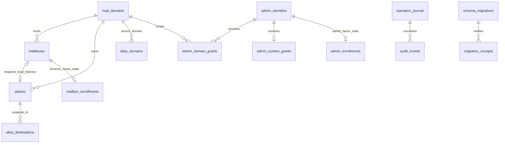
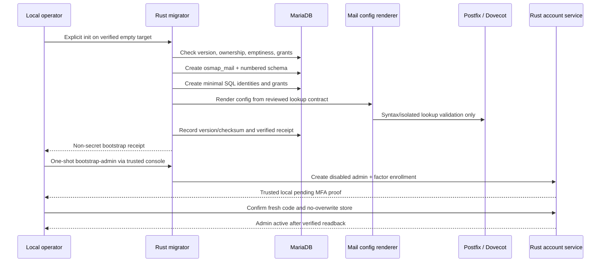

# OSMAP-ADMIN Database Design

**Repository path:** `docs/OSMAP_ADMIN_DATABASE_DESIGN.md`\
**Project:** OSMAP / OSMAP-ADMIN, OpenBSD Secure Mail Access Platform\
**Version:** 0.1.0\
**Date:** 2026-11-13\
**Status:** Proposed implementation design. Not a deployed schema, migration authorization, or production qualification.\
**Scope:** MariaDB schema and relations; data ownership; Postfix/Dovecot SQL projections; privilege grants; fresh installation; versioned migration; single-writer enforcement; backup, reconciliation, and rollback.

> **Change boundary:** This design does not authorize creating or changing any database, account, SQL grant, mail configuration, production service, factor, or PostfixAdmin deployment. Every executable design choice must be verified against the installed MariaDB, Postfix, Dovecot, OSMAP, OpenBSD, and PostfixAdmin versions. Apply changes only through a separately approved, reviewed work order.

## 1. Governing architecture and source of truth

This document is the database companion to [OSMAP_ADMIN_SYSTEM_ARCHITECTURE.md](OSMAP_ADMIN_SYSTEM_ARCHITECTURE.md), the [OSMAP-ADMIN project plan](OSMAP_ADMIN_PROJECT_PLAN.md) (signed documentation branch / [PR #84](https://github.com/unattributed/OSMAP/pull/84)), the [administrative engineering request](ADMINISTRATIVE_USER_MANAGEMENT_ENGINEERING_REQUEST.md), and the [PostfixAdmin functional parity requirements](https://github.com/unattributed/OSMAP/issues/85).

The desired system is a **single, authoritative mail-account store** consumed through narrow native SQL lookups by Postfix and Dovecot and mutated through **one Rust account service**. OSMAP remains the public mailbox-user application. OSMAP-ADMIN is an independent, private administrative application. An administrative subject is **not** automatically a mailbox user and a mailbox login is **never** an administrative grant.

### 1.1 Deployment-mode decisions

| Mode | Authority | Allowed administrative writer | Database action |
| --- | --- | --- | --- |
| Documented Toronto production | Installed `postfixadmin` database and configured SQL lookups | Existing PostfixAdmin and any inventoried legacy account-write mechanisms until a formal ownership gate | **Read-only** PostfixAdmin compatibility/inventory from OSMAP-ADMIN at first; no implied live DDL |
| obsd1 development | Independent writable development `postfixadmin` | Only the designated development writer | A separate read-only Toronto reference replica is **never** promoted, mutated, or selected as the development application's write target |
| Clean installation | New `osmap_mail` database | Scoped Rust account service following local Rust schema bootstrap | Create native versioned schema, separate SQL principals, and validated mailstack lookup projections |
| Existing installation after approved migration | `osmap_mail`, only when switched and reconciled | Scoped Rust account service | Preserve previous authority for a proven, delta-aware rollback; no concurrent dual-write |

The **single-writer rule includes the existing OSMAP password-change helper**, PostfixAdmin, other operator scripts, admin API/CLI paths, scheduled jobs, and any direct SQL mutation tool. Calling OSMAP-ADMIN the writer does not make it exclusive if those other paths remain writable.

### 1.2 Core invariants

1. Only **one selected database and one designated account writer** may govern mail domains, mailboxes, aliases, passwords, quota policy, and delivery status in an installation at a time.
2. Postfix/Dovecot authenticate and route through their **actual configured SQL queries**; no SMTP, LMTP, IMAP, or submission decision depends on the OSMAP-ADMIN HTTP process.
3. Do not create a competing OSMAP mailbox-password table. The authoritative Dovecot-compatible password hash is stored only in the selected mail-account authority. Admin-only credentials are a separate identity domain.
4. Postfix and Dovecot receive **read-only, projection-specific** database grants, not grants to the general account or administrative tables.
5. A browser process receives **no mail-account table write grants, DDL privileges, or protected TOTP directory access**. Only the local Rust account service makes runtime account writes; only the separately invoked local migrator makes DDL/grant changes.
6. Preserve the installed password scheme and encoded hash *byte-for-byte* on migration; do not rehash, decrypt, normalize, or silently change hash prefixes. Preserve account canonicalization, maildir values, flags, and quota meaning.
7. TOTP seeds and accepted counters remain in OSMAP's protected **file-backed factor** and **separate replay** stores. SQL may hold an enrollment status and opaque factor reference, **never a factor seed, OTP, replay counter, reset secret, or raw setup token**.
8. Every mutation uses validated canonical identities, server-side authorization, an expected revision, an idempotency identity, a writer epoch, and an audited result. Stale, uncertain, mismatched, or partially applied state **fails closed**.
9. Account and domain retirement are staged. Deleting SQL metadata must never silently delete Maildir bytes, private mail, keys, or retained backup data.
10. MariaDB DDL and privilege changes are **not assumed transactionally reversible**. Schema migration needs backup/restore evidence and an explicit recovery plan.

## 2. Required Phase 0 inventory before schema freeze

Capture and approve a dated, target-specific inventory from the **selected host**, never an inferred stock PostfixAdmin installation:

- Exact MariaDB version, storage engines, collation, SQL mode, transaction/isolation behavior, binary logging/replication, socket location, current users, and effective `SHOW GRANTS` (sanitized).
- Installed PostfixAdmin version, *actual* tables/columns/indexes/triggers/views, write entrypoints, status semantics, mailbox-local alias behavior, custom extensions, and optional features (domain aliases, catch-all, vacation/Sieve, transport, quota, DKIM, fetchmail).
- Effective Postfix `virtual_mailbox_domains`, `virtual_mailbox_maps`, `virtual_alias_maps`, domain alias, catch-all, delivery-transport, and any SQL client configurations; lookup return/cardinality semantics on the deployed Postfix build.
- Effective Dovecot `passdb`, `userdb`, `iterate_query`, password scheme policy, auth-cache configuration, account normalization, UID/GID ownership, mailbox-home root, quota backend and `doveconf` output.
- OSMAP's currently selected Dovecot account admission, native password-changing helper, credential-freshness/session epoch policy, protected TOTP seed and replay store contracts, and any direct SQL writes.
- The real identity/case-folding and internationalized-domain rules. Do not lowercase mail local parts or accept SMTPUTF8 without a reviewed, compatibility-preserving policy.
- Defined retention, reversible disablement, required reserved aliases, backup MX/vacation behavior, audit retention, and approved migration window.

**Block migration** if an existing source feature or representation cannot be mapped without loss, if a writer remains unidentified, or if a mail consumer continues querying a different authority. Toronto and obsd1 findings must be recorded separately.

## 3. Logical entity and relationship model



The diagram expresses logical ownership. `operation_journal`, `audit_events`, and the migration ledger can be retained in separately permissioned tables or protected storage; foreign-key relationships and log custody must not permit accidental cascade deletion.

### 3.1 Table-level responsibility

| Proposed table / projection | Main fields and invariant | Writer / reader |
| --- | --- | --- |
| `mail_domains` | Stable ID; canonical DNS name; lifecycle status; configured account/alias/assigned quota limits; revision | Rust account writer; sanitized domain lookup view to Postfix |
| `mailboxes` | Stable ID; domain FK; canonical full address; **single authoritative** Dovecot-compatible password hash; stable relative Maildir; auth and delivery flags; quota bytes; revision | Rust account writer; distinct safe projections to Postfix and Dovecot |
| `aliases` | Stable ID; source address or explicit catch-all representation; owning domain FK; active status; kind; optional protected mailbox-delivery reference; revision | Rust account writer; Postfix alias lookup projection |
| `alias_destinations` | Destination per row, with stable display/expansion order and no duplicate targets | Rust account writer; Postfix projection via reviewed lookup strategy |
| `alias_domains` | Optional whole-domain mapping with collision/loop rules; **enable only when installed feature requires it** | Rust account writer; matching Postfix projection only if supported |
| `admin_identities` | Independent administrator login/credential hash/status/revision; no mailbox FK | Rust account writer plus admin authenticator; never mailstack lookups |
| `admin_system_grants` | One system-admin grant per admin identity, independent of domain | Rust account writer; authz engine only |
| `admin_domain_grants` | Admin-to-domain many-to-many scoped grants | Rust account writer; authz engine only |
| `mailbox_enrollments`, `admin_enrollments` | Enrollment state, opaque factor reference, hashed short-lived setup authorization, revision | Guarded factor/account coordinator; never Postfix/Dovecot |
| `operation_journal` | Client operation identity, canonical actor/target, payload digest, expected revision, state and reconciliation result | Rust writer via separate privilege; used for idempotency |
| `audit_events` | Append-oriented actor/operation/target/result/time/revision/hash-chain metadata | Restricted append path only; protected export to external syslog or audit store |
| `writer_control` | Single row: selected authority, write-mode, epoch and current holder, revision | Privileged handover tool changes ownership; Rust writer checks under lock |
| `schema_migrations`, `migration_receipts` | Ordered schema version, immutable checksum, preflight and postflight receipts | Local migrator only; runtime can read current version if required |
| Postfix/Dovecot views | Only columns and active-state semantics required by actual lookup contracts | Migrator defines; native mailstack SQL users only have `SELECT` on permitted views |

**Proposed policy:** zero configured mailbox quota means unlimited; a missing quota is *unknown*, not zero. `MAIL_STORAGE.md` documents one existing deployment-specific `quota` field, but every source unit, limit and enforcement mechanism must be verified. Maildir paths are server-computed from validated stored relative identifiers; never accept an HTTP-provided filesystem path or UID/GID.

### 3.2 Identity and referential constraints

- Domain names are stored in the chosen canonical ASCII/IDNA form with a binary/equivalent deterministic collation and unique key; the source's verified case policy is preserved.
- The mailbox address must match the selected domain, pass existing canonical-identity rules, and be unique installation-wide. Database FKs cannot prove an address's text matches its `domain_id`; the Rust writer must verify it within its domain-locked transaction and test negative cases.
- `maildir` is a **relative**, traversal-free, immutable identifier once mail exists. Changing maildir is a separate storage migration, not an ordinary profile edit. A unique key prevents two native records from unintentionally pointing to the same Maildir.
- An alias source is owned by exactly one source domain. A protected mailbox-local alias must continue to deliver to its mailbox even when forwarding destinations are added. External alias destinations do not grant an admin authority in the destination domain.
- One source alias maps to **one or more normalized destinations**. Avoid silent truncation from `GROUP_CONCAT` or implicit row aggregation; validate the real Postfix lookup contract and its size limits before choosing a deployment-specific SQL projection.
- Native schema foreign keys are restrictive on delete. The account writer disables/retire-marks before separately approved physical purge, with Maildir data explicitly outside SQL cascade scope.
- The first system admin is possible without any domain or mailbox. Domain-admin assignments are explicit FKs. Admin passwords, factors and sessions cannot be derived from mailbox credentials or a matching email string.
- Status is multidimensional: **Dovecot password authentication**, **mail delivery/recipient behavior**, **OSMAP browser enrollment**, and **admin account activation** are independent, explicitly tested states. Pending OSMAP MFA does not by itself disable native IMAP/SMTP authentication.

## 4. Proposed native MariaDB schema (fresh installation)

### 4.1 Physical choices to finalize

The following is the **normative table inventory and an illustrative DDL baseline**, not an automatically approved production migration. The Rust migrator must materialize version-pinned SQL scripts and the exact tested schema, then compare the live definitions to stored checksums. The reference uses InnoDB, `utf8mb4_bin` defaults, and per-column ASCII binary collation for canonical address/domain identifiers. Confirm compatibility with the actual installed MariaDB release and OSMAP/Dovecot identity policy before freezing it.

Use integer stable IDs internally, UTC timestamps with `DATETIME(6)` (set connection timezone explicitly), `BIGINT UNSIGNED` revision counters, and server-controlled updates. Tokens and secrets must not be emitted in migration logs or SQL comments. Do not use `CREATE OR REPLACE` on live account tables or silently accept an existing schema via `IF NOT EXISTS`.

```sql
-- REFERENCE ONLY: empty, disposable osmap_mail installation.
-- Do not execute on Toronto, obsd1, or any populated target.
-- The privileged migrator must verify emptiness, versions and grants first.
CREATE DATABASE osmap_mail CHARACTER SET utf8mb4 COLLATE utf8mb4_bin;
USE osmap_mail;

CREATE TABLE mail_domains (
    id BIGINT UNSIGNED NOT NULL AUTO_INCREMENT PRIMARY KEY,
    canonical_name VARCHAR(253) CHARACTER SET ascii COLLATE ascii_bin NOT NULL,
    state VARCHAR(16) NOT NULL DEFAULT 'active',
    max_mailboxes INT UNSIGNED NULL,
    max_aliases INT UNSIGNED NULL,
    max_mailbox_quota_bytes BIGINT UNSIGNED NULL,
    revision BIGINT UNSIGNED NOT NULL DEFAULT 1,
    created_at DATETIME(6) NOT NULL,
    updated_at DATETIME(6) NOT NULL,
    UNIQUE KEY uq_domain_name (canonical_name),
    CONSTRAINT ck_domain_state CHECK (state IN ('active','disabled','retiring'))
) ENGINE=InnoDB;

CREATE TABLE mailboxes (
    id BIGINT UNSIGNED NOT NULL AUTO_INCREMENT PRIMARY KEY,
    domain_id BIGINT UNSIGNED NOT NULL,
    canonical_address VARCHAR(254) CHARACTER SET ascii COLLATE ascii_bin NOT NULL,
    password_hash VARCHAR(512) CHARACTER SET ascii COLLATE ascii_bin NOT NULL,
    maildir VARCHAR(512) CHARACTER SET ascii COLLATE ascii_bin NOT NULL,
    display_name VARCHAR(255) NOT NULL DEFAULT '',
    auth_enabled BOOLEAN NOT NULL DEFAULT TRUE,
    delivery_enabled BOOLEAN NOT NULL DEFAULT TRUE,
    lifecycle_state VARCHAR(16) NOT NULL DEFAULT 'active',
    quota_bytes BIGINT UNSIGNED NOT NULL DEFAULT 0,
    revision BIGINT UNSIGNED NOT NULL DEFAULT 1,
    created_at DATETIME(6) NOT NULL,
    updated_at DATETIME(6) NOT NULL,
    UNIQUE KEY uq_mailbox_address (canonical_address),
    UNIQUE KEY uq_mailbox_maildir (maildir),
    KEY ix_mailbox_domain (domain_id),
    CONSTRAINT fk_mailbox_domain FOREIGN KEY (domain_id)
        REFERENCES mail_domains (id) ON DELETE RESTRICT,
    CONSTRAINT ck_mailbox_lifecycle CHECK
        (lifecycle_state IN ('pending','active','disabled','retiring')),
    CONSTRAINT ck_mailbox_auth CHECK (auth_enabled IN (0,1)),
    CONSTRAINT ck_mailbox_delivery CHECK (delivery_enabled IN (0,1))
) ENGINE=InnoDB;

CREATE TABLE aliases (
    id BIGINT UNSIGNED NOT NULL AUTO_INCREMENT PRIMARY KEY,
    domain_id BIGINT UNSIGNED NOT NULL,
    canonical_source VARCHAR(254) CHARACTER SET ascii COLLATE ascii_bin NOT NULL,
    kind VARCHAR(24) NOT NULL,
    protected_mailbox_id BIGINT UNSIGNED NULL,
    enabled BOOLEAN NOT NULL DEFAULT TRUE,
    revision BIGINT UNSIGNED NOT NULL DEFAULT 1,
    created_at DATETIME(6) NOT NULL,
    updated_at DATETIME(6) NOT NULL,
    UNIQUE KEY uq_alias_source (canonical_source),
    KEY ix_alias_domain (domain_id),
    CONSTRAINT fk_alias_domain FOREIGN KEY (domain_id)
        REFERENCES mail_domains (id) ON DELETE RESTRICT,
    CONSTRAINT fk_alias_local_mailbox FOREIGN KEY (protected_mailbox_id)
        REFERENCES mailboxes (id) ON DELETE RESTRICT,
    CONSTRAINT ck_alias_kind CHECK
        (kind IN ('manual','mailbox_local','catchall'))
) ENGINE=InnoDB;

CREATE TABLE alias_destinations (
    alias_id BIGINT UNSIGNED NOT NULL,
    position INT UNSIGNED NOT NULL,
    canonical_destination VARCHAR(254)
        CHARACTER SET ascii COLLATE ascii_bin NOT NULL,
    PRIMARY KEY (alias_id, position),
    UNIQUE KEY uq_alias_destination (alias_id, canonical_destination),
    CONSTRAINT fk_destination_alias FOREIGN KEY (alias_id)
        REFERENCES aliases (id) ON DELETE RESTRICT
) ENGINE=InnoDB;

CREATE TABLE admin_identities (
    id BIGINT UNSIGNED NOT NULL AUTO_INCREMENT PRIMARY KEY,
    canonical_login VARCHAR(254) CHARACTER SET ascii COLLATE ascii_bin NOT NULL,
    password_hash VARCHAR(512) CHARACTER SET ascii COLLATE ascii_bin NOT NULL,
    state VARCHAR(16) NOT NULL DEFAULT 'pending',
    auth_epoch BIGINT UNSIGNED NOT NULL DEFAULT 1,
    revision BIGINT UNSIGNED NOT NULL DEFAULT 1,
    created_at DATETIME(6) NOT NULL,
    updated_at DATETIME(6) NOT NULL,
    UNIQUE KEY uq_admin_login (canonical_login),
    CONSTRAINT ck_admin_state CHECK
        (state IN ('pending','active','disabled','locked','retiring'))
) ENGINE=InnoDB;

CREATE TABLE admin_system_grants (
    admin_id BIGINT UNSIGNED NOT NULL PRIMARY KEY,
    granted_at DATETIME(6) NOT NULL,
    CONSTRAINT fk_system_grant_admin FOREIGN KEY (admin_id)
        REFERENCES admin_identities (id) ON DELETE RESTRICT
) ENGINE=InnoDB;

CREATE TABLE admin_domain_grants (
    admin_id BIGINT UNSIGNED NOT NULL,
    domain_id BIGINT UNSIGNED NOT NULL,
    granted_at DATETIME(6) NOT NULL,
    PRIMARY KEY (admin_id, domain_id),
    CONSTRAINT fk_domain_grant_admin FOREIGN KEY (admin_id)
        REFERENCES admin_identities (id) ON DELETE RESTRICT,
    CONSTRAINT fk_domain_grant_domain FOREIGN KEY (domain_id)
        REFERENCES mail_domains (id) ON DELETE RESTRICT
) ENGINE=InnoDB;

CREATE TABLE mailbox_enrollments (
    mailbox_id BIGINT UNSIGNED NOT NULL PRIMARY KEY,
    state VARCHAR(16) NOT NULL DEFAULT 'missing',
    factor_ref VARCHAR(128) CHARACTER SET ascii COLLATE ascii_bin NULL,
    setup_token_sha256 BINARY(32) NULL,
    token_expires_at DATETIME(6) NULL,
    token_consumed_at DATETIME(6) NULL,
    revision BIGINT UNSIGNED NOT NULL DEFAULT 1,
    CONSTRAINT fk_mailbox_enrollment FOREIGN KEY (mailbox_id)
        REFERENCES mailboxes (id) ON DELETE RESTRICT,
    CONSTRAINT ck_mailbox_factor_state CHECK
        (state IN ('missing','pending','active','revoked'))
) ENGINE=InnoDB;

CREATE TABLE admin_enrollments (
    admin_id BIGINT UNSIGNED NOT NULL PRIMARY KEY,
    state VARCHAR(16) NOT NULL DEFAULT 'missing',
    factor_ref VARCHAR(128) CHARACTER SET ascii COLLATE ascii_bin NULL,
    setup_token_sha256 BINARY(32) NULL,
    token_expires_at DATETIME(6) NULL,
    token_consumed_at DATETIME(6) NULL,
    revision BIGINT UNSIGNED NOT NULL DEFAULT 1,
    CONSTRAINT fk_admin_enrollment FOREIGN KEY (admin_id)
        REFERENCES admin_identities (id) ON DELETE RESTRICT,
    CONSTRAINT ck_admin_factor_state CHECK
        (state IN ('missing','pending','active','revoked'))
) ENGINE=InnoDB;

CREATE TABLE writer_control (
    singleton_id TINYINT UNSIGNED NOT NULL PRIMARY KEY,
    selected_authority VARCHAR(48) NOT NULL,
    mode VARCHAR(20) NOT NULL,
    holder VARCHAR(128) NOT NULL,
    fence_epoch BIGINT UNSIGNED NOT NULL,
    revision BIGINT UNSIGNED NOT NULL,
    updated_at DATETIME(6) NOT NULL,
    CONSTRAINT ck_writer_singleton CHECK (singleton_id = 1),
    CONSTRAINT ck_writer_mode CHECK
        (mode IN ('read_only','rust_writer','legacy_writer'))
) ENGINE=InnoDB;

CREATE TABLE operation_journal (
    operation_id BINARY(16) NOT NULL PRIMARY KEY,
    actor_type VARCHAR(24) NOT NULL,
    actor_id BIGINT UNSIGNED NULL,
    actor_key VARCHAR(128) CHARACTER SET ascii COLLATE ascii_bin NOT NULL,
    request_key_sha256 BINARY(32) NOT NULL,
    request_sha256 BINARY(32) NOT NULL,
    operation_kind VARCHAR(80) NOT NULL,
    target_type VARCHAR(40) NOT NULL,
    target_key VARCHAR(254) NOT NULL,
    expected_revision BIGINT UNSIGNED NULL,
    writer_epoch BIGINT UNSIGNED NOT NULL,
    state VARCHAR(24) NOT NULL,
    result_revision BIGINT UNSIGNED NULL,
    created_at DATETIME(6) NOT NULL,
    updated_at DATETIME(6) NOT NULL,
    UNIQUE KEY uq_operation_retry
        (actor_type, actor_key, request_key_sha256),
    CONSTRAINT ck_operation_state CHECK
        (state IN ('pending','committed','rejected','uncertain','reconciled'))
) ENGINE=InnoDB;

CREATE TABLE audit_events (
    id BIGINT UNSIGNED NOT NULL AUTO_INCREMENT PRIMARY KEY,
    operation_id BINARY(16) NOT NULL,
    event_at DATETIME(6) NOT NULL,
    actor_type VARCHAR(24) NOT NULL,
    actor_id BIGINT UNSIGNED NULL,
    action VARCHAR(80) NOT NULL,
    target_type VARCHAR(40) NOT NULL,
    target_key VARCHAR(254) NOT NULL,
    result VARCHAR(24) NOT NULL,
    before_revision BIGINT UNSIGNED NULL,
    after_revision BIGINT UNSIGNED NULL,
    payload_sha256 BINARY(32) NULL,
    prev_event_hash BINARY(32) NULL,
    event_hash BINARY(32) NULL,
    KEY ix_audit_operation (operation_id),
    KEY ix_audit_time (event_at),
    CONSTRAINT fk_audit_operation FOREIGN KEY (operation_id)
        REFERENCES operation_journal (operation_id) ON DELETE RESTRICT
) ENGINE=InnoDB;

CREATE TABLE schema_migrations (
    version BIGINT UNSIGNED NOT NULL PRIMARY KEY,
    name VARCHAR(160) NOT NULL,
    checksum_sha256 CHAR(64) CHARACTER SET ascii COLLATE ascii_bin NOT NULL,
    applied_at DATETIME(6) NOT NULL,
    release_id VARCHAR(96) NOT NULL
) ENGINE=InnoDB;

CREATE TABLE migration_receipts (
    id BIGINT UNSIGNED NOT NULL AUTO_INCREMENT PRIMARY KEY,
    migration_version BIGINT UNSIGNED NOT NULL,
    phase VARCHAR(24) NOT NULL,
    evidence_digest CHAR(64) CHARACTER SET ascii COLLATE ascii_bin NOT NULL,
    observed_at DATETIME(6) NOT NULL,
    CONSTRAINT fk_receipt_migration FOREIGN KEY (migration_version)
        REFERENCES schema_migrations (version) ON DELETE RESTRICT
) ENGINE=InnoDB;
```

### 4.2 DDL review notes and known limitations

The reference DDL intentionally does **not** create SQL accounts, native views, or migrations for optional features. Those are versioned, separately verified components. It also does **not** contain runtime passwords or a default administrator. Before declaring it implementable, the maintainer must address:

1. **Account canonicalization:** ASCII binary identifiers are proposed for initially supported addresses. SMTPUTF8 and canonicalization changes need a separate review; legacy source keys that collide under the selected normalization block migration.
2. **Alias source/catch-all shape:** Some PostfixAdmin schemas use `@example.com`, whole-domain aliases, and mailbox-associated self-forwarding rows. Match effective installed Postfix queries before selecting the precise representation.
3. **Mailbox link:** A protected local-delivery alias's source, `protected_mailbox_id`, and mandatory destination must be validated by the writer. Foreign keys alone cannot enforce source-address identity or prevent a manual destination edit from removing required local delivery.
4. **Quota:** Dovecot userdb expects the installed quota unit and backend-specific fields. The proposed `quota_bytes` is a native semantic unit, **not** permission to reinterpret legacy `quota` values. Verify zero/unlimited policy and authoritative Dovecot enforcement.
5. **Unique operation retry:** `actor_key` is deliberately non-null even when `actor_id` is absent for a bounded local/bootstrap subject. Its namespace must be deterministic, canonical, non-spoofable, and independently authenticated. A canonical request digest is still required to distinguish a legitimate retry from conflicting content; verify actual unique-index races before release.
6. **DDL/migration ledger:** Because the initial schema itself creates the ledger, the migrator must record a separately protected initial schema fingerprint before it records version 1. Interruption before receipt is **unknown**, not an automatic successful retry.
7. **Integrity/audit:** Audit chain hashes do not by themselves make a table immutable. Use a distinct append-only custody service or externally protected, verifiable export. An account writer with broad SQL access must not be able to rewrite or delete previous audits.
8. **Foreign keys:** Any optional domain alias, vacation/Sieve, DKIM, domain quota, or application-password tables require a separate feature-supported migration. Do not fabricate operational backing just to produce a UI setting.
9. **Password hashing:** `password_hash` stores the selected Dovecot-consumable hash exactly. Admin password policy may use a separately reviewed verifier/scheme, with no implied Dovecot auth for admins.
10. **Live host compatibility:** OpenBSD packages, Postfix/Dovecot build flags and configuration syntax, MariaDB SQL mode, native UID/GID, and real Maildir root must be observed on each deployment. The DDL is not a claim of Toronto compatibility.

## 5. SQL projection contracts for Postfix and Dovecot

Do not grant the mail daemons `SELECT` on raw tables when views can isolate required columns. Define versioned views with exact names **after** the installed service's SQL queries and output semantics have been observed.

| Consumer / projection | Required data | Explicit exclusion |
| --- | --- | --- |
| Postfix domain lookup | Canonical domain and effective active/allowed recipient state | Password hashes, factor metadata, admin identities, audits |
| Postfix virtual mailbox lookup | Canonical accepted recipient, validated maildir value or required existence value | Admin credentials, browser enrollment metadata |
| Postfix virtual alias lookup | Canonical source and validated expansions including mandatory local delivery, catch-all and optionally alias domains | SQL admin privileges, arbitrary filesystem paths |
| Dovecot passdb | Exact canonical username and authoritative compatible hash for **auth-enabled** mailboxes | Admin password hashes, TOTP seeds |
| Dovecot userdb | Canonical username, effective maildir/home and quota mapping for **enabled** mailboxes; installed UID/GID contract | Other users' mutable account metadata, admin role grants |
| Dovecot iteration | Authorized enumerable username set, only as needed by the installed backend | Factor and admin data |

The native target must provide **different disabled-state semantics** for SMTP recipient acceptance, Dovecot authentication, LMTP and existing mail storage. Do not collapse all state into `active = 0` without demonstrating each native effect.

**Reference Dovecot passdb lookup shape (not an installed configuration):**

```sql
SELECT canonical_address AS user, password_hash AS password
FROM osmap_mail.v_dovecot_passdb
WHERE canonical_address = '<validated-dovecot-username>';
```

The `<validated-dovecot-username>` token above represents Dovecot's own configuration expansion, **not** string interpolation by the Rust web service; configure and validate exact expansion/escaping against the installed Dovecot version. The projection must return Dovecot's expected fields and hash scheme, otherwise refuse activation. An operator must independently verify native `doveadm` passdb/userdb and IMAP behavior.

**Existing-host example, not a portable native view:** [`maint/openbsd/MAIL_STORAGE.md`](../maint/openbsd/MAIL_STORAGE.md) documents a PostfixAdmin-backed Dovecot userdb query using `mailbox(username, maildir, quota, active)`, a `/var/vmail/` prefix, and sample UID/GID 2000. These values are installation-specific. They must never be copied into an installer without matching native configuration and ownership evidence.

Postfix MySQL alias return cardinality and aggregate-output limits must be verified with an isolated alias fixture containing multiple destinations and realistic maximum sizes. A SQL result that is syntactically valid but silently truncated or yields the wrong expansion is **not** acceptance.

## 6. Privilege and SQL identity model

### 6.1 Required identities

| Principal (illustrative name) | Permission | Must not have |
| --- | --- | --- |
| Local `osmap_admin_migrator` | Local privileged DDL and user/grant lifecycle **only while performing approved migration** | Persistent unrestricted web-service access |
| `osmap_admin_writer` | `SELECT`, `INSERT`, `UPDATE` and explicitly justified row deletion on **required mutable tables**; read and lock `writer_control`; append operation/audit events through a protected audit path | `CREATE`, `ALTER`, `DROP`, `GRANT OPTION`, root/system grants, mail content, direct factor-secret permissions |
| `osmap_postfix_ro` | `SELECT` only on approved Postfix mapping views | `mailboxes.password_hash` (raw), admin tables, DDL/DML |
| `osmap_dovecot_ro` | `SELECT` only on approved Dovecot passdb/userdb/iterate views | Admin identities, factor state, DDL/DML |
| `osmap_admin_readonly` | Minimum scoped inventory views or service-only API reads | Any broad write/DDL grants; bypass of Rust authorization |
| OSMAP public web process | No direct MariaDB account credentials | All SQL grants to mail-account or admin tables |
| OSMAP-ADMIN private web process | No direct MariaDB account credentials | All SQL grants to mail-account or admin tables |
| Dedicated audit custodian | Append or verified export only, separate log custody | Unreviewed update/delete of historical audit |

Use distinct local OS users and client credentials. Prefer the installed MariaDB-supported local-socket authentication method and protected host-owned configuration. Do not put passwords in source, shell history, public diagnostics, `ps` arguments or committed files. The migrator should create SQL identities using a secure secret input; it must not embed a default password in a SQL migration.

### 6.2 Template for narrowed SQL grants

Run **only after** the selected schema and views are created and SQL accounts have been securely provisioned. The illustrative principal names and view names must be matched by the final config renderer. The explicit list is intentional; avoid `GRANT ALL ON osmap_mail.*`, `WITH GRANT OPTION`, `FILE`, `SUPER`, `CREATE USER`, or globally scoped privileges on runtime accounts.

```sql
-- Selected lookup-only grants, subject to observed view names.
GRANT SELECT ON osmap_mail.v_postfix_domains TO 'osmap_postfix_ro'@'localhost';
GRANT SELECT ON osmap_mail.v_postfix_mailboxes TO 'osmap_postfix_ro'@'localhost';
GRANT SELECT ON osmap_mail.v_postfix_aliases TO 'osmap_postfix_ro'@'localhost';
GRANT SELECT ON osmap_mail.v_dovecot_passdb TO 'osmap_dovecot_ro'@'localhost';
GRANT SELECT ON osmap_mail.v_dovecot_userdb TO 'osmap_dovecot_ro'@'localhost';
GRANT SELECT ON osmap_mail.v_dovecot_iterate TO 'osmap_dovecot_ro'@'localhost';

-- Proposed table-scoped Rust writer privileges.
-- Exact DML grants must be generated from the frozen operation-to-table map.
GRANT SELECT, INSERT, UPDATE ON osmap_mail.mail_domains TO 'osmap_admin_writer'@'localhost';
GRANT SELECT, INSERT, UPDATE ON osmap_mail.mailboxes TO 'osmap_admin_writer'@'localhost';
GRANT SELECT, INSERT, UPDATE ON osmap_mail.aliases TO 'osmap_admin_writer'@'localhost';
GRANT SELECT, INSERT, UPDATE, DELETE ON osmap_mail.alias_destinations TO 'osmap_admin_writer'@'localhost';
GRANT SELECT, INSERT, UPDATE ON osmap_mail.admin_identities TO 'osmap_admin_writer'@'localhost';
GRANT SELECT, INSERT, UPDATE, DELETE ON osmap_mail.admin_system_grants TO 'osmap_admin_writer'@'localhost';
GRANT SELECT, INSERT, UPDATE, DELETE ON osmap_mail.admin_domain_grants TO 'osmap_admin_writer'@'localhost';
GRANT SELECT, INSERT, UPDATE ON osmap_mail.mailbox_enrollments TO 'osmap_admin_writer'@'localhost';
GRANT SELECT, INSERT, UPDATE ON osmap_mail.admin_enrollments TO 'osmap_admin_writer'@'localhost';
GRANT SELECT, INSERT, UPDATE ON osmap_mail.operation_journal TO 'osmap_admin_writer'@'localhost';
GRANT SELECT ON osmap_mail.writer_control TO 'osmap_admin_writer'@'localhost';
GRANT SELECT ON osmap_mail.schema_migrations TO 'osmap_admin_writer'@'localhost';

-- The audit path needs its own reviewed append-only identity and protocol.
-- Do not assume the account writer may update or delete audit_events.
```

**Important grant caveat:** The exact statement privilege needed for `SELECT ... FOR UPDATE` and the owner/definer behavior of views must be tested against the installed MariaDB version. If `writer_control` cannot be locked using the chosen restricted grant, revise the service protocol and permissions explicitly, never promote the writer to global administrator. `CREATE VIEW` definers and `SQL SECURITY` behavior must be fixed, tested and included in the migration ledger to prevent privilege bypass. MariaDB's account-host matching (socket vs TCP and `localhost` vs other hosts) must also be verified using an actual connection as each principal.

Required grant tests: each lookup identity succeeds only for its views; password hashes are unavailable to Postfix; admin/factor tables are unavailable to both daemons; web UIDs cannot directly connect as a writer; writer cannot DDL, grant, export files, or access factor files; migrator credentials are inaccessible outside the operator/migration context. Record sanitized `SHOW GRANTS` outputs, negative query failures and the actual connected SQL principal.

## 7. Single-writer protocol and transactional mutation rules

### 7.1 Ownership transitions

`writer_control` is a **fencing record and observability control**, not proof that all writers are fenced. A legacy application that ignores it can still write if its database credentials remain valid. Exclusivity requires *both* service-side validation **and** administrative revocation/containment of every competing write path.

1. **Legacy phase:** Current PostfixAdmin and any documented password helper remain authorized until inventoried. The Rust compatibility adapter has read-only credentials. No Rust account mutation is permitted.
2. **Freeze:** Operator disables/blocks all legacy administrative writes, including UI routes, scheduled jobs, CLI scripts and the existing OSMAP password-update path. Capture an explicit writer inventory and protected consistent checkpoint.
3. **Fence:** Privileged transition tool removes legacy write grants or otherwise enforces an equivalent proven write block, terminates/rechecks stale sessions where needed, increments `fence_epoch`, sets `mode='rust_writer'`, and records the selected authority and unique holder.
4. **Enable:** Only one Rust account service instance with the issued epoch and dedicated writer credentials may accept mutations. Other instances are read-only or stopped; do not assume a filesystem lock works across hosts.
5. **Reconcile:** Verify Postfix, Dovecot and any OSMAP account helper all consult the same selected source and that old credentials cannot write. Retain maintenance logs and rollback artifacts.
6. **Rollback:** Stop new Rust mutations, increment/fence epoch, reconcile all writes since cutover, then restore previous authority and grants only after verified state convergence. Never reactivate an out-of-date writer against stale rows.

**Hard rule:** A production app-process compromise with active writer DML rights may bypass service-level ownership policy. SQL grants reduce blast radius but do not cryptographically enforce application authorization. Treat it as a privileged process boundary requiring confinement, monitoring and independent review. If multi-writer resilience is ever required, design a separate database-enforced capability/fencing mechanism and prove failure recovery before enabling it.

### 7.2 Mutation transaction sequence

The designated Rust writer handles **all** mailbox/domain/alias/admin password mutations and account-management CLI requests through the same typed protocol:

1. Authenticate the caller at the private UI/CLI boundary. The service independently verifies caller peer identity, authoritative admin session, role, target domain, step-up freshness and requested operation.
2. Parse and canonicalize exact typed input. Validate quotas, alias destinations, policy, identity uniqueness, immutable maildir and allowed state transition. Never allow arbitrary SQL, table names, SQL WHERE fragments, or filesystem paths from clients.
3. Begin an InnoDB transaction using the installed supported isolation level. Lock the singleton `writer_control` row and reject wrong selected authority, mode, holder or epoch. Lock target domain/records in a fixed global order to prevent deadlocks and enforce limits.
4. Resolve operation idempotency by **non-null actor namespace and unique request key**, checked against the canonical request digest. A matching committed retry returns the recorded result; a mismatched digest or uncertain prior operation is rejected pending reconciliation.
5. Compare the submitted `expected_revision` to the locked record. Perform bounded, prepared SQL statements and require the expected affected rows. Increment revision and update timestamps in the same transaction. Store the operation record and safe audit correlation.
6. Commit account, journal and database-local audit intent atomically where possible. Do **not** claim remote factors, Maildir creation, external logs, or Postfix/Dovecot reloads were part of the SQL transaction.
7. Perform any separately authorized downstream verification or side effect, and record the final outcome. If the response is lost after commit, retrieve by operation ID; never blindly resubmit with a new request key.
8. On a deadlock, timeout, reconnect, crash or uncertain commit, **do not assume rollback**. Re-read the operation journal and the effective native mailstack state before retry; preserve an `uncertain` disposition when it cannot be proved.

The native database must use unique constraints, foreign keys, service-side authorization and revision checks **together**. Domain counters are validated while holding the domain lock; concurrent provisioning cannot evade mailbox/alias caps by counting rows before locking.

### 7.3 Account and lifecycle rules

- **Create mailbox:** Lock domain; validate uniqueness/limits; insert compatible hash, stable Maildir and quota; create mandatory local-delivery alias and destination; write journal; commit; verify Postfix recipient and Dovecot passdb/userdb projections. No browser session until independent TOTP completion. Native IMAP/SMTP availability is separately specified, not implied by browser MFA.
- **Reset password:** Write the selected canonical mailbox hash **only via account service**; preserve the existing OSMAP account-epoch, session revocation and native Dovecot credential-freshness contract. Verify old-password rejection and new-password acceptance on the selected auth backend. Already authenticated external IMAP/SMTP connections may remain; do not falsely claim termination.
- **Change alias:** Replace destination set transactionally while preserving mandatory local mailbox delivery. Reject loops, unauthorized source scopes, reserved source collision, over-large aggregate output and unsupported target/alias-domain semantics.
- **Change quota:** Verify new configured bytes and source-unit conversion; then prove actual Dovecot native quota enforcement with a disposable account. Web/SQL readback alone is insufficient.
- **Disable/retire:** State the independent effects on SMTP acceptance, local delivery, Dovecot auth and browser sessions; verify them with real lookup tests. Leave Maildir bytes and factor files intact pending explicit data-retention/purge decisions.
- **Role/factor change:** Invalidate affected admin or mailbox sessions and epochs; preserve no-overwrite factor, independent replay and signed recovery requirements. A domain admin cannot create a system admin or reset a system admin's factor.
- **Cross-domain alias:** A domain admin owns only an authorized **source**, never the destination domain. This is not authority to modify the destination account or its aliases.

## 8. Schema creation and bootstrapping (fresh install)

The Rust bootstrap/migrator is a **local, privileged, bounded tool**. It is not a web endpoint. Initial database server installation/initialization uses supported MariaDB vendor procedures; the Rust tool owns **application** database creation and schema thereafter.



Fresh bootstrap requirements:

1. Refuse unexpected existing database, table, accounts, unknown migrations, insufficient backup capacity or ambiguous production target. Require an explicit installation identity and non-secret manifest of intended database/socket/service users.
2. Confirm installed SQL feature set/SQL modes and secure MariaDB connection before any DDL. No root password may be embedded in the repository or installer.
3. Create `osmap_mail` only on an empty intended target. Apply numbered, checksummed scripts; after each DDL step verify exact schema shape and record a durable receipt **outside the transaction assumption**.
4. Securely create separate SQL accounts, apply narrowly scoped permissions and verify each by logging in as that principal. The migrator remains the only DDL/grant actor and drops its active capability after completion.
5. Render Postfix/Dovecot lookup configuration **for review**; validate queries and recipient/auth/userdb/quota behavior using isolated fixtures. **Activation of mailstack configuration is a separate authorized deployment step.**
6. Create first disabled independent system-admin identity via one-shot *local* bootstrap. Install and verify its protected factor with a fresh code on a trusted local path before activation. Refuse concurrent, repeated or incomplete bootstrap; never expose an unauthenticated browser bootstrap route.
7. Activate the private admin service only after schema/grant/factor/bootstrap readback. Domain and mailbox creation proceed through the scoped writer, not through the migrator.

## 9. Migration sequencing and backward compatibility

### 9.1 Versioned migration artifact contract

Each migration is an immutable reviewed file or embedded release artifact with: unique ordered version, exact SQL checksum, compatible source versions, MariaDB version range, preflight checks, intended tables/views/grants, expected postflight fingerprints, recovery instructions, and operator/change identifiers. An applied version with mismatched checksum is an error, **not** a request to overwrite the ledger.

- **Phase A, preflight:** Check version and grants, verify backup and restore point, schema fingerprint, no conflicting owner, and source projection health. Record sanitized plan and refusal cases.
- **Phase B, DDL:** Issue only known operations in deterministic order. Because MariaDB DDL can commit implicitly, maintain durable step receipts and halt on an interrupted step until the actual schema has been reconciled.
- **Phase C, verification:** Inspect `INFORMATION_SCHEMA`, constraints, indexes, views, owners/definers, SQL grants, and representative Postfix/Dovecot fixtures. Verify precise data/semantic digests and no privilege expansion.
- **Phase D, release:** Record migration completion, preserve hashes/evidence privately, and authorize the next dependent deployment stage separately. Never run destructive down migrations on a live mail authority without protected, proven restoration.

Migration names might be `0001_native_core`, `0002_lookup_views`, `0003_operational_metadata`, and feature-specific versions; **the numeric order is illustrative** and must follow implemented dependencies. Never use `CREATE OR REPLACE TABLE` as a convenience migration on populated data.

### 9.2 Existing `postfixadmin` compatibility and cutover

**Stage 0, observe:** Extract exact installed schema and query/config contracts. Label source tables as required, optional or unsupported; retain hash/row-count/field mapping proof. Candidate upstream names (`domain`, `mailbox`, `alias`, `alias_domain`, `admin`, `domain_admins`, `vacation`, `fetchmail`, etc.) are **not** assertions that every Toronto table exists.

**Stage 1, read-only adapter:** Build the Rust PostfixAdmin adapter using only `SELECT`; compare domains, aliases, mailbox local delivery, quota, disabled state, password projections and administrative roles to native Postfix/Dovecot behavior. Do not write through both PostfixAdmin and Rust.

**Stage 2, optional legacy-schema writer:** Only after a distinct single-writer transition may the Rust account service write the existing legacy schema through a separately reviewed adapter, preserving triggers and associated rows. This is **not** equivalent to migrating to `osmap_mail`; PostfixAdmin's management writes must already be fenced.

**Stage 3, native rehearsal:** On a protected isolated target, create a *new empty* `osmap_mail`; import a consistent source snapshot with explicit field mappings, exact hashes, stable Maildirs, alias destinations, admin grants and preserved enabled features. Record unmappable rows as blocking, not dropped. Preserve protected factor/replay state separately; it is not part of a SQL-only import.

**Stage 4, write freeze and reconcile:** Freeze every old account writer, capture changes after snapshot, reconcile complete primary-key sets, semantic row digests and lookup outputs; ensure no account/delivery delta is lost. `osmap_mail` remains inactive until approved cutover.

**Stage 5, atomic operational transition:** Under an explicit maintenance work order, switch **all** actual Postfix, Dovecot, and OSMAP account/credential writer/query consumers to the same verified authority, establish the Rust fence epoch and exclusive grants, and test representative mail delivery, aliases, password auth, userdb paths, quota and browser MFA. This is a coordinated deployment sequence, **not** a claim that MariaDB can atomically commit configuration changes across services.

**Stage 6, retain rollback:** Preserve the old schema, PostfixAdmin executable/configuration (secured), old mailstack query config, protected SQL backups, migration mappings and factor/replay state until post-cutover-write reconciliation and separately authorized retirement are complete.

### 9.3 Representative semantic reconciliation manifest

| Category | Required comparison | Blocking mismatch examples |
| --- | --- | --- |
| Domains | Canonical key set, flags, limits, effective Postfix recognition | Dropped domain, differing disabled behavior |
| Mailboxes | Canonical IDs/addresses, exact password hashes, maildir, flags, quota | Rehashed credential, changed Maildir, conflicting case-normalization |
| Aliases | Source keys, all destinations, required local delivery, catch-all/alias domain semantics | Missing secondary destination, broken mailbox self-delivery, silent truncation |
| Admin grants | Independent admin subjects, global/domain assignments, inactive subjects | Role escalation or silent mailbox-to-admin implication |
| Native auth | Dovecot passdb/userdb lookup and old/new credential behavior | Query points to old DB, unsupported hash, wrong home/UID |
| Quota | Configured units and actual `doveadm quota`/native enforcement | UI shows limit but quota plugin does not enforce |
| Factors/sessions | Protected secret and replay-state identity, required revocation | File overwritten, accepted counter reset, old browser session remains valid |
| Mail storage | Stable Maildir content and ownership; no implicit move | Byte/UIDVALIDITY changes, missing filesystem data |
| Writer authority | Grant census, active process/connection checks, fence epoch | PostfixAdmin or helper still able to mutate after handover |

## 10. Backup, restore, and interruption recovery

A proven recovery set includes: versioned schema/DDL and metadata, consistent account-data snapshot, migration receipts, privileged SQL grant definitions, Postfix/Dovecot/OSMAP effective config, protected TOTP secrets and replay state, session/epoch and pending-operation records, and separate retained Maildir data. Keep all private contents outside GitHub and sanitize evidence.

- Verify backup integrity, confidentiality, filesystem ownership and ability to restore on a disposable OpenBSD target **before** any production schema change.
- An unknown DDL state, interrupted factor installation or ambiguous SQL commit halts writes until explicit reconciliation. Do not automatically rerun the entire script.
- A rollback after live mutations needs **delta-aware** reconciliation for account records, aliases, hashes, quota, admin grants, factor state and mail delivery; never restore a stale database/configuration snapshot over newer operations without preserving them.
- Reinstating PostfixAdmin is separately authorized. Its grants/UI/scheduled jobs are not automatically reopened merely because a backup exists.
- Preserve schema and audit receipts through recovery. No SQL rollback command can reconstruct deleted Maildir messages, revoked factor files, lost mail, or external configuration changes by itself.

## 11. Security tests and acceptance gates

| Gate | Acceptance evidence |
| --- | --- |
| A. Schema creation | Clean, disposable OpenBSD/MariaDB installation creates `osmap_mail` with exact tables, constraints, indexes, revisions and checksum-matched migrations, **without** PostfixAdmin/PHP |
| B. SQL least privilege | Actual connection tests prove Postfix/Dovecot read-only views, absence of admin/factor/hash exposure where not needed, denied DML/DDL/GRANT and no web-side credentials |
| C. Single writer | Concurrent attempts from PostfixAdmin, OSMAP native helper, CLI and Rust service show one authorized owner; stale epochs and old SQL grants fail closed |
| D. Domain/mailbox lifecycle | Domain create/disable, mailbox create/reset/disable/retire produce correct native Postfix recipient and Dovecot passdb/userdb results, with mailbox bytes retained |
| E. Aliases and quota | Multiple destinations, mandatory self-delivery, catch-all, conditional alias domains, collision/loops and actual native Dovecot quota enforcement tested |
| F. Authorization | Global/domain admin boundaries, forged service requests, direct socket access, revisions, cross-domain scope, role elevation, step-up and CSRF refusal independently tested |
| G. Factor and sessions | First-admin bootstrap, pending-user enrollment, no-overwrite secrets, persistent replay refusal, account epochs/session revocation and recovery interruption proved |
| H. Migration parity | Full source/target sets and semantic digest reconciliation, unchanged existing password hashes/Maildirs, exact consumer query cutover, supported installed PostfixAdmin functionality accounted for |
| I. Recovery | Interrupted DDL/write, lost response, deadlock, partial factor action, backup restore, configuration rollback and post-cutover delta reconciliation proven |
| J. Delivery and release | Normal OSMAP signed-source review and `make security-check` plus target-native validation; separate operator UAT and explicit production/retirement approval |

Report `PASS`, `FAIL`, `UNKNOWN` or `NOT RUN` accurately. A local test, synthetic fixture or obsd1 result does **not** qualify the Toronto authoritative service. PostfixAdmin retirement is an independent final change, not a consequence of deploying this schema.

## 12. Open design decisions, mandatory before implementation

1. Actual PostfixAdmin source schema and installed optional feature inventory on the selected host.
2. Exact native canonical-address and SMTPUTF8 policy compatible with existing OSMAP, Postfix and Dovecot users.
3. Service-specific SQL view definitions, Postfix alias result cardinality, catch-all and local-delivery semantics, and Dovecot installed passdb/userdb/quota query syntax.
4. Exact MariaDB server version and SQL mode, collation, credential/auth plugin, view security/definer, grant behavior and lock-permission requirements.
5. Native `osmap_mail` migration scripts and selected admin password-hash/verifier; source hash preservation rules.
6. Idempotency actor-key namespace and request-digest policy; audit append custody and operational retention.
7. Admin and mailbox factor subject namespaces, secure external setup channel, activation policy for native clients pending browser MFA.
8. Whether legacy-schema Rust writes are needed before native cutover; if so, exact fencing and full write-path inventory.
9. Installed feature support for alias domains, vacation/Sieve, quotas, DKIM, app passwords, transport and fetchmail, each with explicit implementation or accepted deferment.
10. Backup/restore operator procedure, host-specific OpenBSD installation directories, mailstack configuration owner and separately reviewed cutover/retirement gates.

None of these unknowns should be silently converted into a claim of deployed capability. They are implementation and acceptance decisions, not blockers to publishing this proposed design.

## 13. Primary technical references

**Project source of truth:**

- [OSMAP-ADMIN system architecture](OSMAP_ADMIN_SYSTEM_ARCHITECTURE.md)
- [OSMAP-ADMIN project plan](OSMAP_ADMIN_PROJECT_PLAN.md), [PR #84](https://github.com/unattributed/OSMAP/pull/84)
- [Administrative user management engineering request](ADMINISTRATIVE_USER_MANAGEMENT_ENGINEERING_REQUEST.md)
- [PostfixAdmin parity and acceptance inventory, issue #85](https://github.com/unattributed/OSMAP/issues/85)
- [Existing OSMAP architecture](ARCHITECTURE.md) and [security model](SECURITY_MODEL.md)
- [TOTP secret and replay model](TOTP_SECRET_MANAGEMENT_MODEL.md)
- [Existing SQL userdb and quota example](../maint/openbsd/MAIL_STORAGE.md)
- [Development SQL authority boundary](../maint/development-db/README.md)

**Upstream maintainers and vendors:**

- MariaDB Foundation / MariaDB plc: [CREATE TABLE](https://mariadb.com/docs/server/reference/sql-statements/data-definition/create/create-table), [GRANT](https://mariadb.com/docs/server/reference/sql-statements/account-management-sql-statements/grant), [implicit commits from DDL](https://mariadb.com/docs/server/reference/sql-statements/transactions/sql-statements-that-cause-an-implicit-commit)
- Postfix project (Wietse Venema): [Postfix MySQL lookup documentation](https://www.postfix.org/MYSQL_README.html), [virtual alias and mailbox configuration](https://www.postfix.org/VIRTUAL_README.html)
- Dovecot project: [SQL passdb/userdb](https://doc.dovecot.org/2.3/configuration_manual/authentication/sql/), [userdb mapping](https://doc.dovecot.org/2.3/configuration_manual/authentication/user_databases_userdb/)
- PostfixAdmin maintainers: [official PostfixAdmin source repository](https://github.com/postfixadmin/postfixadmin)
- OpenBSD project: [`pledge(2)`](https://man.openbsd.org/pledge.2), [`unveil(2)`](https://man.openbsd.org/unveil.2), and [`doas(1)`](https://man.openbsd.org/doas.1)

---

**Proposed Git commit message:** `docs: define osmap-admin database schema and single-writer controls`
