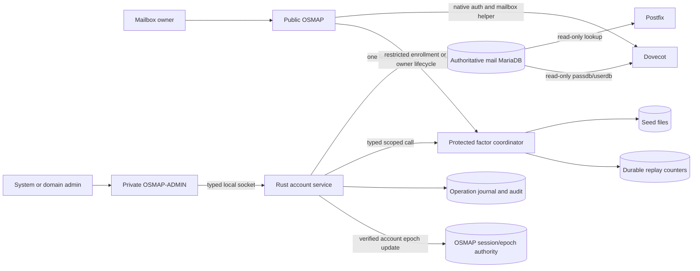

# OSMAP-ADMIN Identity Lifecycle

**Repository path:** `docs/OSMAP_ADMIN_IDENTITY_LIFECYCLE.md`\
**Project:** OSMAP / OSMAP-ADMIN, OpenBSD Secure Mail Access Platform\
**Version:** 0.1.0\
**Date:** 2026-11-13\
**Status:** Proposed implementation design; no deployed implementation, host mutation, schema change, or production qualification is implied.\
**Scope:** Mailbox and administrator identity creation, credentials, first-factor and TOTP enrollment, browser activation, account suspension/reactivation, credential and factor changes, recovery, staged retirement, and native mail-service effects.

> **Change boundary:** This document is a design contract, not authorization to create accounts, issue recovery credentials, disclose factor secrets, change MariaDB, affect mail delivery, or disable PostfixAdmin. All implementation and installation work requires scoped review, explicit authorization, native tests, and target-specific acceptance evidence.

## 1. Purpose and binding decisions

OSMAP-ADMIN is a **separate private Rust administrative control plane** for domains, mailboxes, aliases, administrator identities, and account lifecycle changes. OSMAP remains the public mailbox-user webmail and bounded self-service application. Postfix and Dovecot remain the native transport, delivery, authentication, and mailbox authorities for their respective operations.

This specification complements [OSMAP_ADMIN_SYSTEM_ARCHITECTURE.md](OSMAP_ADMIN_SYSTEM_ARCHITECTURE.md), [OSMAP_ADMIN_DATABASE_DESIGN.md](OSMAP_ADMIN_DATABASE_DESIGN.md), and the [OSMAP-ADMIN project plan](OSMAP_ADMIN_PROJECT_PLAN.md) ([PR #84](https://github.com/unattributed/OSMAP/pull/84)). It incorporates [PostfixAdmin functional parity issue #85](https://github.com/unattributed/OSMAP/issues/85), the [administrative user management engineering request](ADMINISTRATIVE_USER_MANAGEMENT_ENGINEERING_REQUEST.md), [current TOTP model](TOTP_SECRET_MANAGEMENT_MODEL.md), [operator recovery SOP](TOTP_OPERATOR_RECOVERY_SOP.md), [V3 identity evidence](V3_IDENTITY_LIFECYCLE_EVIDENCE.md), and [native mail storage contract](../maint/openbsd/MAIL_STORAGE.md).

**Binding invariants**

1. **One account authority and one writer:** Every domain, mailbox, alias, password-hash, quota, and lifecycle mutation goes through the designated authoritative writer in the selected deployment mode. The existing OSMAP password-change helper is a competing write path until inventoried and integrated or deliberately fenced. No PostfixAdmin/OSMAP-ADMIN dual-write.
2. **Different subject namespaces:** A mailbox principal (`mailbox:<canonical-address>` or a stable internal identifier) and an administrator (`admin:<stable-id>`) are independent identities. Matching email strings do not confer administrator privileges, authenticate an admin, or link factors or sessions.
3. **No duplicate mailbox password database:** The selected MariaDB mail-account authority stores the one Dovecot-compatible mailbox password hash. Admin-only password credentials are separately scoped to admin identities and never returned through Dovecot/Postfix lookups.
4. **TOTP remains protected:** Current mailbox-user TOTP seed files and accepted-counter replay state remain in their established protected stores. No SQL TOTP seed, OTP, recovery code plaintext, accepted counter, or retrievable secret. Separate admin identity namespace and protected factor namespace are required.
5. **Independent state dimensions:** Mailbox record lifecycle, Dovecot/native-client authentication, Postfix/LMTP acceptance/delivery, OSMAP browser TOTP eligibility, and account suspension/retention are different facts. Do not report one as proof of another.
6. **Only the identity owner normally sees the enrollment secret:** An administrator creates a *pending invitation*, not a silently enrolled owner factor. Recovery is a separate identity-attested, audited workflow.
7. **Unknown or partially applied transitions do not become active by assertion:** Verify authoritative database readback, factor-store state, native lookup behavior and session effects; preserve an `uncertain` operation until reconciled.
8. **Current host boundaries remain:** The documented Toronto `postfixadmin` database stays authoritative until an explicit cutover; obsd1 development and read-only Toronto replica are separate. Existing-host read-only compatibility precedes any Rust writer activation. Fresh installs use versioned `osmap_mail` schema creation with the privileged local migrator.
9. **Identity retirement does not erase mail:** Disablement and logical retirement do not delete Maildir bytes, message identifiers, OpenPGP material, backup sets, or audit trails. Retention, export and physical purge require their own policy and authorization.
10. **No unsupported assurance claim:** Browser TOTP does not by itself protect IMAP/SMTP native clients, and invalidating OSMAP browser sessions does not necessarily terminate already-authenticated external mail connections.

## 2. Actors, authorization and trust domains

| Actor or service | Authority and responsibilities | Express prohibitions |
| --- | --- | --- |
| System administrator | Installation-wide domain/mailbox/alias operations, admin grants, supervised recovery, scoped retention approval; fresh step-up for high-risk actions | Cannot read mail body, private keys, factor seeds, accepted counters, or silently bypass MFA |
| Domain administrator | Manage approved objects in explicitly assigned source domains; mailbox reset/recovery only if configured policy permits and independent recovery controls pass | Cannot create system admins, administer other domains, access another admin's factor, or expand rights through an alias destination |
| Mailbox owner | Own allowed OSMAP self-service, password change, TOTP management after ordinary authenticated admission | Cannot provision users, set mail-stack SQL, obtain admin sessions, or change another user's state |
| OSMAP-ADMIN web | Private UI, admin login/MFA/session/CSRF, input validation and typed operation dispatch | Cannot hold SQL DML/DDL credentials, write factor files, run arbitrary shell commands, or modify host configuration |
| Rust account service | Server-side RBAC, canonical identity and revision checks, one-writer fencing, authoritative SQL changes, operation journal and safe audit | Cannot trust browser-supplied role/scope, bypass change review, or infer factor success from an SQL row |
| Rust factor coordinator | No-overwrite seed provisioning, code verification and replay consumption, rotation/revocation and reconciled factor metadata | Cannot expose established seeds or reset replay state to make a test pass |
| Local bootstrap/migrator | Privileged **offline** schema setup and first-admin creation only under an operator-authorized control | No unauthenticated public bootstrap endpoint and no routine browser privilege escalation |
| Postfix and Dovecot | Native SQL lookups and their actual SMTP, routing, IMAP/LMTP, passdb/userdb and quota semantics | Do not request admin permission from a web application on the mail path |
| Recovery operator | Execute approved local recovery with identity, containment, and session attestations | Signed approval alone does not prove that required real-world checks were performed |

Every mutating request must be reauthorized by the service using **authenticated subject**, role and domain grants, target state, operation class, recent step-up where required, canonical target, expected record revision, operation idempotency key, and current writer epoch. UI checks are usability controls, not the authorization boundary. Protected account/recovery actions must be audit-correlated, and denials must be safe and attributable without disclosing credentials.

## 3. Identity classes and their authoritative stores

| Identity class | Canonical identity | Credential authority | Factor and replay authority | Browser-session authority |
| --- | --- | --- | --- | --- |
| Mailbox user | Normalized full mailbox address; internal stable mailbox ID in native schema | Active mail-account database hash consumed by selected Dovecot passdb | Existing OSMAP protected mailbox factor files plus separate replay counter store | Existing OSMAP session and durable account/credential epoch contract |
| System administrator | Stable admin ID and separately normalized admin login | `admin_identities` hash with independently reviewed verifier | Protected **admin-only** factor namespace, with replay separation and approved shared Rust verifier | Private OSMAP-ADMIN session store and admin `auth_epoch` |
| Domain administrator | Stable admin ID with explicit domain-grant rows | Same independent admin credential mechanism | Same admin-only factor isolation | Same private admin session service; scoped authorization reevaluated |
| Setup/recovery participant | Opaque, short-lived challenge bound to one target and one permitted transition | Not an independent account or mailbox password | Pending factor enrollment record and transient protected enrollment material | Restricted, non-mail, non-admin enrollment session only |

**SQL mapping:** Native tables proposed in the database design are `mail_domains`, `mailboxes`, `admin_identities`, `admin_system_grants`, `admin_domain_grants`, `mailbox_enrollments`, `admin_enrollments`, `writer_control`, `operation_journal`, and `audit_events`. Use the existing `postfixadmin` schema only through an inventoried compatibility adapter until cutover. Field-level contracts and SQL grant restrictions belong to the database design.

**Account epoch gap:** The native draft includes `admin_identities.auth_epoch` but does not give `mailboxes` an equivalent database column. The mailbox browser revocation mechanism is the existing OSMAP durable account-epoch/session contract. Before implementation, select and prove its authoritative persistence and coordinated update semantics; add an explicitly reviewed schema revision only if needed. Do **not** treat `mailboxes.revision` as a replacement browser session epoch by assumption.

**Factor-state gap:** The proposed SQL enrollment tables represent `missing`, `pending`, `active`, and `revoked`. Recovery and rotation are **workflow/operation-journal states**, not new factor-table enum values unless a future reviewed migration adds them. The actual protected seed and replay-store observations always take precedence over an optimistic SQL `active` flag.

## 4. State model: separate planes, never one misleading `active` flag

### 4.1 Mailbox resource lifecycle

The proposed `mailboxes.lifecycle_state` accepts `pending`, `active`, `disabled`, and `retiring`. These are **administrative resource states**, not evidence of native auth or browser MFA:

| Mailbox state | Meaning | Permissible transition |
| --- | --- | --- |
| `pending` | Created or being reconciled; no complete provisioning claim | `active` only after configured delivery/auth projections verified, or `disabled` on containment |
| `active` | Administrative resource may operate subject to independent `auth_enabled`, `delivery_enabled`, domain and factor policy | `disabled` or `retiring` through authorized operation |
| `disabled` | Administratively suspended/contained; desired native auth and delivery policy must be explicit | `active` after resolved cause, verified grants and readback; or `retiring` |
| `retiring` | No ordinary reactivation; retention and dependent aliases/domains being resolved | Final archival/purge under separate authorization; reversal only by approved restore process |

**Native flags** are explicitly independent: `mailboxes.auth_enabled` controls the authorized Dovecot passdb acceptance projection, and `mailboxes.delivery_enabled` controls the configured delivery/recipient projections. Their actual semantics depend on installed Postfix/LMTP lookup configuration and must be verified against the target host. Domain state can override mailbox usability. Do not interpret `delivery_enabled=false` as guaranteed upstream SMTP rejection, because an alias/catch-all/other transport rule may still accept the recipient.

### 4.2 Browser factor lifecycle

| Enrollment state | Meaning | Admitted action |
| --- | --- | --- |
| `missing` | No currently qualified active enrollment for the subject | Start authorized, restricted enrollment |
| `pending` | Scoped challenge and protected pending seed being prepared or awaiting first-code proof | Verify possession, expire, cancel or reconcile; no ordinary browser admission |
| `active` | Verified factor installed in protected store with durable accepted-counter enforcement | Normal browser MFA after primary auth; guarded rotation or revocation |
| `revoked` | Prior factor withdrawn while evidence remains preserved under the approved revocation process | No factor login; independent recovery/new enrollment only |

These SQL values are projections, not the TOTP authority. Filesystem no-overwrite rules, precise secret-store ownership/mode, replay locking, canonical mailbox filename convention, and the separate admin namespace must be tested. A SQL `active` status with absent/unreadable secret is **invalid and fail-closed**.

### 4.3 Administrator identity lifecycle

The native `admin_identities.state` supports `pending`, `active`, `disabled`, `locked`, and `retiring`:

- `pending`: password initialized but no authenticated, accepted admin factor and no ordinary admin admission.
- `active`: eligible for admin login *only if* current password, active admin MFA, scoped grants, current auth epoch, and listener/session controls all pass.
- `locked`: temporary, attributable authentication-risk containment. Must not be automatically treated as a permanent policy sanction; unlocking needs its own authorization and rate-limit controls.
- `disabled`: explicit administrative suspension; admin sessions invalid and no service privileges.
- `retiring`: admin identity/grants revoked for interactive operation while historical attribution remains available.

An admin may be created **without any mailbox or domain**. Assigning a system grant or domain grants does not activate a pending identity. An active admin whose required factor is revoked is effectively **not eligible for login** even if its `admin_identities.state` still says `active`; the coordinator should reconcile and suspend where policy requires.

### 4.4 Effective-capability matrix

| Condition | OSMAP ordinary browser | Native IMAP/SMTP auth | Postfix recipient/delivery | Private admin browser |
| --- | --- | --- | --- | --- |
| New mailbox, MFA pending | Denied except restricted enrollment | **Configured policy decision**; not implicitly denied by browser MFA | Governed by effective recipient/alias maps, independently verified | No grant |
| Mailbox active with MFA | Password + accepted TOTP + valid current session | Governed by Dovecot auth flags/passdb and client policy | Governed by Postfix/Dovecot delivery maps | No grant |
| Mailbox disabled | Denied; revoke browser sessions | Must enforce desired refusal and prove actual results | Must enforce chosen reject/hold/retain behavior with native test | No grant |
| Factor revoked but mailbox otherwise active | Denied until approved recovery | Might remain enabled if `auth_enabled` unchanged | Might remain enabled | No grant |
| Admin pending/disabled/locked | Unrelated | Unrelated unless the admin separately owns a mailbox | Unrelated | Denied |
| Admin active with factor | Unrelated | No native-mail authority from admin role | No mail routing authority from admin role | Allowed only within scoped grants |
| Retired mailbox | Denied | Denied under approved retirement policy | Explicitly verified no unintended aliases or delivery | No grant |

**Phase 0 decision required:** Whether native IMAP/SMTP credentials are usable before first OSMAP factor enrollment. The baseline design allows independently valid native credentials unless the selected rollout policy explicitly disables native auth. If a strict no-native-auth-until-enrolled policy is chosen, configure and verify the actual Dovecot passdb/auth flag and any SMTP SASL consumer. A browser enrollment record alone cannot enforce that policy.

## 5. End-to-end flow: create a mailbox user

### 5.1 Preconditions and input contract

- Actor: active, freshly step-up-authorized system admin or policy-authorized domain admin within an assigned **source** domain.
- Domain: active and selected from current authoritative database; address unique; domain mailbox count and quota limits enforced under a domain lock.
- User data: canonical full mailbox address, optional display name, configured quota, native credential initialization policy, controlled maildir and account enable/delivery decision. Reject ambiguous Unicode/IDNA, wrong-domain local parts, wildcard confusion, path traversal, and foreign mailbox IDs.
- All requests: expected revision/uniqueness precondition, request digest/idempotency key, current writer fencing and no competing PostfixAdmin/OSMAP credential writer.
- Password setup: never email a password in plaintext, return a hash, or depend on the new mailbox being usable to receive its own invitation. Choose an independent established delivery or owner-attested channel first.

### 5.2 Provisioning sequence

```mermaid
sequenceDiagram
    actor Admin as Scoped administrator
    participant UI as OSMAP-ADMIN private web
    participant A as Rust account service
    participant DB as Authoritative MariaDB
    participant P as Postfix native lookup
    participant D as Dovecot passdb/userdb
    participant F as Factor coordinator
    actor Owner as Mailbox owner
    participant O as OSMAP restricted enrollment
    Admin->>UI: Create mailbox in allowed domain
    UI->>A: Typed create request + authenticated context
    A->>A: Reauthorize; canonicalize; verify fence and revision
    A->>DB: Transaction: mailbox + protected local alias + journal
    DB-->>A: Commit receipt, initial pending state
    A->>P: Verify source and recipient/alias projection
    A->>D: Verify userdb, password scheme and quota projection
    alt Any native check fails or result uncertain
        A->>DB: Mark operation uncertain and contain access
        A-->>UI: Reconciliation required, not success
    else Native checks pass
        A->>F: Start no-overwrite mailbox TOTP enrollment
        A->>DB: Record short-lived invitation digest and pending state
        A-->>Admin: Invitation delivery instruction, no seed
        Admin-->>Owner: Verified independent setup channel
        Owner->>O: Present single-use setup authorization
        O->>F: Generate/protect candidate seed and request code proof
        Owner->>O: Prove code from own authenticator
        F->>F: Consume accepted counter, install verified seed
        F-->>A: Protected-store receipt
        A->>DB: Consume invitation and reconcile enrollment state
        A-->>Owner: Limited setup complete
    end
```

The actual runtime protocol must not depend on a privileged web process. The diagram shows *conceptual verification calls*, not Postfix or Dovecot HTTP APIs. Where native probes require privileged local commands or a disposable message, execute them only through reviewed local helper/operator paths and do not run one for every ordinary user request unless bounded and explicitly designed.

1. **Validate and reserve:** The Rust writer enforces domain scope, canonical identity, quota/limit, duplicate address, alias collision and writer epoch under a transaction. Deny stale revisions and duplicate requests with mismatched payloads.
2. **Create authoritative record:** Create the mailbox, compatible hashed native credential if policy allows, immutable server-computed relative Maildir, and required protected local-delivery alias association. Log operation ID and initial state; no Maildir-byte deletion or arbitrary home path selection.
3. **Verify effects:** Check actual Postfix recipient/alias semantics and Dovecot passdb/userdb, configured quota and owner IDs against disposable controlled fixtures. If external validation cannot complete, mark `uncertain` or leave `pending` and contain access rather than claiming success.
4. **Initialize browser enrollment:** An approved factor coordinator produces a pending, subject-bound, expiring, single-use setup authorization. Store only a cryptographic token digest, expiry and consumed status in MariaDB; protected candidate seed material remains outside SQL.
5. **Deliver invitation independently:** The administrator may initiate the invitation but does not receive the owner's seed. Verify recipient identity and use a channel that does not require first logging into the new mailbox. Email to the new mailbox is insufficient if mailbox access is not yet available.
6. **Owner proves possession:** The limited OSMAP enrollment surface allows the intended owner to establish the factor, supply a fresh valid TOTP and complete no-overwrite activation, without obtaining normal mail or admin functions from the setup token.
7. **Activate browser eligibility:** Re-read real factor and replay state, consume invitation once, update enrollment metadata and revoke any restricted setup sessions. Only then allow normal password-plus-TOTP OSMAP authentication. Administrative `mailboxes.lifecycle_state=active` must not by itself be interpreted as MFA completion.
8. **Record evidence:** Report canonical identity, non-secret state dimensions, operation ID, SQL revision, tested native projections and factor receipt. No passwords, TOTP seed or QR provisioning URI in audit or support exports.

### 5.3 PostfixAdmin mailbox alias behavior

Where the installed source creates a protected mailbox-local alias/delivery row, preserve its effective behavior. Editing forwarding destinations must not remove the mailbox's own delivery destination. Catch-all and alias-domain behavior require the installed-specific lookup contract and separate cycle/collision testing. No domain administrator gains control over the **destination** domain merely by configuring forwarding from an authorized source.

## 6. Credential creation, change and reset

### 6.1 Mailbox credentials

- **Authoritative storage:** One selected Dovecot-compatible password hash under `mailboxes.password_hash` in `osmap_mail`, or its actual PostfixAdmin-schema counterpart during the legacy phase. Never store a duplicate hash in OSMAP state or OSMAP-ADMIN's admin identity store.
- **Algorithm:** Preserve imported hashes byte-for-byte. For *new* hashes use a verified Dovecot-supported scheme configured for the installed passdb, with explicit scheme prefix where required; do not name a default scheme without host evidence. Reject unsupported scheme or silent hash coercion.
- **Initial credential:** Favor a one-use owner-attested password setup transition via an independent channel rather than disclosing an administrator-chosen permanent password. If a temporary credential is allowed, it requires an independently enforced expiry/first-change policy rather than an unconsumed database flag.
- **Owner password change:** Require an authenticated current owner and existing OSMAP same-account reauthorization, authoritative conditional write, durable account-epoch/session consequences, and real old-password rejection/new-password acceptance. The existing credential-freshness stock-auth helper and Dovecot auth-cache assumptions must be revalidated on the selected host.
- **Administrative reset:** Require actor scope, fresh admin MFA step-up, recorded reason, identity notification through an independent channel, and no recovery token secrecy leak. Reset cannot be used as an admin-login or factor enrollment bypass.
- **Uncertain update:** If SQL commit, Dovecot readback, session revocation, or cache assertions disagree, mark operation `uncertain`, stop follow-up writes and contain entry until reconciliation. Do not retry with a new hash blindly.

### 6.2 Admin credentials

- Use a separate admin hash and verifier; admin password login does **not** authenticate as a Dovecot mailbox.
- First bootstrap and later admin invitations start `admin_identities.state=pending` with no interactive authority until admin factor verification completes.
- Admin password change/reset increments `auth_epoch`, invalidates private admin sessions, rejects old credential, verifies new credential, and requires a separately authorized recovery path if MFA is unavailable.
- Never allow an active domain administrator to set or reset the password of a system administrator; system-admin grant changes require fresh high-privilege step-up and an audit record.
- No seeded default password, default administrator or universal recovery credential.

### 6.3 Session and native-client consequences

| Action | OSMAP browser sessions | OSMAP-ADMIN sessions | Already-authenticated IMAP/SMTP |
| --- | --- | --- | --- |
| Mailbox password change/reset | Revoke **all sessions for that mailbox**, atomically or under a fail-closed pending barrier with authoritative credential freshness | No implication unless same person has a separate admin account with its own credential event | May persist; record and test installed capabilities rather than claiming forced termination |
| Mailbox suspend/retire | Invalidate affected mailbox sessions | No automatic admin identity effect | Existing connections may persist; use a reviewed server-side termination/containment mechanism if this is a defined requirement |
| Mailbox TOTP rotate/revoke/recover | Revoke affected mailbox sessions or advance approved epoch barrier | No implication | Browser TOTP does not directly change native client auth |
| Admin credential/factor/role change | No mailbox session implication | Advance `auth_epoch`, revoke all relevant admin sessions and reauthorize scope | No implied native client effect |
| Domain suspension | Revoke affected mailbox sessions under defined cohort and versioned policy | Domain admin sessions must lose affected domain authorization immediately; consider session revocation as an additional measure | Test host-specific native auth and delivery behavior; do not assume termination |

A *requested* revocation is not equivalent to *confirmed* revocation. The service must verify the session/epoch persistence boundary and refuse fresh admission while the state is incomplete. The local mail stack may use authentication caches; document installed cache behavior and refuse claims of immediate native credential invalidation without native testing.

## 7. TOTP enrollment, validation and activation

### 7.1 Existing OSMAP compatibility contract

The current mailbox-user factor verifier follows RFC 6238-style TOTP with 6-digit codes and 30-second steps by default. The accepted time counter must be durably consumed once, with cooperative locking and replay refusal even for concurrent requests. The existing mailbox seed filename uses the canonical account identity encoded as hexadecimal under `OSMAP_TOTP_SECRET_DIR`, with replay state held separately beneath `cache/totp-replay`. These formats are compatibility requirements for existing accounts, not a general invitation to rename, import or reinitialize active files.

### 7.2 New owner enrollment

1. Admin creates mailbox identity and receives a non-secret enrollment state, not the owner's QR or seed.
2. System issues an unpredictable, short-lived, single-use invitation bound to subject ID, permitted operation, credential state and current revision. Store only a digest; ensure server-side expiry and rate limits. Setup authority must not be interchangeable with session bearer tokens.
3. Authenticate the correct recipient using the reviewed independent channel and enrollment admission mechanism. Present the seed once to the intended owner over the restricted secure enrollment session. Treat provisioning URIs and QR images as secrets: no third-party image generation, logging, query parameters, screenshots in evidence, or browser persistence.
4. The owner supplies a fresh TOTP; the factor service verifies within configured skew and records counter consumption durably. Another request with the same counter must fail.
5. Protect the seed with atomic **no-overwrite** installation, exact owner-only permissions and symlink/traversal refusals. The setup is not complete until protected store and SQL metadata reconcile.
6. Consume the setup challenge, destroy or expire temporary candidate material, invalidate limited setup sessions, and admit ordinary OSMAP sessions only through a fresh password-plus-TOTP login.

**Interrupted enrollment:** If the seed is installed but the SQL activation update fails, never overwrite it or reset the replay counter. Reconcile by verified canonical subject, factor digest/reference, pending operation, and authorized recovery decision. If SQL says active but protected state is absent, refuse normal login and record a containment finding.

### 7.3 Admin enrollment and first system administrator

- Before any domain or mailbox exists, a **trusted local one-shot Rust `bootstrap-admin` procedure** creates one pending system-admin identity and protected pending admin enrollment. It does not use the public OSMAP listener.
- Establish a separately reviewed admin password verifier, distinct admin principal namespace and factor-store path. Present the bootstrap enrollment to the operator over the trusted local terminal, not an unattended log or a public web endpoint.
- Require a fresh code proof, no-overwrite protected factor installation, replay-store acceptance, SQL status readback and one-shot bootstrap closure before activating the first system admin.
- Only afterward may the private OSMAP-ADMIN login establish a bounded admin session with password plus MFA.
- Subsequent system/domain administrator creation follows separate invitation, role-grant review and owner-held factor enrollment. No automatic activation from assignment of domain grants.
- An interrupted local bootstrap leaves a disabled/pending admin and a recoverable local operation receipt. It must not create an unauthenticated fallback administrator.

### 7.4 Rotation and revocation

**Rotation:** Requires an authorized same-subject reauthentication or approved recovery, a new protected pending candidate, a new code proof, no silent overwrite, preserved old-factor evidence, explicit transition, accepted-counter isolation and session invalidation. Do not delete the old factor before the new factor is proved unless a separately approved containment reason requires immediate revocation. Record exact old/new factor states without exposing either seed.

**Revocation:** Requires independent scope/authority checks, protected preservation-first factor custody, digest/revision compare-and-swap, refusal of further browser MFA, session invalidation and an explicit recoverability decision. Revocation must not erase the accepted-counter history to allow replay. Revocation of a mailbox factor does not by itself disable Dovecot passdb or mail delivery.

**Re-enrollment:** Never a re-run of initial create that overwrites an active seed. Use a separately approved recovery/rotation state machine and unique operation identity.

## 8. Activation and admission rules

### 8.1 Mailbox browser activation predicate

An ordinary OSMAP mailbox session may be created only when **all** of the following are true:

- The Dovecot-backed canonical mailbox credential is accepted by the configured authoritative path.
- Domain and mailbox are not disabled or retiring under the selected browser-access policy.
- The owner has an existing **active and readable protected** mailbox TOTP factor, with accepted-counter durable replay controls.
- Submitted code is fresh, accepted once by the existing verifier and bound to the same canonical mailbox identity.
- The browser login meets origin/Host/rate-limit controls, account epoch/currency and regular session policy.
- No pending credential/factor/disable transition prevents admission or requires operator reconciliation.

No `mailboxes.active`, SQL enrollment `active`, or Maildir path is sufficient alone.

### 8.2 Administrator admission predicate

Private admin login requires current admin password verification, `admin_identities.state=active`, a qualified admin-only factor, accepted fresh TOTP, current `auth_epoch`, private listener and hardened cookie/origin controls. Every privileged operation then rechecks server-side domain/system grants, target and revision, and fresh step-up as required. A mailbox session cookie, even for the administrator's own email address, must always be rejected for admin endpoints.

### 8.3 Restricted setup admission

The setup token grants **only** the specific pending enrollment or password-setup transition. It does not permit inbox view, message submission, account enumeration, administrator access, recovery of an enrolled seed, or other accounts' setup. It must be scoped to the target identity and invalidated on completion, credential change, suspension, expiry or detected replay. Existing V3 WSTG rules that deny general signup and account provisioning remain in force: only the explicitly defined restricted enrollment route may be added, and corresponding regression tests must be updated.

## 9. Suspension, lockout and reactivation

### 9.1 Mailbox suspension

A suspension is a deliberate administrative security/operational action with **separately selected native authentication and delivery effects**. Request payloads must identify the reason class and configured effective policy; a boolean `disabled` without an agreed mailflow outcome is insufficient.

| Suspension profile | Required intended effect | Evidence |
| --- | --- | --- |
| Security containment | Deny OSMAP browser and new native authentication, revoke sessions, define handling for existing connections; decide mail receipt separately | Direct passdb negative tests, session denial, documented connection limitation |
| Temporary access hold | Deny new login; choose whether inbound mail is held/accepted or rejected; do not silently discard | Postfix recipient/LMTP probe plus Dovecot auth and pending-mail disposition |
| Delivery-only hold | Leave native credential behavior according to policy while routing/receipt changes are explicitly applied | Postfix/alias delivery results and no unintended forwarding |
| Domain suspension | Apply coherent policy to all affected account/alias flows, admin domain grants and browser sessions | Multi-account cross-domain checks, catch-all/alias checks, domain scope refusal |

Sequence: (1) authenticated scoped step-up, (2) capture expected revision and current effective state, (3) write-fenced authoritative transaction to update intended flags and journal, (4) immediate protected session/epoch containment, (5) native recipient and auth tests, (6) reconcile actual versus intended effects. Partial success is `uncertain`, not a green UI status. Keep existing Maildir and factors safe.

### 9.2 Automatic lockout

Login throttling/temporary administrator `locked` state is not permanent disablement and must not enable account enumeration or attacker-triggered irrecoverable denial. Apply bounded rate controls and a reviewed unlock path. Do not automatically invalidate or remove an existing factor seed to implement a login lock. Preserve non-secret event evidence.

### 9.3 Reactivation

1. Confirm the original suspension cause is resolved and the actor has authority over the **same canonical subject**.
2. Reevaluate domain state, mailbox/alias ownership, grants, quota, maildir safety, password freshness and factor-store condition.
3. Require fresh step-up, revision match and known writer epoch. Refuse implicit `retiring -> active` or silent factor resurrection.
4. Restore only the explicitly selected native auth/delivery flags; verify real Dovecot and Postfix projections.
5. If factor is missing/revoked or credential compromised, require separately authorized reset/recovery and fresh factor verification before allowing ordinary OSMAP/admin browser access.
6. Issue no prior session revival. New login establishes a newly authenticated, current-epoch session.

## 10. Lost-factor, forgotten-password and administrator recovery

Recovery must resist an attacker who knows the mailbox address, stole the password, controls a forwarded alias, or has access to a compromised mailbox. A mail-delivered token to the **same** affected mailbox is not an independent identity proof when access to that mailbox is part of the failure or compromise.

### 10.1 Mailbox-user lost-factor recovery

```mermaid
stateDiagram-v2
    [*] --> Requested
    Requested --> IdentityAttestation: Independent identity check
    Requested --> Refused: Failed evidence or policy
    IdentityAttestation --> Approved: Authorized operator approval
    IdentityAttestation --> Refused: Inadequate identity proof
    Approved --> Contained: Preserve/revoke old factor; block old sessions
    Contained --> PendingReenrollment: One-use scoped setup authority
    PendingReenrollment --> Verified: Owner proves new TOTP
    PendingReenrollment --> Uncertain: Interrupted install or readback
    Verified --> Restored: Reconcile store, SQL, epoch and fresh login
    Uncertain --> Contained: Operator reconciliation
    Refused --> [*]
    Restored --> [*]
```



**Minimum workflow:**

1. Start an authenticated, authorized request or local operator-assisted request; return an enumeration-safe response to an unauthenticated caller.
2. Attest subject identity over an independent, documented channel and investigate compromised native credentials, forwarding aliases, device possession and current sessions. Record **what was actually checked**, not only that a form was signed.
3. Use the existing signed, short-lived human-operator recovery approval where required, verifying scope, target canonical identity, signer, validity, unique operation ID and replay protection. No approval can override missing real-world attestation.
4. Contain old OSMAP sessions, preserve or revoke the prior factor through approved no-overwrite/digest safeguards, and decide separately whether native mail auth needs temporary suspension or credential reset.
5. Issue a one-use, short-lived restricted setup authorization to the verified owner over an independent channel. Do not email the old seed, expose the stored factor, or silently rotate it.
6. Verify new TOTP code possession and durable accepted-counter refusal, reconcile protected store with SQL metadata, invalidate the challenge and require a new ordinary OSMAP password-plus-TOTP login.
7. Audit decision, operator, scoped reason, timestamps, credential/session effects, fact-based verification and uncertainty, without identity documents, password contents, seeds or codes in public evidence.

**Compromise escalation:** If there is reason to suspect email forwarding or mailbox compromise, do not rely on that mailbox as a recovery channel. A reset may require immediate native credential containment, review of aliases and sessions, and explicit evidence that later reactivation cannot reintroduce the compromise.

### 10.2 Forgotten mailbox password

A logged-in user performs the existing authoritative password-change journey with reauthorization. Without a valid password/session, use independent operator-attested recovery: verify identity, authorize a scoped password reset, record preconditions, conditionally write one compatible hash, invalidate OSMAP sessions/epoch, verify Dovecot old rejection/new acceptance, and independently notify the owner. MFA remains required for browser access; a password reset does not reset or grant TOTP. A new temporary password must not be sent in cleartext through insecure channels.

### 10.3 Admin factor/password recovery

- Use a trusted local operator workflow and stricter authorization than a mailbox-owner recovery. A domain admin may never reset a system admin's factor, password or role.
- Preserve separation between `admin:*` and `mailbox:*` namespaces, even where they share an email string.
- For loss of the only system admin, use the separately reviewed **offline break-glass restoration procedure**, with operator identity, physical/host access and dual-control policy as selected. Do not create a permanent bypass password, web recovery API, or universal factor override.
- Invalidate affected `auth_epoch` and all admin sessions, verify no escalated grants survived unauthorized changes, and require a fresh enrolled factor before private admin sign-in.
- Protect the **last active qualified system administrator** from ordinary deletion/demotion; recovery must retain a documented path that cannot be exploited by a domain administrator.

### 10.4 Recovery result classification

| Result | Meaning | Permitted next step |
| --- | --- | --- |
| `refused` / `rejected` | Policy/authorization, expiry, proof, or revision failed before valid mutation | Reattempt only via new independently authorized process |
| `pending` | Recovery authorized but verification/containment incomplete | No ordinary account activation |
| `committed` | Authoritative durable state and required security side effects confirmed | Controlled fresh login with all factors |
| `uncertain` | Filesystem, SQL, epoch, native auth or notification results diverge | Contain and reconcile; no optimistic retry |
| `reconciled` | Previously uncertain operation has explicit resolved state and evidence | Resume only if new admission predicate passes |

These operation-journal terms must map to the concrete `operation_journal.state` enum in the database design. `refused` in UI language maps to the database's `rejected` where applicable; do not add an unsupported SQL enum value by accident.

## 11. Administrator creation, role changes and retirement

### 11.1 Create system/domain administrator

1. Require active system administrator with fresh step-up, or first-install local bootstrap when **no** prior active system admin exists.
2. Allocate unique stable admin ID and canonical login in the *admin-only* namespace. Do not require creation of a mailbox.
3. Store separate admin password hash; begin `pending` without active admin sessions.
4. Assign narrowly reviewed system grant or domain grants, recorded with actor/operation/target and required confirmation.
5. Deliver approved pending admin MFA enrollment to the intended admin, not to the creating admin as a retrievable seed.
6. Accept a fresh code, install protected admin-only factor, reconcile SQL/secret state, then mark `active`.
7. Verify positive in-scope permission and negative cross-domain/system operations using direct service protocol requests, not only hidden UI controls.

### 11.2 Grant, revoke and demote

All grant changes use authenticated system-admin step-up, row revision and protected audit. Domain administrators cannot promote themselves or others to global admin. Immediately revoke affected admin sessions or increment `auth_epoch` and recheck authorization, including for existing browser sessions. An admin cannot retain foreign-domain authority through cached role claims. Reject deleting the last qualified system-admin grant without a separately reviewed recoverability plan.

### 11.3 Disable/retire admin

Disable login, revoke sessions and grants through a controlled state transition; keep audit attribution stable. Never cascade-delete historical audit events or mailbox identities by deleting an admin's credential row. An admin identity may be logically retired while the person retains a separate, unrelated mailbox account. Physical removal of admin metadata follows retention policy and must not break audit referential integrity.

## 12. Mailbox and domain retirement

Retirement is **not** a single `DELETE FROM mailboxes` operation.

| Stage | Required action | Acceptance observation |
| --- | --- | --- |
| 1. Request and freeze | Authorized retirement with reason, domain grant, recent step-up, expected revision; deny conflicting alias/credential writes | Operation ledger and exact target recorded |
| 2. Disable access | Mark `retiring`; disable browser admission and desired native auth; revoke sessions | Negative browser/Dovecot auth evidence |
| 3. Resolve inbound mail | Decide reject, hold, forward or retain under actual Postfix/LMTP policy; inventory catch-all, alias domains, forwards and protected local alias | Native recipient and forwarding results, no silent discard |
| 4. Preserve data | Retain Maildir bytes, UIDVALIDITY/UIDNEXT, flags, subscriptions, indexes, keys and factor/replay evidence under authorized custody | Inventory and protected backup/restore proof |
| 5. Export and retention | Record legal/operator retention schedule and export approval; maintain access boundaries on archives | Non-secret receipts and restore test |
| 6. Final disposition | Separately authorized secure purge after expiry, full dependency resolution and dry-run, or keep archive indefinitely per policy | Verified non-ambiguous disposition, protected audit linkage |

**Domain retirement:** Ensure dependent mailboxes, local/system aliases, catch-all and alias domains, domain administrator grants, optional DKIM/vacation/routing and DNS responsibilities are inventoried. Do not cascade-erase mailboxes or private mail merely because a domain is marked retiring. No automatic revocation of independently scoped system administrators.

**Re-create after retirement:** Treat a reissued address as potentially a **new security principal**. Before reuse, explicitly decide whether historical mailbox identity, factor file naming, replay state, Maildir data, sessions, aliases and audit ownership remain reserved. Do not accidentally inherit an old owner's factor, secrets, private mail, or access token by reusing the same canonical address. The existing canonical-address-derived factor filenames make identity reuse a mandatory Phase 0 safety decision. Default: **deny address reuse until a reviewed tombstone, quarantine and rebinding protocol exists**.

## 13. Single-writer, concurrency and multi-store consistency

### 13.1 Writer handoff

- **Legacy Toronto:** PostfixAdmin and inventoried legacy helpers remain authoritative; OSMAP-ADMIN's PostfixAdmin adapter starts **read-only**. Do not grant a competing Rust writer while legacy mutation routes exist.
- **Handoff:** Explicitly freeze all legacy writers, including the current OSMAP credential-change helper and batch jobs; capture a consistent checkpoint; remove/bind legacy SQL write grants; set current `writer_control` owner/fence epoch; verify *actual* inability of old principals to write.
- **Rust authority:** The account service is the only mailbox/domain/alias/credential mutation entry point. Browser and CLI both use the same typed, reauthorized service path.
- **Rollback:** Stop new mutations, reconcile all post-switch account changes and native consumers, then restore prior authority only after proven convergence. SQL snapshots alone do not restore factor files, replay counters, browser epochs, aliases or mail bytes.

### 13.2 Transaction boundary

A normal SQL mutation requires idempotency key + canonical payload digest, expected revision, actor namespace, current writer epoch and locked database objects in a fixed order. Mutate related rows and operation journal in a bounded InnoDB transaction, then commit and independently verify result. The service must reject stale, mismatched or ambiguous retries. Internal uniqueness/FK constraints protect against duplicate or orphaned records but do not replace domain authorization. SQL grants are necessary but not sufficient if a compromised privileged writer bypasses its own application logic.

### 13.3 SQL versus factor/session operations

MariaDB, the protected factor filesystem, Dovecot, Postfix and OSMAP's session store do **not** share a distributed atomic transaction. The implementation therefore requires a durable transition/saga protocol:

1. **Prepare:** Reauthorize actor, stage operation journal, record intended state and identify containment actions; prevent new privileged admission if the operation affects credentials/factors.
2. **SQL commit:** Perform exactly the authorized relational update with expected revisions and writer fence. Preserve operation ID for retries.
3. **Protected side effect:** Invoke typed factor/session helper with a subject-bound request and compare-and-swap/no-overwrite semantics; capture non-secret receipt.
4. **Native verification:** Probe required Postfix and Dovecot effects with bounded, preapproved methods against the selected host.
5. **Reconcile:** Compare authoritative SQL state, protected factor/replay state, browser epoch, native lookups and journal receipt. Mark `committed` only when all required effects pass; otherwise `uncertain` and contained.
6. **Restart safety:** On process failure or duplicate callback, resume by operation ID and existing receipts, not by blindly replaying a random seed installation, password hash change or factor revocation.

Avoid claiming a distributed transaction exists. Some invalidation operations must be **fail-closed admission barriers** before an independent side effect can be completed; exactly how to hold those barriers in the current OSMAP runtime is a required implementation decision. MariaDB schema changes and grants may implicitly commit and are part of the separate local migrator contract, never an interactive account-lifecycle transaction.

## 14. Data-flow and boundary examples



- Private management access is loopback/WireGuard-gated, separate from public OSMAP authentication, cookie and Host/origin policy.
- Neither browser process accesses mail-account SQL write credentials or raw factor files.
- Factor coordinator must authenticate/authorize the specific *service* caller and subject operation; a Unix socket file mode alone does not bind a browser actor to a domain scope.
- The webmail owner's established password-change path must be routed through the designated writer or safely fenced during handoff, not duplicated as a second password authority.
- Service audit records capture `actor`, `actor_namespace`, `operation_id`, `target`, `expected_revision`, `observed_revision`, `writer_epoch`, `result`, and sanitized effect receipts. Do not include seed, password, hash, code, setup token, private messages, or recovery identity documents.

## 15. Threat scenarios and denial requirements

| Scenario | Required refusal or containment |
| --- | --- |
| Ordinary OSMAP user submits an admin route or steals an admin URL | No inherited admin session, cookie, role, or socket authority |
| Domain admin changes a mailbox in a different domain | Deny based on canonical source target and grants in service, regardless of UI |
| Alias targets a foreign domain | Source can be allowed under forwarding policy; destination confers **no** administrative privilege |
| Reused setup token or expired token | Deny deterministically; prevent replay or cross-subject enrollment |
| Second setup against existing factor | Refuse overwrite; require explicit recovery/rotation |
| Two concurrent accepted TOTP codes from the same step | Exactly one accepted counter update; replay refused |
| Lost admin factor and only one admin exists | No unauthenticated bypass; controlled offline recovery only |
| Account reset succeeds in SQL but session invalidation fails | Fail closed on browser admission; mark `uncertain` and reconcile |
| PostfixAdmin and Rust both possess active SQL DML grants | Fail ownership gate; stop cutover and prevent conflicting writes |
| Schema says MFA active but seed missing | Deny login and report protected-state mismatch |
| Retired address is quickly re-created | Deny reuse until tombstone and factor/Maildir rebinding policy is proved |
| Disabled mailbox still accepts SMTP through catch-all/alias | Record actual delivery discrepancy and contain; no false success report |
| Already-authenticated IMAP client remains connected after reset | Disclose limitation, use separately qualified server-side termination if required |
| Admin creates user and requests user's TOTP secret | Deny export or permanent seed display; owner-only setup channel |
| Revoked factor's replay counter reset to make recovery succeed | Reject; preserve replay and factor evidence |
| Existing copied Toronto replica accidentally selected on obsd1 | Reject mutation and preserve one-way replica boundary |

## 16. Acceptance plan and evidence requirements

### 16.1 Functional lifecycle tests

| ID | Test | Required evidence |
| --- | --- | --- |
| IDL-001 | Fresh-install first system admin before first domain/mailbox | Local one-shot bootstrap, admin-only password/factor, private login; no public bootstrap |
| IDL-002 | Create domain and mailbox with scoped admin | SQL revision, protected mailbox-local alias, native recipient and Dovecot userdb/passdb readback |
| IDL-003 | Owner first enrollment | No mailbox-login dependency for setup channel; fresh code proof, protected seed, consumed invitation, new OSMAP login |
| IDL-004 | Native-before-browser policy | Actual IMAP/SMTP auth result recorded before factor enrollment, consistent with selected policy |
| IDL-005 | Owner password change | Authoritative old rejection/new acceptance, browser-session revocation, other mailbox preserved |
| IDL-006 | Admin password reset | Scoped step-up and independent channel, no MFA bypass; state and native auth reconciled |
| IDL-007 | TOTP rotation | No overwrite, protected previous factor, new proof, replay separation, session effects |
| IDL-008 | TOTP revocation | Old factor refused, replay preserved, sessions invalid; native mail behavior correctly distinguished |
| IDL-009 | Lost-factor recovery | Independent attestation + approval + containment + owner-held new factor, no secret disclosure |
| IDL-010 | Suspend/reactivate mailbox | Browser/new native auth and delivery profiles separately exercised; no old session revival |
| IDL-011 | Domain suspension | Cross-domain scope, alias/catch-all and cohort access effects verified |
| IDL-012 | Retire mailbox | Staged alias disposition, Maildir/UID/keys preserved; unauthorized purge denied |
| IDL-013 | Retire/recreate canonical address | Old TOTP, replay, Maildir and session binding cannot be inherited by a new principal |
| IDL-014 | Create/disable/promote/demote admin | Independent identity, scope checks, auth epoch and last-admin guard |
| IDL-015 | Explicit writer transition | Legacy credentials and old password helper cannot mutate after Rust gate |

### 16.2 Adversarial and concurrency tests

| ID | Test | Required refusal |
| --- | --- | --- |
| IDL-101 | Ordinary mailbox token/cookie at private admin endpoint | Deny with no admin mutation |
| IDL-102 | Forged actor, domain grant or target in direct Unix protocol | Deny at service boundary |
| IDL-103 | Stale revision/writer fence/duplicate idempotency key | Safe conflict or same committed result, never duplicate factor/write |
| IDL-104 | Parallel TOTP verification for identical counter | One acceptance at most |
| IDL-105 | Interrupted factor install, DB update or session revocation | `uncertain`, contained and deterministically reconcilable |
| IDL-106 | Foreign owner uses a setup invitation | No cross-subject factor/session enrollment |
| IDL-107 | Existing factor file, symlink or wrong permissions | Reject without overwrite, leak or replay reset |
| IDL-108 | Reset token through mailbox's own compromised forwarding | Independent-channel policy holds; no bypass |
| IDL-109 | Admin loss/last-system-admin removal attempt | Denied or separately approved offline recoverable process |
| IDL-110 | Rejected target still has Postfix acceptance via alias | Do not claim suspension passed; explicit containment |
| IDL-111 | Active IMAP connection after reset | Record real persistence/termination outcome, not fictitious session kill |
| IDL-112 | Unauthorized factor seed/QR/audit export | Denied; sanitized logs, evidence and error responses |

### 16.3 Acceptance scope and evidence hygiene

- Record **PASS**, **FAIL**, **UNKNOWN** or **NOT RUN** per test and host. Source unit tests, disposable OpenBSD fixtures, obsd1 and Toronto production are different evidence tiers.
- Preserve non-secret operation IDs, signed source delivery receipts, checksummed test outputs, current effective mail configuration, SQL projection proofs, and sanitized audit. Do not export production password hashes, seed files, QR images, private message bodies, recovery identity data or session bearer tokens.
- Run focused Rust tests, service protocol RBAC and concurrency tests, password/factor negative tests, WSTG authentication/session/authorization coverage and repository `make security-check`. Then qualify against the specifically authorized native host. A passing build or local test does not grant permission to activate a public endpoint.
- Existing Toronto PostfixAdmin remains in place until parity, single-writer handoff, state/secret backup/restore, verified rollback and independent operator approval. Retirement is a separate reviewed change.

## 17. Implementation slices and decisions to freeze

| Slice | Delivery target | Dependency |
| --- | --- | --- |
| L0. Inventory | Installed PostfixAdmin schema/write routes, Dovecot passdb/userdb, Postfix maps, OSMAP password helper and factor/session contracts | No mutation; host-specific observed evidence |
| L1. Shared identity foundation | Canonical subject types, admin-only namespace, typed operations, session/epoch policy and read-only compatibility | L0 scope and authorization rules |
| L2. Fresh bootstrap | Local first-system-admin pending/verified activation and `osmap_mail` initial schema | Migrator, protected admin factor store, rollback |
| L3. Core provisioning | Domain, mailbox and admin create; protected mailbox-local alias; native lookup verification | One-writer contract and tested SQL projection |
| L4. Enrollment | Independent owner setup channel, limited session, TOTP proof, SQL/seed reconciliation | Existing file-backed factor/replay contract |
| L5. Changes/containment | Password change/reset, rotation, revocation, suspension/reactivation, role/epoch changes | Fully tested multi-store barrier and native auth effects |
| L6. Recovery and retirement | Lost-factor, last-admin break-glass, mailbox/domain retirement, tombstones and retention | Independent attestations, storage/inbound-mail policy and restore proof |
| L7. Existing install cutover | Read-only adapter to fenced single writer; optional native `osmap_mail` authority migration and rollback | All P0 lifecycle and security tests; operator approval |

**Mandatory open decisions before code freeze**

1. Exact selected host Postfix/Dovecot schema/query and whether native IMAP/SMTP access is permitted before browser TOTP enrollment.
2. Trusted independent first-user invitation channel, subject proof, timeout and resend/revocation policy.
3. Admin factor root/filename and replay namespace, verifier/hash policy, and trusted first-admin local terminal contract.
4. Existing mailbox account-epoch persistence and fail-closed invalidation barrier, including where new writer transactions coordinate with current OSMAP password helper.
5. Whether domain administrators can initiate mailbox factor recovery, under what evidence requirements, and what independent reviewer is needed.
6. Suspension profiles: incoming-mail reject versus hold/accept, active connection containment, alias and catch-all handling.
7. Canonical mailbox address reuse/tombstone retention and factor/Maildir segregation for different people assigned the same address over time.
8. Last-active-admin prevention, offline break-glass custody and recovery test ownership.
9. Recovery and TOTP replacement operation states that are not represented by the initial database draft; select journal-driven workflow or reviewed schema migration.
10. Concrete retention periods, export custodians, privacy controls and separately authorized physical deletion procedures.

## 18. References and attribution

### Project sources (design authority)

- [OSMAP-ADMIN System Architecture](OSMAP_ADMIN_SYSTEM_ARCHITECTURE.md)
- [OSMAP-ADMIN Database Design](OSMAP_ADMIN_DATABASE_DESIGN.md)
- [OSMAP-ADMIN Project Plan](OSMAP_ADMIN_PROJECT_PLAN.md), [PR #84](https://github.com/unattributed/OSMAP/pull/84)
- [Administrative User Management Engineering Request](ADMINISTRATIVE_USER_MANAGEMENT_ENGINEERING_REQUEST.md)
- [PostfixAdmin functional parity issue #85](https://github.com/unattributed/OSMAP/issues/85)
- [TOTP Secret Management Model](TOTP_SECRET_MANAGEMENT_MODEL.md)
- [TOTP Operator Recovery SOP](TOTP_OPERATOR_RECOVERY_SOP.md)
- [V3 Identity Lifecycle Evidence](V3_IDENTITY_LIFECYCLE_EVIDENCE.md)
- [OpenBSD Mail Storage and Quota](../maint/openbsd/MAIL_STORAGE.md)
- [OSMAP Architecture](ARCHITECTURE.md), [Security Model](SECURITY_MODEL.md)

### Original vendors, standards and project maintainers

- **IETF**, [RFC 6238: TOTP](https://www.rfc-editor.org/rfc/rfc6238), algorithm, time steps and unique secret requirements.
- **Dovecot project**, [Dovecot 2.3 passdb](https://doc.dovecot.org/2.3/configuration_manual/authentication/password_databases_passdb/), [userdb](https://doc.dovecot.org/2.3/configuration_manual/authentication/user_databases_userdb/) and [authentication cache](https://doc.dovecot.org/2.3/configuration_manual/authentication/caching/). Version-specific; inspect actual deployment before applying.
- **Postfix project**, [MySQL lookup table reference](https://www.postfix.org/MYSQL_README.html) and [virtual mailbox domain guidance](https://www.postfix.org/VIRTUAL_README.html). SQL map behavior must match installed config.
- **MariaDB Foundation / MariaDB**, [SQL implicit commits](https://mariadb.com/docs/server/reference/sql-statements/transactions/sql-statements-that-cause-an-implicit-commit) and [GRANT](https://mariadb.com/docs/server/reference/sql-statements/account-management-sql-statements/grant). DDL and grant changes are not assumed to roll back inside an account transaction.
- **OWASP Foundation**, [Forgot Password Cheat Sheet](https://cheatsheetseries.owasp.org/cheatsheets/Forgot_Password_Cheat_Sheet.html), [Multi-Factor Authentication Cheat Sheet](https://cheatsheetseries.owasp.org/cheatsheets/Multifactor_Authentication_Cheat_Sheet.html), and [Session Management Cheat Sheet](https://cheatsheetseries.owasp.org/cheatsheets/Session_Management_Cheat_Sheet.html). Secondary application-security implementation guidance, not a substitute for installed vendor contracts.

**Disposition:** This is a lifecycle and security contract for future implementation. It introduces no new live accounts or credentials and does not qualify OSMAP-ADMIN, browser recovery, native-client suspension, migration or PostfixAdmin retirement.
