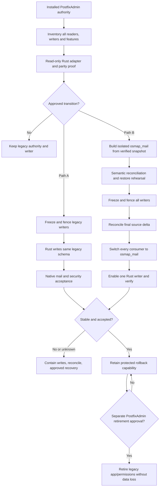

# OSMAP-ADMIN Migration, Cutover, Rollback, and PostfixAdmin Retirement

**Repository path:** `docs/OSMAP_ADMIN_MIGRATION_AND_ROLLBACK.md`\
**Project:** OSMAP / OSMAP-ADMIN / OpenBSD Mailstack\
**Version:** 0.1.0\
**Date:** 2026-11-13\
**Status:** Proposed implementation and operator runbook. No live migration, account modification, service reload, writer transfer, or PostfixAdmin retirement is authorized by this document.\
**Purpose:** Move an installed PostfixAdmin-backed mail system to an OSMAP-ADMIN-controlled account lifecycle without losing accounts, mail, credentials, aliases, security state, or recoverability.

> **Critical operating rule:** This document specifies an implementation and approval contract, not an already available OSMAP-ADMIN migration command. The Rust migrator, writer-handover tooling, adapters, native schema, and acceptance automation are planned capabilities. Do not execute illustrative transitions on Toronto, obsd1, or any populated mail installation until the required code, checks, backups, and operator work order exist and have been qualified.

## 1. Scope, authority, and dependencies

The migration replaces **administrative ownership**, not the mail transport. Postfix still routes and submits SMTP; Dovecot still authenticates users, serves IMAP/LMTP, resolves userdb/Maildir paths, and enforces installed quota policy. MariaDB remains the SQL engine. OSMAP remains the separate mailbox-user webmail and self-service product. OSMAP-ADMIN becomes the **private Rust administrative control plane** only after its own functional, security, and installation acceptance.

Read and reconcile this runbook with these controlling OSMAP documents before executing an implementation slice:

- [OSMAP-ADMIN Project Plan](OSMAP_ADMIN_PROJECT_PLAN.md), governed by signed [PR #84](https://github.com/unattributed/OSMAP/pull/84).
- [OSMAP-ADMIN System Architecture](OSMAP_ADMIN_SYSTEM_ARCHITECTURE.md), [Database Design](OSMAP_ADMIN_DATABASE_DESIGN.md), [Identity Lifecycle](OSMAP_ADMIN_IDENTITY_LIFECYCLE.md), [Security Model](OSMAP_ADMIN_SECURITY_MODEL.md), [UX Specification](OSMAP_ADMIN_UX_SPECIFICATION.md), and [Installation and Upgrade](OSMAP_ADMIN_INSTALLATION_AND_UPGRADE.md).
- [Administrative User Management Engineering Request](ADMINISTRATIVE_USER_MANAGEMENT_ENGINEERING_REQUEST.md) and [PostfixAdmin parity issue #85](https://github.com/unattributed/OSMAP/issues/85).
- [OSMAP native mail storage and quota contract](../maint/openbsd/MAIL_STORAGE.md), [OpenBSD service integration](../maint/openbsd/README.md), [TOTP storage](TOTP_SECRET_MANAGEMENT_MODEL.md), [operator recovery](TOTP_OPERATOR_RECOVERY_SOP.md), and [identity evidence](V3_IDENTITY_LIFECYCLE_EVIDENCE.md).
- [`openbsd-mailstack`](https://github.com/unattributed/openbsd-mailstack), particularly its [SQL foundation](https://github.com/unattributed/openbsd-mailstack/blob/main/docs/03-mariadb-and-sql-foundation.md), [Postfix SQL integration](https://github.com/unattributed/openbsd-mailstack/blob/main/docs/05-postfix-core-and-sql-integration.md), [Dovecot integration](https://github.com/unattributed/openbsd-mailstack/blob/main/docs/06-dovecot-auth-and-mailbox-delivery.md), [backup and DR](https://github.com/unattributed/openbsd-mailstack/blob/main/docs/12-backup-and-disaster-recovery.md), and [production topology notes](https://github.com/unattributed/openbsd-mailstack/blob/main/docs/production-mail-blackbagsecurity.md).
- Private, operator-authorized host details in [`openbsd-self-hosting`](https://github.com/unattributed/openbsd-self-hosting), which must **not** be copied as raw private configuration, secrets, operational evidence, or network details into public OSMAP commits.

The repository's documented Toronto host uses a live `postfixadmin` MariaDB account authority. The obsd1 writable development database is **not** the Toronto database; the obsd1 Toronto reference replica is read-only, one-way, and **never** a production migration target or automatic promotion source. All historical host and software versions are dated observations, not current-version guarantees.

### 1.1 What this migration does not do

- It does not replace or upgrade Postfix, Dovecot, MariaDB, OpenBSD, Rspamd, Redis, ClamAV, WireGuard, PF, nginx, or OSMAP as an incidental side effect.
- It does not copy Maildirs, change UID/GID, mailbox GUIDs, UIDVALIDITY, UIDNEXT, flags, subscriptions, indexes, quotas, or Sieve state without a **separately authorized storage migration**.
- It does not silently move TOTP seeds or replay counters into SQL, reset MFA, reuse a retired username's state, or invent a new mailbox password authority.
- It does not promote a development, replica, restored, or stale database merely because that database is readable.
- It does not remove PostfixAdmin/PHP/nginx routes until a **separate retirement gate** is signed and supported by installed acceptance evidence.
- It does not authorize taking public SMTP, IMAP, or delivery services offline for testing convenience.

## 2. Binding migration invariants

| ID | Invariant | Required proof |
| --- | --- | --- |
| MIG-I01 | Exactly one **selected mail-account database authority** serves the installation at any time. | Actual Postfix/Dovecot/OSMAP SQL source and query validation. |
| MIG-I02 | Exactly one **designated account writer** controls domains, mailboxes, aliases, passwords, quotas, and account status. | Complete writer inventory plus effective credential/route fencing, not a UI label. |
| MIG-I03 | A writer change against legacy `postfixadmin` is **distinct** from moving data to `osmap_mail`. | Separate implementation work orders and acceptance receipts for each transition. |
| MIG-I04 | No PostfixAdmin to Rust dual-write or simultaneous competing primary account databases. | Negative tests of every former write path throughout and after cutover. |
| MIG-I05 | All existing password-hash bytes, canonical account identities, and native mail location bindings are preserved unless explicitly and individually authorized. | Field-level comparison and Dovecot authentication tests. |
| MIG-I06 | All required domain, mailbox, alias, alias-domain, catch-all, protected self-delivery, and quota semantics survive. | Complete key-set comparison and native Postfix/Dovecot query/behavior tests. |
| MIG-I07 | Existing mailbox data and auxiliary IMAP state are **not deleted, regenerated, or reassigned** by an account database migration. | Filesystem/storage manifest and native Maildir identity checks. |
| MIG-I08 | Admin identities are separate from mailbox accounts; matching addresses never confer grants. | Explicit grants and independent admin password/TOTP login. |
| MIG-I09 | Mailbox TOTP secret files, independent replay state, browser sessions, and credential epochs preserve established ownership and transition rules. | Protected state manifest, no-overwrite tests, session revocation/freshness proof. |
| MIG-I10 | Every mutation has an authorized actor, request identity, expected revision, writer epoch, and traceable result. | Operation journal, audit integrity, refusal/replay/uncertain-result tests. |
| MIG-I11 | SQL grants, view definers, service UIDs, sockets, and private HTTP boundary remain least privileged. | Actual effective principals, positive and negative grant/peer tests. |
| MIG-I12 | Failure or uncertainty stops **administrative mutations**, preserves mail and evidence, and never initiates an automatic destructive rollback. | Recovery rehearsal and non-destructive halt behavior. |
| MIG-I13 | Any rollback after new writes requires forward-delta reconciliation. | Complete post-switch event set, current-state readback, operator reconciliation receipt. |
| MIG-I14 | PostfixAdmin retirement is independent of cutover completion. | Explicit parity, recovery, operational acceptance and retirement approval. |

## 3. Two independently approvable migration paths

### Path A: Transfer the writer, retain the existing `postfixadmin` schema

Initially deploy a **read-only** Rust compatibility adapter against the installed PostfixAdmin tables. Inventory and match effective behavior, then, under a separately authorized write freeze, revoke or contain PostfixAdmin and all other old account writers. Enable one scoped Rust writer using a reviewed legacy-schema adapter. **Postfix and Dovecot keep reading their proven existing schema and queries**, except narrowly justified configuration repairs.

This path can reduce the immediate risk of moving physical data. It still requires exact support for legacy triggers, mailbox-associated alias rows, quota units, hashing schemes, optional fields, and historic maintenance integrations. The native Rust service cannot claim compatibility merely because it can insert rows. PostfixAdmin may remain installed in **disabled/read-only operational recovery custody** but must not retain functioning competing write credentials.

### Path B: Transfer account authority to new `osmap_mail`

Create an empty native `osmap_mail` using the versioned Rust migrator. Import a consistent copy of the verified legacy authority into an isolated target. Prove complete mappings, semantic fingerprints, grants, lookup projections and every required installed workflow. During approved cutover, freeze **all** account writes, reconcile source changes since snapshot, fence old credentials, coordinate configuration changes across Postfix, Dovecot, OSMAP account helpers, and OSMAP-ADMIN, and activate the new designated writer only after convergence.

Path B may follow Path A or proceed after read-only compatibility and full rehearsal if the operator explicitly approves that sequence. Do not equate SQL import with an operational cutover. There is no cross-service atomic transaction spanning MariaDB and all mail daemon configuration changes; the work order must specify safe intermediate states and a bounded, fully tested activation sequence.



## 4. Installed target discovery and compatibility matrix

Before code freeze or host writes, gather a **timestamped, host-specific** inventory through read-only or approved native inspection. Do not use upstream PostfixAdmin table names or public `openbsd-mailstack` rendered examples as assertions about Toronto.

| Component | Capture and verify | Migration significance |
| --- | --- | --- |
| OpenBSD | Actual release, architecture, patches, base services, rc.d names, `pledge`/`unveil` behavior | Service and confinement compatibility. |
| Packages | Installed Postfix/Dovecot/MariaDB/nginx/OSMAP/PostfixAdmin versions, plugin/build options, binary origins | Exact syntax, driver and binary restore compatibility. |
| MariaDB | Server/client versions, storage engines, SQL modes, collations, character sets, isolation, row formats, GTID/binlogs if used, target host and socket | Dump consistency, import correctness, durable recovery, schema compatibility. |
| PostfixAdmin | Installed version, database/schema, configuration, extensions, triggers, jobs, UI write routes, active features | Source mapping and all competing writers. |
| Postfix | Effective `main.cf`/`master.cf`, domain/mailbox/alias/transport/relay maps, query source, active-state and catch-all behavior | Native recipient, delivery and forwarding authority. |
| Dovecot | Effective passdb and userdb SQL, auth cache, hash schemes, LMTP/IMAP, quota/Sieve plugins and userdb paths | Credential freshness, auth, Maildir and quota correctness. |
| OSMAP | Active `osmap_serve`, mailbox and account/password helpers, source-bound auth observation, session/epoch state, web routes | Account helper **writer inventory**, browser activation, session revocation. |
| Admin/factors | PostfixAdmin admin and domain-admin rows, external grants, Rust admin identity store, user TOTP secret/replay directories | RBAC mapping, factor preservation and bootstrap eligibility. |
| Jobs | Cron, scripts, backup import/restore, maintenance jobs, provisioning systems, MariaDB events and external integrations | Hidden writes and concurrent mutation risk. |
| Mail storage | Maildir root, actual native UID/GID, filesystem/mounts, Sieve, quotas, message identity, backups | Preservation and recoverability. |
| Operations | Backups, tested restores, monitoring, alert routes, firewall/WireGuard/nginx, DNS/TLS | Safe cutover, rollback and limited exposure. |

Record installed versions as facts; required compatibility is determined through tests. The established weekly `syspatch` and `pkg_add -u` operations continue under the separate [Installation and Upgrade](OSMAP_ADMIN_INSTALLATION_AND_UPGRADE.md) policy. **No weekly maintenance job may implicitly run schema migration, writer transfer, native import, or retirement.** Rehearse an upcoming package/OS change separately when it changes Dovecot authentication, MariaDB backup/restore, Postfix SQL lookup behavior, or the admin Rust service contract.

## 5. Legacy PostfixAdmin feature and data inventory

### 5.1 Physical inventory, not guesses

Candidate upstream objects to inspect include `domain`, `mailbox`, `alias`, `alias_domain`, `admin`, `domain_admins`, optional `vacation`, `vacation_notification`, quota tables, `fetchmail`, DKIM metadata, logging and configuration tables. **Presence and semantics are installation-dependent.** Inspect effective table definitions, indexes, triggers, views, generated columns, character sets, grants, event schedulers and actual SQL consumers. Inventory each required PostfixAdmin function in [issue #85](https://github.com/unattributed/OSMAP/issues/85) as required, enabled-optional, upstream-only, unsupported or operator-excluded.

### 5.2 Field-level mapping requirements

| Source concept | Legacy evidence to inspect | Native mapping / preservation contract |
| --- | --- | --- |
| Domain | Canonical name, active flag, description, domain/account/alias limits, quota policy | `mail_domains` with stable mapping and exact effective domain lookup state. |
| Mailbox | Username/address, domain, display name, password bytes, active state, maildir, quota | `mailboxes` with preserved canonical address, exact password-hash bytes, unchanged Maildir identifier and verified quota units. |
| Alias | Source, raw/expanded destination list, active flag and mailbox self-delivery association | `aliases` plus `alias_destinations`, preserving order/semantics, local delivery and multiple recipients. |
| Catch-all | Installed wildcard/source representation | Explicit supported catch-all mapping only after real Postfix lookup proof. |
| Alias domain | Source/target domain and recipient expansion policy | `alias_domains` only if enabled and proven; do not silently flatten unsupported behavior. |
| Administrator | Admin identity, credential scheme, enabled state, role and domain links | Separate `admin_identities`, `admin_system_grants`, `admin_domain_grants`; **no grant from matching mailbox address**. Credential import requires verified compatible policy or controlled re-enrollment. |
| Vacation/Sieve | Enabled backend, dates, suppression rules, transport and storage | Preserve installed backend and semantics, or block/defer with explicit disposition; SQL-only migration is insufficient. |
| DKIM | Actual active signer, selector, signing maps and key custody | Preserve key material and signer configuration independently. Do not put private keys into migration reports. |
| Fetchmail/other | Installed worker, retrieval secrets, schedule and status | Protect separate secret store; migrate only after feature-specific backend proof. |
| Audit/config | Legacy log data, setup/configuration, triggers, migration history | Archive immutable legacy evidence and map retained operational metadata; not an automatic join with new audit chain. |
| TOTP/sessions | OSMAP protected seed files, replay counters, account session epochs | Keep outside SQL migration; preserve exact identity binding and current protection. |

### 5.3 Non-negotiable mapping checks

- Compare **complete key sets**, not merely total row counts. Preserve canonical representation, null vs empty semantics, case/IDNA policy, timestamps where significant, and one-to-many relationships.
- Detect duplicates or collisions created by target collation/normalization and refuse the import. Do not silently merge addresses or aliases.
- Determine whether legacy mailbox-associated alias destinations include the mailbox itself. Preserve local delivery before enabling forwarding changes.
- Verify whether the installed Postfix alias query aggregates multi-recipient destinations; avoid truncation caused by group concatenation or output bounds.
- Interpret legacy quota units and zero/unlimited behavior from installed Dovecot semantics. Do not equate an absent field to zero.
- Preserve every selected Dovecot-compatible password-hash string byte-for-byte; never import plaintext, auto-rehash without a password, or leak hash values to audit/evidence.
- Refuse any source row or enabled feature that cannot be represented without loss. An approved exclusion requires proof that it is unused and non-required.

## 6. Migration states and control ledger

The migration coordinator must use an explicit, append-oriented state machine and durable receipt. A failed operation may remain **unknown**; SQL response loss is not proof of rollback.

| State | Meaning | Allowed next action |
| --- | --- | --- |
| `inventory` | Source and target selected, read-only evidence gathering | `parity_ready` when complete. |
| `parity_ready` | Read-only adapter and mapping accepted | `rehearsed` after isolated full-cycle tests. |
| `rehearsed` | Representative snapshot/import, cutover and rollback drill passed | `freeze_requested` only by approved work order. |
| `freeze_requested` | All writer paths being stopped/contained; cutover not yet committed | Return to legacy if no state changed; otherwise reconcile. |
| `fenced` | Old write paths proven blocked, effective SQL grants/sessions verified | Execute one approved path or remain contained. |
| `reconciled` | Final source delta and selected target projections match | `switching` with recorded checkpoint. |
| `switching` | Consumer configuration handover in progress | `verifying` only after all services use selected source; otherwise contain/reconcile. |
| `verifying` | New writer active, native health and security probes in progress | `accepted`, `contained`, or `uncertain`. |
| `accepted` | Explicit installed acceptance, continued monitoring | `retirement_eligible` only after separate parity/operations review. |
| `contained` | Writes suspended after known failure | Investigate, recover or rollback using delta-safe procedure. |
| `uncertain` | Source, commit, read/write grant or consumer state cannot be proven | No new writes, forensic reconciliation, explicit operator decision. |
| `rolled_back` | Previous authority restored and all deltas accounted for | Verify again and retain records. |
| `retired` | Legacy application disabled/removed by independent approval | Recover only through documented long-term contingency. |

A recorded writer epoch (`writer_control.fence_epoch`) is useful for Rust-side fencing, but **it does not constrain legacy code that ignores the table**. Effective write authority requires actual credential/route/job containment and a recheck of established SQL connections. The source and target control ledgers must not be treated as shared writer consensus during migration.

### 6.1 Change manifest fields

Every rehearsal and cutover receipt records a non-secret **change ID**, operator approval, environment/hostname label, timestamp and timezone, source and destination DB identities, schema/source fingerprints, target release IDs/checksums, preflight results, expected/actual row counts, canonical semantic digests, writer inventory, backup IDs and restore proof, factor/session state references, configuration hashes, writer epoch/holder, service reload order, final operation-journal watermark, native test outcomes, disposition and linked private evidence location. Never include passwords, user hashes, TOTP seeds/codes, private keys, full mail contents, or live recovery approvals in public artifacts.

## 7. Preflight and go/no-go checkpoint

A designated operator and independent reviewer must answer the following before every live writer/authority transition.

1. The exact **current** authoritative DB, selected connection principal and source host are verified from effective Postfix/Dovecot/OSMAP config, not a repository default.
2. Every account writer is inventoried: PostfixAdmin, its API/CLI/jobs, OSMAP account/password helper, independent user provisioning, direct SQL automation, maintenance jobs, scheduled events and recovery tools.
3. The required installed PostfixAdmin parity matrix is complete; every P0 function is implemented/accepted or has an explicit, justified operator disposition. No unsupported account/alias state remains.
4. The selected Rust build and native schema versions are signed/reviewed and pass source, QEMU, native OpenBSD, security, adversarial and integration tests in a matching environment.
5. Current OpenBSD/package versions and effective SQL queries are compatible. Weekly package update results since rehearsal have been assessed for drift.
6. All relevant data, grants, configuration, factor/replay stores, browser session/epoch state and mail storage have complete private backup coverage, and **restore was exercised** into an isolated target.
7. The backup is consistent for the actual storage engines. MariaDB `--single-transaction` gives a consistent snapshot for transactional InnoDB tables, not arbitrary engines; no concurrent DDL may invalidate it. Backup contents/privileges and logs are reviewed.
8. Source and target inventories and semantic digests match after rehearsal. Test accounts exercise both ordinary and tricky installed domain, alias, quota, password and admin cases.
9. The target has enough space/retention and protected custody for both databases, backup sets, journals and rollback artifacts.
10. A bounded maintenance plan specifies when writes freeze, how readers behave, exact config activation order, which services may be reloaded, and how to recover if a reload fails.
11. Private admin access is working through the expected WireGuard/loopback boundary; OSMAP public access cannot access it. No unauthenticated first-admin route exists.
12. An independent operator can stop cutover at each checkpoint; rollback does not require guessing the delta or exposing secrets.

**NO-GO** on any unknown source, unknown writer, missing/mismatched hash, unrepresentable feature, unhealthy native lookup, unverified backup restore, missing secure admin login, leaked secret, unexpected live schema, inconsistent factor state, or attempted replica promotion. An incomplete state is a blocker, not a degraded PASS.

## 8. Backup and evidence capture before migration

### 8.1 Backup as coherent recovery units

1. **Mail account authority:** Consistent `postfixadmin` snapshot, full schema, triggers, views, events, migration/version history, SQL grants and exact server version/engine information. Add binlog/position or equivalent reliable change-capture point where supported and configured.
2. **Native target and new metadata:** If Path B, pre-activation `osmap_mail` versioned schema, migration receipts, `writer_control`, operation journal, admin credentials/grants, audit and target backups.
3. **Mail services:** Effective Postfix maps/config, Dovecot passdb/userdb/hash schemes, auth sockets, quota/Sieve configuration, nginx routing, PF/WireGuard policy, TLS dependencies, and rc/service launcher configuration.
4. **Mail storage:** Maildir bytes, ownership, metadata, indexes and control files, mailbox GUID and UID continuity, subscriptions, flags, Sieve and storage/backing mount provenance. Retain source data without background cleanup.
5. **OSMAP and OSMAP-ADMIN state:** Signed binaries, config, sessions, account epochs, recovery/contact state as applicable, separate admin factor store and mailbox TOTP seed/replay state. Record path and ownership manifests without exporting secret bytes into a public archive.
6. **Operations:** Site-specific keys, backup encryption custody, restore instructions, audit integrity anchors, provider-dependent configuration and mail queue status, held securely outside public Git.

Use the existing `openbsd-mailstack` backup/restore helpers only after verifying they cover **every** added Rust admin state directory and native `osmap_mail` entity. Its `restore-mailstack.ksh` defaults to staged extraction, which is the correct starting point; any overwrite/database import is a separately authorized decision. Preserve off-host backup copies and verify their readability and restoration, not only filenames or hash manifests.

### 8.2 Source snapshot consistency

For InnoDB-backed selected tables, use a vendor-supported consistent snapshot method with a recorded change position. `mariadb-dump --single-transaction` is a candidate **only** after inspecting actual engines, triggers/events, privileges and DDL concurrency, and ensuring dump options capture all required objects. A table using another storage engine may require a stronger freeze/backup method. No SQL export alone protects Maildir content or external factor state.

The **final freeze checkpoint** is independent of the earlier bulk snapshot. Record a final authoritative read after known write paths are blocked and database connections reconciled. Preserve the source unmodified for later reverse comparisons.

## 9. Reconciliation and deterministic comparison

### 9.1 What must match

Compare source and target using canonical, versioned projections, with field-specific preservation proofs rather than blind binary equality between different schemas:

| Object | Equality or semantic-preservation requirement |
| --- | --- |
| Domains | Full canonical name set; active state; supported limits; effective Postfix domain match. |
| Mailboxes | Full canonical address set; source-to-target ID map; exact password-hash bytes (private comparison); active/login/delivery states; display names; immutable maildir; effective quota units. |
| Aliases | Every source, active flag and destination multiset/order as relevant; self-delivery; protected aliases; catch-all and alias-domain expansion. |
| Administrators | Separate principal mapping; intended system/domain grants; enabled/locked state; credential verification or approved re-enrollment with no privilege elevation. |
| Optional services | Enabled vacation/Sieve, transport, retrieval and DKIM behavior or signed exclusion. |
| Maildir | Paths, owners, and selected message/index identities unchanged; no content copy implied. |
| Factor/session | Protected files and replay counters preserved; explicit revocation/epoch changes only as approved and audited. |
| Queries | Actual Postfix recipient/virtual alias expansion and Dovecot passdb/userdb/quota outputs match effective source semantics. |

### 9.2 Comparison discipline

- Generate **private** deterministic sorted canonical exports, with explicit encoding, null markers, separators, field order, collation and normalization version. Use row-level and whole-set SHA-256 to spot differences; protect source exports because password hashes and addresses are sensitive. Published evidence contains counts/status and safe references, not unsalted password-hash fingerprints or raw row material.
- Compare complete key sets and reconcile all mismatches; count equality alone can hide substitution, truncation, duplicates or mapping errors.
- Validate *functional equivalence*, not just SQL equality: Postfix expansions, acceptance/rejection rules and Dovecot effective login/userdb behavior may depend on SQL query filters, daemon config or external plugins.
- Include negative scenarios: disabled domain, disabled mailbox, alias cycle, multi-destination forward, wildcard/catch-all, missing local recipient, quota edge, domain-admin cross-scope and malformed canonical identity.
- Compare source snapshot checkpoint, each staging delta, final freeze snapshot, and earliest post-cutover journal watermarks. Track the capture windows so no concurrent change disappears between comparisons.
- For every mismatch, classify `mapping_defect`, `source_inconsistency`, `target_inconsistency`, `unsupported_feature`, `unexplained`, or `authorized_difference`; unexplained is **NO-GO**.

### 9.3 Delta strategy

For an initial bulk snapshot taken before the freeze, reconstruct every intervening source account mutation using a trusted binlog/change-capture mechanism **only if it was enabled, complete and rehearsed**; otherwise use a bounded full comparison and final freeze snapshot, not an invented replay log. Keep read-only mail delivery active where safely supported while administrative writes are frozen. Transactionally import/reconcile all final data changes to the inactive target, and validate no further source writes occurred before authority switch.

Once the new Rust writer is active, its `operation_journal` and audit records capture post-cutover writes, but a successful journal entry alone does not prove all native side effects. Re-read account tables and Postfix/Dovecot projections after each uncertain result. For rollback, build a complete reverse reconciliation set of **all committed or possibly committed** target operations since the cutover checkpoint, including credential and status changes.

## 10. Writer inventory and fencing

### 10.1 Writers to find

- PostfixAdmin HTTP handlers, service accounts and PHP application connections.
- PostfixAdmin API, CLI, setup scripts, schema update jobs, and cron tasks, if installed.
- Existing OSMAP native password-change/account helper, its SQL credential and any account epoch/session side effects.
- Operator scripts for mailboxes, aliases, domain changes, quota, password resets or recovery.
- External provisioning/identity tools, importers, replication targets or MariaDB events that mutate account tables.
- Any bypass using MariaDB root, backup user or privileged operator console.
- Old Rust worker processes and reconnecting pools, including a second writer host.

Dovecot passdb/userdb and Postfix virtual-map clients are intended **readers**, not authorized account writers. Audit and factor/session stores may have separate, narrowly scoped writers but do not create a second mail-account authority.

### 10.2 Mandatory fence sequence

1. Place administrative UI and APIs into a deterministic **read-only/maintenance** state. Display the freeze state and operator change reference. Do not show stale success affordances.
2. Stop or block scheduled/admin account-mutating jobs. Disable the legacy OSMAP password-write path or route it through the selected writer with the proven same-account freshness/session contract.
3. Allow inflight operations to finish only when their results are known; otherwise mark them `uncertain` and stop the handover until reconciled.
4. Revoke or narrow PostfixAdmin/legacy write grants. Terminate or drain previously authenticated SQL sessions/pools as required by the installed server, then prove an old credential **cannot** mutate a test/controlled target. Merely removing nginx access or changing `writer_control` is insufficient.
5. Establish the new Rust writer's dedicated minimal DML grant, current writer epoch and unique live holder; verify no second writer is running. Do not give the admin web process the writer credential.
6. Reconcile the freeze checkpoint, log the effective SQL principals and all negative write tests, then enable **one** new writer only at the designated step.

All transitions are separately audited with a protected write-owner receipt. If fencing cannot be proven, **keep writes frozen** and return to a safe operator decision; never “temporarily” permit both credentials to write.

## 11. Path A execution: Rust writer on the installed schema

**Prerequisite:** Read-only adapter verified, legacy field mapping/trigger behavior tested, signed work order, full backups and restore drill completed.

1. Verify every consumer still points to the installed `postfixadmin` authority and identify the exact current writer grants and OSMAP password-helper behavior.
2. Freeze all legacy account writers using Section 10. Record final source state and operation watermark.
3. Grant only the required table-scoped permissions to the reviewed Rust legacy adapter. **Do not** grant DDL or general database administration to the runtime writer.
4. Verify Rust authorization, expected revisions and idempotency. Legacy tables may lack native revision fields; the adapter must implement a proven conditional-update/serialization contract without silently altering installed tables.
5. Enable the private Rust admin writer. Use synthetic fixtures or specifically approved disposable accounts to exercise create/edit/disable/restore/alias/password/quota within the installed schema.
6. Verify native Postfix recipient/alias behavior, Dovecot authentication/userdb/quota and OSMAP password/TOTP admission after each applicable mutation. Confirm unchanged unrelated user/mailbox and no privilege expansion.
7. Verify legacy PostfixAdmin cannot write and that each side-effect/event is auditable. Record Path A acceptance; preserve PostfixAdmin program/config in protected rollback custody.

**Path A rollback:** Stop Rust mutations, inspect its full committed and uncertain journal, reconcile legacy account rows to the desired prior state **including post-handover changes**, then restore the prior PostfixAdmin writer *only* after Rust SQL grants and sessions are fenced and old admin access can be safely reauthorized. No source/target DB switch is necessary, but stale data still cannot be restored blindly. Restore OSMAP password-helper authority intentionally and test its credential-freshness/session-epoch contract.

## 12. Path B execution: move to native `osmap_mail`

### 12.1 Isolated rehearsal and native preparation

1. Freeze the proposed native schema definition from [Database Design](OSMAP_ADMIN_DATABASE_DESIGN.md) against actual installed MariaDB capabilities, with ordered immutable versioned migrations and exact checksum receipts.
2. Create a **new empty** `osmap_mail` only in the isolated rehearsal target; never run a fresh-install `init` command against a populated legacy database.
3. Build the source adapter/export and target loader; preserve password-hash bytes, account keys, maildir mapping, aliases, quota units, admin role scope and enabled optional feature semantics.
4. Generate versioned read-only Postfix and Dovecot SQL views/queries matching the installed query and output contract. Validate selected host/socket and view definer privilege behavior.
5. Import a complete source snapshot, reconcile every required data row/projection, then simulate delta catch-up, failed import, stale source, false backup and competing writer.
6. Rehearse the complete configuration switch and reverse switch on disposable OpenBSD/Postfix/Dovecot/MariaDB/OSMAP services, including blocked/uncertain mutation tests and actual native quota enforcement.
7. Prove backup and restore of both schemas, protected factor/session state, config and rollback unit. Only after independent review may the operator authorize live use.

### 12.2 Approved live authority cutover

| Checkpoint | Action | Mandatory observation | On failure |
| --- | --- | --- | --- |
| B0 | Inspect active authority, selected host and backup receipt; confirm production work order | Exact source and target, one current writer, restore tested | NO-GO. |
| B1 | Stage a populated but **inactive** target from a consistent legacy snapshot | Complete import and semantic/native fixture parity | Keep legacy live. |
| B2 | Freeze every account writer, stop/bound inflight account changes | No legacy writes; final watermark and known operations | Contain and reconcile. |
| B3 | Apply final delta and recalculate semantic digests | Full canonical sets and active-state semantics match | Keep readers on legacy. |
| B4 | Fence old writer grants and sessions, ensure new writer still blocked | Negative old-credential mutation test succeeds | Remain frozen. |
| B5 | Stage/review new Postfix, Dovecot and OSMAP account-helper configuration | Syntax/connection/queries validate in isolated context; rollback configs retained | Restore previous staged configs. |
| B6 | Coordinated activation of all consumer configurations | No Postfix/Dovecot/OSMAP consumer points to inconsistent authority | Contain writes, restore known-good config as qualified. |
| B7 | Establish one current Rust writer epoch/credential | Unique holder, no legacy writer and no competing helper | Contain. |
| B8 | Verify synthetic mailbox/alias/password/quota and real login paths | Native tests + browser MFA/security tests pass, unrelated accounts unchanged | Contain and evaluate rollback. |
| B9 | Record acceptance and monitor with protected rollback assets | Explicit operator approval, stable audit/queue/mail state | Maintain containment or roll back safely. |

Configuration activation cannot be a true atomic SQL transaction. Stage file sets and known-good copies, validate complete service configurations, apply within a bounded change window, and verify each service's *effective* selected authority. No mixed Postfix/Dovecot authority is acceptable for continued production operation. If B6 is interrupted, **disable administrative writes** and restore a coherent known-good source selection or complete a reviewed forward repair before resuming new mutations.

### 12.3 Consumer-specific refresh rules

- **Postfix:** Verify domain, mailbox and alias queries in the actual installed map driver/config; run supported syntax checks and controlled recipient/alias/delivery probes. Query success from SQL CLI alone does not establish correct SMTP semantics.
- **Dovecot:** Verify password query, default/per-record schemes, userdb uid/gid/home/Maildir and quota, existing auth cache behavior, and the installed LMTP/IMAP semantics. Record active-connection limitations separately from new-authentication tests.
- **OSMAP:** Inventory and refresh the native account/password helper when Dovecot configuration or SQL authority changes, following its documented [account authority refresh procedure](../maint/openbsd/README.md#account-authority-after-dovecot-configuration-changes). Test affected credential epochs, session revocation and owner login, plus an unrelated preserved account.
- **OSMAP-ADMIN:** Verify private HTTP boundary, admin credentials/TOTP, scope grants, service socket identity and writer epoch. The public OSMAP session must never authenticate the private admin plane.
- **Factors:** Preserve protected mailbox-user and admin-only TOTP namespaces; no implicit re-provision, factor overwrite or replay-counter reset. Browser access pending MFA and native IMAP/SMTP availability remain independent states.

## 13. Post-cutover observation and change control

After activation, retain old authority, old client config, backup copies and migration mapping under private access controls. Monitor the selected change window and a defined stability period for:

- Postfix recipient rejection/acceptance, alias/forwarding behavior, queue length, local LMTP handoff and unexpected bounces.
- Dovecot new authentication failures, userdb/uid/gid/Maildir projection, quota plugin failures, Sieve/vacation where installed, IMAP and LMTP health.
- OSMAP password-plus-TOTP login, account session and credential-epoch behaviors, mailbox-helper operation, and other-account isolation.
- OSMAP-ADMIN admin login/MFA/session expiry, authorization denials, writer fencing, operation journal, failed/uncertain changes, audit export and privileged process health.
- MariaDB read/write principals and connections, schema drift, denied legacy writes, backup status, replica direction and source/target divergence.
- nginx/PF/WireGuard private-admin exposure and changed services or package dependencies.

Treat `no errors observed` as weaker than positive tested behavior. Keep a dated decision record of synthetic probes, selected real native tests, operator acceptance, any remaining supported-but-unverified feature, and exact boundaries of the result. A working web UI does not establish mail delivery, quota enforcement or safe rollback.

## 14. Rollback: principles and incident classification

**Rollback is a controlled data and authority reconciliation operation, not merely restarting an old service.** First stop administrative mutations, preserve logs/journals and database state, then determine whether any committed or uncertain writes occurred after the writer switch.

| Failure class | Safe immediate action | Preferred recovery |
| --- | --- | --- |
| Private admin UI down, Postfix/Dovecot healthy | Preserve current selected authority and writer, contain UI | Restore reviewed admin UI binary/listener only. Do not change account DB. |
| Rust writer stops, readers healthy | Freeze new admin writes; preserve journal | Repair/restart same designated writer only after epoch, grant and uncertain-operation reconciliation. |
| Legacy credential still writes | Stop both old and new account writes, preserve the evidence | Re-establish fencing and reconcile every overlapping mutation; never assert single-writer PASS. |
| SQL import/projection mismatch before B6 | Keep legacy service authority | Discard or repair **inactive** target using verified source snapshot and mapping. |
| B6 configuration switch interrupted | Freeze writers; identify each effective reader source | Restore a coherent, reviewed single authority or finish verified forward config switch. |
| New authority bad before new writes | Contain writer, verify zero accepted operations | Revert coordinated consumer config to known-good legacy source, prove grants and mail behavior. |
| New authority bad after accepted/uncertain writes | Freeze all writers, capture source and target | Reconcile changed identities, credentials, aliases, quota, sessions and factor effects; only then reverse. |
| Dovecot credential/session mismatch | Stop unsafe password resets; preserve native auth state | Reconcile auth helper/source/cache/epoch and test current credential changes; do not reset sessions or factors blindly. |
| MariaDB corruption/host loss | Isolate source and target, preserve backup/binlog/queue/mail files | Restore to isolated environment and compare against all later deltas before promotion. |
| Uncertain first-admin/factor state | Keep private admin activation blocked | Trusted local recovery, never bypass TOTP or reuse a seed without proven ownership. |
| Failed retirement cleanup | Stop deletion, preserve legacy package/config archive | Restore needed non-secret runtime assets only after ensuring retired legacy writer cannot reactivate. |

### 14.1 Rollback before any new writes

If no new mutation was accepted or left uncertain after switch, and the operator can **prove** that condition from Rust journal, audit, SQL state and effective credentials, the previous source authority can be restored by coordinated configuration rollback and writer fencing. Verify that no unrecorded bypass write occurred. This is not automatic and still requires native service and access tests.

### 14.2 Rollback after new or uncertain writes

1. Suspend **all** account mutations, both Rust and legacy. Record the current time, selected authority, expected writer epoch and exact service source selection.
2. Preserve an immediate, immutable target snapshot, current operation journal, audit anchors, SQL binary/change log if available, and affected OSMAP browser session/epoch and factor state. Do not erase the current target as a cleanup step.
3. Build a **complete** post-cutover operation inventory: created/edited/disabled/retired mailboxes, domains/aliases, quota, password changes, admin grants, user/admin enrollment, factor recovery/rotation, and unknown-commit cases. Include out-of-band changes if any were detected.
4. Compare each target's current canonical state to the retained legacy state. Define an authorized reverse or forward-reconciliation plan for every changed key. Preserve newest valid password hash, account authorization, alias semantics and mail state according to explicitly approved owner/security policy. Do not silently overwrite a password or re-enable a disabled account.
5. Reconcile session epoch and factor/replay consequences. Do **not** roll back accepted TOTP counters, reinstall old revocation state, or unintentionally revive revoked sessions/factors. Revoke sessions conservatively when state validity is uncertain; record native IMAP/SMTP session limitations.
6. Restore the **coherent** previous account authority and matching Postfix/Dovecot/OSMAP configs only after semantic state convergence. Verify that all service consumers consult exactly the same authority.
7. Fence the Rust writer credentials, sessions and epoch before reauthorizing the one legacy writer. Verify a disabled Rust credential cannot mutate source state.
8. Test native Postfix routing/aliases, Dovecot fresh auth/userdb/quota, OSMAP browser password-plus-TOTP and private administrative access. Confirm unrelated accounts and Maildir bytes remain intact.
9. Record exact rollback result as PASS, FAIL or UNKNOWN, remaining blocked operations, and the retained incident evidence. Keep public mail access contained only to the extent required for actual security or consistency risks.

If changed identities cannot be reconciled safely, do **not** point services back at a stale database. Keep writes contained and choose a separately reviewed forward repair or recovery plan. Never infer that returning an older binary undoes SQL, data, factor, client-session or Maildir changes.

### 14.3 Rollback after schema migration or service upgrade

MariaDB DDL such as `ALTER TABLE`, `CREATE TABLE`, `RENAME TABLE` and many grant operations can cause implicit commits. A failed DDL migration requires inspection of the **actual** schema and migration receipt before repair or restoration; no generic `ROLLBACK` SQL transaction reverses it. `osmap_mail` changes may require backup restore or reviewed forward correction, while preserving writes after the snapshot. Keep MariaDB server/package upgrade rollback separate from schema rollback; restoring old binaries against newer on-disk data is not inherently safe.

## 15. Mail storage and retention safeguards

Account-table migration must **not** perform Maildir relocation. Preserve actual `/var/vmail` layout only if that is the installed effective root; the UID/GID example in [MAIL_STORAGE.md](../maint/openbsd/MAIL_STORAGE.md) is not an installation identity. Preserve complete message bytes, GUIDs, UIDVALIDITY/UIDNEXT, message UIDs, flags, subscriptions, directory indexing/control files, and relevant Sieve files or symlinks. A missing mount or directory must never be interpreted as an empty mailbox.

Mailbox deactivation is distinct from deletion, and may affect IMAP/SMTP login, recipient acceptance and delivery differently. Verify each actual installed map/query and service behavior. A retired address cannot be reissued into prior user's Maildir, factors or browser sessions. Export, retention and irreversible purge require separate authorization and evidence, after alias/forwarding dependencies are resolved. No `DROP DATABASE`, broad `DELETE`, mail-file purge or automatic cleanup is part of ordinary writer handover.

## 16. Security, identity, and audit acceptance

- **Authentication:** Independent admin password plus TOTP, step-up for dangerous operations, no mailbox-session to admin escalation, least-privilege operator CLI.
- **Authorization:** Every domain-admin action checks assigned source domain server-side; role grants and admin disablement invalidate affected admin sessions. Test direct typed socket requests, not only browser pages.
- **SQL:** Postfix and Dovecot only see scoped read projections. Neither sees admin hashes, factors, audit or migration secrets. No web process obtains the account writer or migrator credential.
- **Network/process:** Admin listener remains private behind approved nginx/PF/WireGuard policies. Unix socket peer identity and OpenBSD confinement match the selected installed binaries and paths.
- **Audit:** Actor, operation, target, revision, epoch, request ID, before/after outcome and uncertainty are attributable and exported under independent custody. No password, password hash, TOTP secret/code, recovery token, private key or message content is included in logs or public evidence.
- **Recovery:** First-admin bootstrap is one-shot/local and cannot be rearmed by replaying an old database dump. Lost-factor recovery preserves existing signed operator attestation and identity/containment requirements.
- **Safety:** Concurrent, duplicate, malformed, cross-domain, stale-revision, mixed-epoch, connection-loss and replayed operations fail closed. Writer-fence refusal is observable.

## 17. PostfixAdmin retirement is a separate change

**Eligibility requires all of the following:**

1. Functional parity with every actually required and enabled PostfixAdmin workflow in issue #85, including domains, mailboxes, forwarding, protected local delivery, aliases/catch-all, quota, administrator grants and credential/factor lifecycle, or an explicit approved exclusion.
2. Accepted installed Postfix and Dovecot behavior on the current target, not only unit tests or synthetic SQL results; proven OSMAP browser MFA and private OSMAP-ADMIN session isolation.
3. A stable period with **one** identified administrative writer, no accepted competing legacy writes, reconciled audit journal and verified backups/restores.
4. A demonstrated delta-aware rollback drill in a production-representative OpenBSD/MariaDB system using correct installed package and service versions.
5. No still-required PHP/PostfixAdmin integration, scheduled task, authentication action, API client, password-change job, alias administration utility, or configuration renderer depends on the old web app.
6. Complete backup/retention of historical PostfixAdmin data and logs, legacy configuration, code/package inventory, and migration map in protected operator custody.
7. Explicit operator and independent reviewer approval of a **retirement work order** separate from the migration and cutover receipts.

### 17.1 Authorized retirement sequence

1. Re-run the installed dependency and legacy writer scan. If even one required flow depends on PostfixAdmin, **stop** and keep it secured in disabled/read-only custody.
2. Back up and verify PostfixAdmin configuration/history plus any still-required schema. Protect legacy password hashes and sensitive data.
3. Remove/disable PostfixAdmin HTTP routes and PHP-facing handlers from the private nginx policy **only when** no other app needs them. Verify public and private listener/Host/path behavior, including rejected old URLs.
4. Remove obsolete PostfixAdmin-specific scheduled jobs and active write credentials; confirm no legacy connection can change authoritative tables. Do not revoke a shared credential that still serves an approved Postfix/Dovecot read path without staging a replacement.
5. Remove PHP/PostfixAdmin packages/configuration **only** where exclusively used by this retired component and subject to the current OpenBSD package dependency inventory. Do not remove MariaDB, Postfix, Dovecot or other PHP consumers by association.
6. Retain historical database and evidence for the agreed retention period. Do **not** drop legacy tables merely because the admin route is gone; old source data is a recovery and audit asset until separately authorized disposal.
7. Verify OSMAP-ADMIN and mail services, commit the signed retirement receipt, and maintain a documented break-glass restore path that **never** automatically re-enables a legacy writer alongside Rust.

### 17.2 Retirement outcomes

| Result | Meaning |
| --- | --- |
| `RETIREMENT_ACCEPTED` | Every required parity and recovery gate passed, old route/credential/job exposure removed, retained history protected. |
| `RETIREMENT_DEFERRED` | Cutover accepted but some legacy dependency or observation gate remains open; keep PostfixAdmin safe and non-writing. |
| `RETIREMENT_BLOCKED` | Required data/workflow unknown, writer conflict, failed restore, or unacceptable security exposure. |

## 18. Implementation and validation work packages

| Work package | Deliverable | Evidence required before proceeding |
| --- | --- | --- |
| M0. Inventory | Effective source schema/queries, writer and feature parity matrix, storage/factor map | Independent review, no host mutation. |
| M1. Read-only compatibility | Rust adapter lists domains/mailboxes/aliases and verifies same lookup semantics | Native positive and negative tests; no DML grant. |
| M2. Source preservation | Consistent backup, full mapping/digests, isolated restore tooling | Complete restore and source/target comparison. |
| M3. Writer fencing | Bounded writer handover, revoked legacy grants, operation journal/epoch proof | Every bypass path refused; uncertain results contained. |
| M4A. Legacy writer | Scoped Rust writer against source schema | CRUD, auth, quota, alias, sessions and audit PASS. |
| M4B. Native data import | `osmap_mail` schema, loader, views, native projections | All installed P0 field/mapping cases PASS. |
| M5. Full rehearsal | Complete switch, rollback with and without new writes | Independent review of delta reconstruction and restore. |
| M6. Live cutover | Approved single-writer transfer, coordinated consumers, native tests | Operator acceptance and monitored stable state. |
| M7. Retirement | Remove old app/control paths after distinct approval | No legacy write/route/dependency and preserved recovery assets. |

No work package is production-qualified merely because a Markdown specification, unit test, source review or obsd1 rehearsal exists. For a Toronto migration, record **Toronto-specific** installed evidence and decision.

## 19. Acceptance test matrix

Use isolated, disposable identities and fixtures unless a separately authorized on-host test explicitly requires otherwise. Every test records expected result, observed result, actor, selected authority, source reference and PASS/FAIL/UNKNOWN/NOT RUN. At minimum:

| Test ID | Scenario | Required result |
| --- | --- | --- |
| MIG-T01 | Identify installed MariaDB/OS/packages/active DB | Actual effective components recorded; incompatible baseline blocks. |
| MIG-T02 | Complete PostfixAdmin installed feature inventory | Required, conditional, unsupported and excluded dispositions complete. |
| MIG-T03 | Inspect all old SQL/database/app writers | Every writer identified, including OSMAP password helper. |
| MIG-T04 | Attempt read-only adapter mutation | Denied and audited; no write capability. |
| MIG-T05 | Source hash/collation/canonicalization comparison | No silent identity collision or hash conversion. |
| MIG-T06 | Copy full domain and mailbox key sets | Exact source/target semantic equality. |
| MIG-T07 | Copy alias list with multiple recipients | Destinations and protected local delivery preserved. |
| MIG-T08 | Catch-all and alias-domain behavior if installed | Native Postfix expansion equivalent. |
| MIG-T09 | Disabled domain/mailbox semantics | Native recipient/auth behavior preserved and verified. |
| MIG-T10 | Maildir/UID/GID/metadata preservation | Same native storage and ownership, no bytes removed. |
| MIG-T11 | MariaDB consistent snapshot and restore | Completes with all required tables/triggers/views/events/grants. |
| MIG-T12 | Simulated concurrent source mutation during snapshot | Captured/reconciled or correctly refused. |
| MIG-T13 | Mid-import interruption | Inactive target marked uncertain, resumability safe, legacy unchanged. |
| MIG-T14 | Unknown native migration version/checksum | Refused without DDL or data loss. |
| MIG-T15 | Old PostfixAdmin credential after fence | Cannot write, including existing connection-pool routes. |
| MIG-T16 | Old OSMAP password helper after fence | Cannot bypass selected writer; freshness contract preserved. |
| MIG-T17 | Duplicate/new Rust writer epoch or holder | Second/stale writer denied. |
| MIG-T18 | Retry same idempotency key | Exactly one effect; conflicting request digest refused. |
| MIG-T19 | Lost response after SQL commit | Journal/readback reconciles; no blind resubmit. |
| MIG-T20 | Postfix domain and recipient lookups | Correct selected authority and effective accept/reject behavior. |
| MIG-T21 | Native alias/forwarding transport | Local delivery and forwarding match required behavior. |
| MIG-T22 | Dovecot new credential authentication | Expected old/new/disabled password behavior; no unrelated impact. |
| MIG-T23 | Dovecot userdb/maildir/quota enforcement | Actual path and quota effect, not just UI report. |
| MIG-T24 | OSMAP mailbox password plus TOTP browser login | Only eligible user obtains ordinary session; replay refused. |
| MIG-T25 | Admin-only password/TOTP and domain RBAC | Correct scope; forged mailbox session denied. |
| MIG-T26 | User/admin factor and replay-state preservation | No overwrite/replay reset or cross-namespace collision. |
| MIG-T27 | Role/credential mutation and session epoch | Required browser/admin sessions revoked, native limitation recorded. |
| MIG-T28 | Mixed consumer source during switch | Detected, writes contained, coherent source restored or repaired. |
| MIG-T29 | Pre-write rollback | Proven zero post-switch changes and correct source reactivation. |
| MIG-T30 | Post-write rollback | Every committed/uncertain delta reconciled before authority reverse. |
| MIG-T31 | Legacy and Rust simultaneous write attempt | Detected/refused; never accepted as a safe coexistence state. |
| MIG-T32 | Database backup restoration on isolated host | Verified recoverable identity, aliases, mail data, factor/session state. |
| MIG-T33 | Private edge and SQL/socket grant restrictions | No public admin route, no web DML, no excessive daemon read. |
| MIG-T34 | Retirement after parity | Old URL/job/credential access removed; mail/admin PASS. |
| MIG-T35 | Retirement blocked by remaining dependency | Defer without removing needed service or losing account access. |
| MIG-T36 | Weekly syspatch/package-update drift after cutover | Correct review/verification, no automatic migration or writer change. |

**Minimum exit criteria:** all applicable P0 flows PASS, all safety/security tests PASS, no unexplained data mismatch, no hidden writer, verified restore plus delta-safe rollback drill, installed native mail tests PASS, explicit operator acceptance. An incomplete optional test needs an approved disposition; an incomplete safety or P0 test blocks cutover/retirement.

## 20. Operator change record template

Copy this section into the **private** change record and populate from actual evidence; do not commit sensitive values.

```text
change_id: <operator-controlled identifier>
installation: <non-secret environment label>
operation: path-a-writer-handover | path-b-native-cutover | rollback | retirement
approved_by: <operator approval reference>
reviewed_by: <independent reviewer reference>
source_authority: <verified DB identifier and protected config reference>
target_authority: <verified DB identifier or not-applicable>
installed_versions: <OpenBSD/Postfix/Dovecot/MariaDB/OSMAP package inventory reference>
writer_inventory_receipt: <private reference>
parity_matrix_receipt: <issue-85 mapping and disposition reference>
backup_set: <protected backup ID plus verified restore receipt>
source_checkpoint: <consistent snapshot/time/change position>
source_semantic_digest: <protected digest receipt, no credential or personal data>
target_semantic_digest: <protected digest receipt, no credential or personal data>
source_delta_status: complete | blocked | unknown
post_cutover_delta_status: none-proven | reconciled | unknown
writer_epoch_and_holder: <safe reference>
consumer_configuration_receipt: <Postfix/Dovecot/OSMAP hash references>
admin_factor_session_receipt: <protected evidence reference>
mail_storage_preservation_receipt: <private reference>
negative_legacy_write_test: pass | fail | not-run
native_postfix_test: pass | fail | not-run
native_dovecot_test: pass | fail | not-run
osmap_login_and_totp_test: pass | fail | not-run
osmap_admin_rbac_test: pass | fail | not-run
rollback_rehearsal: pass | fail | not-run
incident_or_uncertain_operations: <ticket references or none-proven>
result: accepted | deferred | blocked | rolled_back | uncertain
accepted_by: <operator decision reference>
public_evidence_location: <sanitized artifacts only>
private_evidence_location: <protected custody reference>
```

## 21. Official technical sources and interpretation

These are primary vendor/maintainer references. Read the installed-version branch of each, not only the newest online page:

- **Postfix project:** [MySQL lookup integration](https://www.postfix.org/MYSQL_README.html), [Postfix documentation](https://www.postfix.org/documentation.html). The installed Postfix query/map and transport behavior, not web admin display, determine effective recipient and alias routing.
- **Dovecot project:** [Dovecot 2.3 SQL authentication](https://doc.dovecot.org/2.3/configuration_manual/authentication/sql/), [userdb behavior](https://doc.dovecot.org/2.3/configuration_manual/authentication/user_databases_userdb/). Installed release syntax and configured passdb/userdb consumers must be checked.
- **PostfixAdmin maintainers:** [PostfixAdmin source repository](https://github.com/postfixadmin/postfixadmin), [project documentation](https://postfixadmin.github.io/postfixadmin/). Match exact installed version and active extensions before deriving schema or CRUD assumptions.
- **MariaDB Foundation / MariaDB documentation:** [mariadb-dump](https://mariadb.com/docs/server/clients-and-utilities/backup-restore-and-import-clients/mariadb-dump), [backup and restore overview](https://mariadb.com/docs/server/server-usage/backup-and-restore/backup-and-restore-overview), [implicit-commit statements](https://mariadb.com/docs/server/reference/sql-statements/transactions/sql-statements-that-cause-an-implicit-commit). Transactional snapshots require suitable storage engines and safe DDL conditions; DDL rollback is not generally available.
- **OpenBSD project:** [system management and syspatch](https://www.openbsd.org/faq/faq10.html), [package management](https://www.openbsd.org/faq/faq15.html), [pkg_add(1)](https://man.openbsd.org/pkg_add.1). Current supported release, package set, maintenance state and system confinement must be observed on each target.

**Design decision:** Begin with read-only PostfixAdmin compatibility. Authorize writer handover only with independent fencing and full functional/security parity. Move to `osmap_mail` only through a separate, rehearsed authority migration. Preserve original accounts, mail, factors, sessions and rollback capability. Retire PostfixAdmin only after another independently reviewed decision and qualified native evidence.
