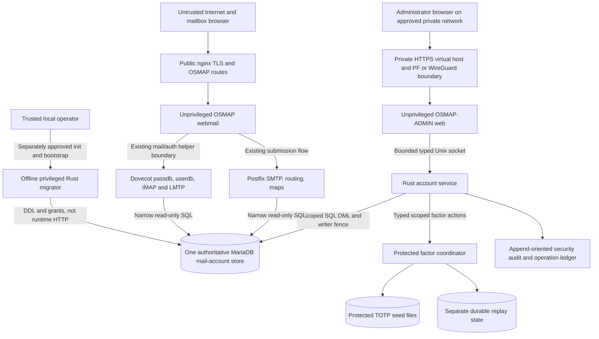
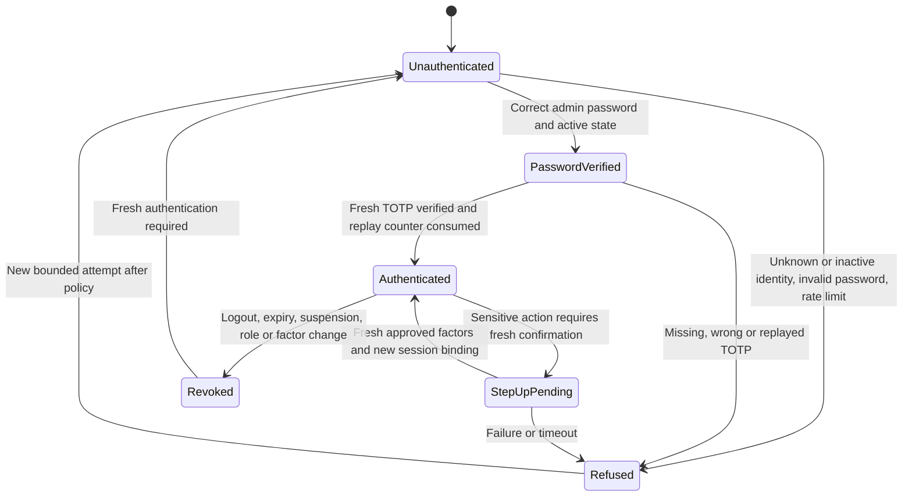

# OSMAP-ADMIN Security Model

**Repository path:** `docs/OSMAP_ADMIN_SECURITY_MODEL.md`\
**Project:** OSMAP / OSMAP-ADMIN, OpenBSD Secure Mail Access Platform\
**Version:** 0.1.0\
**Date:** 2026-11-13\
**Status:** Proposed security design and verification baseline. Not an implemented feature, a completed assessment, or a production authorization.\
**Scope:** Administrative authentication, authorization and RBAC, privilege separation, authenticated sessions, service-to-service trust, audit and evidence, abuse cases, threat model, failure containment, and security acceptance.

> **Change boundary:** This document authorizes no host, MariaDB, account, TOTP, configuration, routing, migration, or PostfixAdmin change. Production use requires separately reviewed implementation slices, current host-specific verification, and explicit operator acceptance. Do not interpret security requirements as evidence that OSMAP-ADMIN is already implemented.

## 1. Purpose and security objectives

OSMAP-ADMIN is the planned **separate private Rust administrative control plane** for an OSMAP installation. It is intended to replace required PostfixAdmin administration functions without replacing Postfix transport, Dovecot authentication/IMAP/LMTP, MariaDB, the established OpenBSD mail stack, or OSMAP's public mailbox-user application.

The governing repository documents are:

- [OSMAP-ADMIN system architecture](OSMAP_ADMIN_SYSTEM_ARCHITECTURE.md)
- [OSMAP-ADMIN database design](OSMAP_ADMIN_DATABASE_DESIGN.md)
- [OSMAP-ADMIN identity lifecycle](OSMAP_ADMIN_IDENTITY_LIFECYCLE.md)
- [OSMAP-ADMIN project plan](OSMAP_ADMIN_PROJECT_PLAN.md), tracked in [PR #84](https://github.com/unattributed/OSMAP/pull/84)
- [Administrative user management engineering request](ADMINISTRATIVE_USER_MANAGEMENT_ENGINEERING_REQUEST.md)
- [OSMAP existing security model](SECURITY_MODEL.md) and [architecture](ARCHITECTURE.md)
- [TOTP secret management model](TOTP_SECRET_MANAGEMENT_MODEL.md), [operator recovery SOP](TOTP_OPERATOR_RECOVERY_SOP.md), and [identity-lifecycle evidence](V3_IDENTITY_LIFECYCLE_EVIDENCE.md)
- [PostfixAdmin parity inventory, issue #85](https://github.com/unattributed/OSMAP/issues/85)

This document adds **security properties, attacker assumptions, and tests** to those architecture and data contracts. It does not supersede the existing OSMAP browser, credential-freshness, or protected TOTP storage behavior.

### 1.1 Required security outcomes

| ID | Outcome | Evidence required |
| --- | --- | --- |
| SEC-ARCH-01 | A public OSMAP mailbox session never confers administrator authority. | Cross-cookie, cross-origin, direct-route, and direct-socket negative tests. |
| SEC-ARCH-02 | Admin identities, credentials, factors, sessions, and role grants have their own namespace. | Separate principal and persistence inspection; no identity inference from an email match. |
| SEC-ARCH-03 | The private web process has no database write/DDL, protected-factor write, arbitrary shell, or mail-storage access. | Effective OpenBSD UID/GID, socket/filesystem confinement, MariaDB grants, and attempted forbidden operations. |
| SEC-ARCH-04 | Each mutation is reauthorized by the Rust account service against current state and target scope. | Direct protocol authorization tests with forged actor, role, target and stale grants. |
| SEC-ARCH-05 | Exactly one writer controls authoritative mail-account state per installation. | Verified writer fencing and effective grants, including legacy helpers and PostfixAdmin. |
| SEC-ARCH-06 | Password and factor changes invalidate affected browser sessions, with truthful native-client claims. | Epoch/session tests and actual Dovecot password acceptance/rejection checks. |
| SEC-ARCH-07 | Authentication and security-relevant administration is attributable without recording secrets. | Sanitized protected audit events, denied requests, correlation, integrity and retention checks. |
| SEC-ARCH-08 | Failure, concurrency, retries, and migration uncertainty lead to containment, not an unverified success state. | Crash/retry/replay, split-state reconciliation and rollback tests. |
| SEC-ARCH-09 | Administrators cannot read private mail, protected OpenPGP private keys, or enrolled factor secrets by virtue of their role. | Negative filesystem, API, SQL, socket and rendered-UI tests. |
| SEC-ARCH-10 | Existing Postfix and Dovecot flows remain available without invoking OSMAP-ADMIN HTTP endpoints. | Controlled native routing, alias, authentication, delivery and quota verification. |

### 1.2 Existing authority and environments

1. The documented Toronto deployment currently relies on the existing `postfixadmin` MariaDB account authority. OSMAP-ADMIN begins there as a **read-only compatibility/inventory client**. PostfixAdmin stays the administrative writer until a separately approved cutover.
2. obsd1 has its own writable development `postfixadmin` database. Its **read-only Toronto reference replica is not a write target** and must never be silently promoted. Development test results do not qualify Toronto.
3. A clean installation may bootstrap the proposed native `osmap_mail` database through a privileged **local Rust migrator**. PostfixAdmin and PHP are not prerequisites.
4. All OSMAP self-service account mutations, particularly the existing password-change helper, must be inventoried and placed behind the same one-writer rule or explicitly fenced before administrative ownership changes. No competing credential store, dual-write, or hidden privileged bypass is permitted.
5. The current protected file-backed mailbox TOTP seed store and separate accepted-counter replay store remain authoritative for factors. The database carries only bounded enrollment metadata. Any factor-store redesign needs independent review.

## 2. Assets, principals, and attacker capabilities

### 2.1 Assets to protect

| Asset | Security significance | Intended custody |
| --- | --- | --- |
| `admin_identities`, credentials, system/domain grants | Global or domain-scoped ability to change real mail accounts | Separate admin credential service and narrowly authorized account service |
| Authoritative domains, mailboxes, password hashes, aliases, quota and routing flags | Control over who can authenticate, receive mail, and forward messages | Exactly one MariaDB authority; one designated runtime writer |
| Admin session tokens and step-up state | Reusable privilege for sensitive actions | Server-side admin session store with bounded bearer cookie |
| Mailbox-user OSMAP sessions and authentication epochs | Browser mailbox access and credential freshness | Existing OSMAP session/epoch mechanisms |
| TOTP enrollment seeds and accepted counters | Strong second-factor capability, replay prevention | Protected factor and separate replay stores, by subject namespace |
| Recovery approvals and setup challenges | Path to reassignment of identity control | Restricted local recovery process and digest-only token metadata |
| Writer-fence and operation journal state | Prevent conflicting ownership, retried mutations and ambiguous results | Account service and privileged migration/cutover tooling |
| Security audit and evidence | Investigation, incident reconstruction, tamper detection | Restricted append-oriented audit custody, independent export where configured |
| Maildir content, user OpenPGP private material, host secrets, backup sets | Highly sensitive user/host data outside administrative management | Existing mail and cryptographic service custody, never general admin web access |
| SQL connections and service socket | Powerful paths across OS and database trust boundaries | Dedicated OS identities, bounded local sockets and grants |

### 2.2 Principal taxonomy

| Principal | Identity source | Permitted domain |
| --- | --- | --- |
| Mailbox user | Canonical mailbox resolved by existing Dovecot/OSMAP browser path | Own OSMAP mail and explicitly permitted self-service only |
| System administrator | Stable `admin_identities.id` plus active `admin_system_grants` row | Installation-wide approved administration, never implicit mail-body access |
| Domain administrator | Stable admin ID plus explicit `admin_domain_grants` records | Approved domain-scoped administration, not cross-domain/system grants |
| Admin web process | Dedicated unprivileged OpenBSD service identity | Render UI, authenticate admin, manage bounded session and invoke typed local socket |
| Rust account service | Distinct OpenBSD service identity and scoped SQL writer | Server-side policy, revision/fence checks and authorized account mutations |
| Rust factor coordinator | Separate protected service identity | Subject-scoped enrollment, verification, rotation/revocation and replay access |
| Audit writer/custodian | Restricted service or approved facility | Append/forward non-secret audit events, verify integrity |
| Privileged bootstrap/migrator | Local, explicitly authorized operator process | Initial schema/grants and one-time first-admin bootstrap; not a web API |
| Postfix lookup identity | Dedicated MariaDB read-only principal | Only necessary routing, recipient and alias projections |
| Dovecot lookup identity | Dedicated MariaDB read-only principal | Only necessary passdb/userdb and quota projections |

A system administrator may also personally own a mailbox. These are **two independently authenticated principals**. A matching contact email, display name, identity string or browser login is never a join condition that grants rights.

### 2.3 Attacker model

Assume a remote attacker may control arbitrary HTTP requests, headers, cookies, bodies, redirects and timing; possess leaked mailbox credentials, a compromised VPN endpoint or browser session; manipulate an alias destination or attacker-controlled domain; race authenticated operations; and probe exposed service sockets or files after an unprivileged foothold. Also model a malicious or mistaken domain administrator, an operator using wrong host/database targets, a stolen admin password without a factor, and partial compromise of the web process.

Do **not** assume WireGuard membership, localhost origin, a reverse-proxy address, TLS termination, a `Host` header, an `X-Forwarded-For` value, a cookie, or a caller-supplied role is itself proof of administrative identity. Separately treat complete root/DBA/host takeover as a high-impact residual risk requiring host controls, protected backup custody and out-of-host detection. The app's RBAC cannot confine an attacker who legitimately controls the operating system or MariaDB administrator account.

## 3. Trust boundaries and data flow

The diagram is a **target design**, not an implementation inventory. An account-service or factor-coordinator logical boundary may share reviewed Rust crates, but runtime principals and privileges must remain separated as specified.

### 3.1 Boundary control inventory

| Boundary | Attack or failure | Required controls | Fail-closed test |
| --- | --- | --- | --- |
| Public internet to OSMAP | Discover admin route or reuse public credentials | Distinct admin origin/listener, nginx and PF routing, deny public proxy mapping | From public network, admin endpoint unreachable or explicitly denied |
| Private network to admin HTTPS | VPN peer without admin identity; spoofed Host/forwarded headers | Independent password + TOTP, hardened TLS, exact Host/Origin validation, bounded proxy trust | Invalid host, untrusted forwarding, missing factor and peer-only access denied |
| Admin browser to web runtime | CSRF, XSS, cookie theft/fixation, automation, request smuggling | Server-rendered safe output, bounded request parser, CSRF, headers, session rotation, login throttling | Forged CSRF/origin, poisoned cookie and malformed requests denied |
| Admin web to account-service Unix socket | Web compromise, forged actor, role, session, method or target | Filesystem-mode/OS peer identity, typed versioned protocol, server-side session/grant readback | Direct socket forgery and wrong UID refused |
| Account service to MariaDB | Excessive SQL privilege, stale write owner, injection, race | Parameterized fixed SQL, least privileges, fence epoch, revisions, constraints and transaction journal | Wrong writer/stale revision/SQL injection denied |
| Account service to factor coordinator | Unauthorized seed access or subject confusion | Typed method allowlist, per-subject capability, no-overwrite, independent replay, protected paths | Seed extraction, wrong subject and replay denied |
| OSMAP to account service | User settings bypass central mutation owner | Explicit owner-scoped capability and selected write contract | Cross-mailbox, forged owner or duplicate writer denied |
| Postfix/Dovecot to MariaDB | Lookup account can mutate metadata or read admin tables | Separate read-only principals/views with proven effective grants | Write/DDL/admin-table access denied |
| Bootstrap/migrator to host and DB | Wrong database, re-run, unauthorized production activation | Local-only operator authority, exact target proof, snapshots, checksums, no web endpoint | Wrong target/partial schema/duplicate bootstrap refused |
| Audit and backup custody | Data leakage, forgery, deletion, loss of replay state | Secret filtering, protected append/export, integrity checks, controlled restore | Web writer cannot erase audit or read backup secrets |

## 4. Administrator authentication

### 4.1 Identity and credential verification

1. Administrative login accepts only the admin identity namespace, keyed by a stable ID and a canonical admin login. The source is **not** the Dovecot mailbox credential table. Administrator credentials may use independently selected, reviewed password hashing, as defined during Phase 0 against the actual Rust verifier and OpenBSD target.
2. Authentication checks account state (`pending`, `active`, `locked`, `disabled`, `retiring`), permitted login policy, current credential revision and `auth_epoch`. Only `active`, non-locked admins with a fully qualified active factor may receive ordinary admin sessions.
3. Compare submitted credentials safely, avoid user enumeration through response text or meaningful timing differences, and implement rate limits by source and account using carefully bounded, non-enumerating responses. A lock or delay must not provide an attacker with an easy permanent denial of the only administrator.
4. Require password plus a freshly accepted **admin-specific TOTP** for normal login. Reuse the reviewed OSMAP TOTP verifier behavior where practical, including six-digit/30-second defaults, accepted-counter persistence and rejection of repeated or concurrent use, but give admin subjects a distinct protected store namespace.
5. Use a CSPRNG for credentials requiring randomness, setup tokens and session identifiers. Never allow caller-selected admin IDs, token values, session IDs, factor references or recovery keys.
6. Treat TOTP as a shared-secret possession factor that is vulnerable to real-time phishing. Private connectivity, correct TLS origin checks and step-up reduce risk but are not phishing-resistant guarantees. Phishing-resistant authenticators, if later supported, require a separately designed verifier and lifecycle.
7. The initial admin is established by a **one-shot local bootstrap** that works without an existing mailbox or domain. No unauthenticated HTTP setup route, permanent recovery user, universal password or factor bypass is allowed.

### 4.2 Authentication state machine

**Partial login admission:** Do not issue a normal admin bearer session after password verification alone. A temporary challenge record, if needed, is short-lived, narrowly bound, has no privilege to read inventory or mutate accounts, and is not interchangeable with an admin session. A second-factor replay rejection is not bypassed by restarting the flow.

### 4.3 First-admin bootstrap and administrator invitations

- The local bootstrap verifies selected empty/known schema state, exclusive operation identity, intended admin subject, protected factor path, and lack of an already qualified first system administrator. It creates `pending` admin state and an independently installed factor with owner-proved possession before activation.
- An existing system administrator may create another `pending` admin and issue a limited setup challenge. Enrollment is performed by the invited subject, not by revealing a permanent TOTP seed to an existing administrator.
- Domain administrators cannot create system-admin grants, grant their own new domain scope, reset a system admin password/factor, or access the first-admin bootstrap command.
- A forgotten factor or password is handled by the governed recovery procedure, not by treating an already-active identity as a fresh invitation.
- Protect the last qualified system-administrator path from ordinary removal or demotion. Break-glass recovery is offline, auditable, narrowly authorized and must never be exposed as a normal web login mode.

### 4.4 Password and factor events

| Change | Admin/browser consequence | Native mail consequence |
| --- | --- | --- |
| Admin password change/reset | Verify owner or recovery authority, advance admin `auth_epoch`, revoke all affected admin sessions | None unless the admin separately owns a mailbox and its credential is changed through that separate identity |
| Admin TOTP rotate/revoke/recover | No-overwrite protected transition, durable replay isolation, revoke affected admin sessions and require new factor proof | None implied |
| Admin role assignment/revocation | Recheck grants at service boundary; invalidate or epoch-fence affected sessions immediately | Postfix/Dovecot lookup authority unchanged |
| Mailbox-user password change | Preserve selected OSMAP account epoch, revoke affected OSMAP browser sessions and verify Dovecot old-password rejection/new acceptance | New native authentication changes; already-authenticated connections may persist |
| Mailbox-user TOTP change | Reconcile protected factor state and revoke OSMAP browser sessions | Native IMAP/SMTP remains separate unless an independently deployed auth policy says otherwise |
| Mailbox/admin disablement | Refuse new browser admission, invalidate matching sessions and verify declared backend effects | Mailbox auth/delivery effect requires actual Dovecot/Postfix checks, not inference |

No security claim may confuse browser session revocation with forced termination of an existing native IMAP or SMTP connection. Dovecot auth caches and the host's effective configuration must be observed before asserting credential changes take effect.

## 5. Role-based and attribute-based authorization

### 5.1 Roles and independent authorization checks

The initial role set is **system administrator**, **domain administrator**, and **mailbox user**. Mailbox user is not an admin role, and cannot authenticate to OSMAP-ADMIN. A separate OS operator or service identity is not equivalent to a human system administrator.

The Rust account service is the **policy enforcement point** for every privileged operation, including browser, CLI and operator tooling. The OSMAP-ADMIN web may reject an obviously prohibited request early, but its decision is not sufficient. The service independently establishes caller identity and **current** grants and checks:

- Exact authenticated admin subject and enabled/locked state, or a separately defined owner-scoped OSMAP self-service principal.
- Typed action/capability, target object type and canonical stable identity.
- Installation and domain scope, including source domain and every affected dependent object.
- Object state, expected revision, applicable domain/installation policy and privilege escalation constraints.
- Required recent authentication and step-up proof for high-impact operations.
- Writer mode, selected authority, fence epoch, idempotency key and mutation preconditions.
- Whether the action would remove the last qualified system admin, bypass retention or enable an impermissible account transition.

The account service must not trust a `role`, `admin_id`, `domain_id`, `auth_time`, or `step_up=true` string supplied in the request body. Session authority must be resolved from a trusted server-side session record or a separately designed, audience-bound, short-lived signed capability that is validated end-to-end. If the socket crosses a privilege boundary, relying solely on the peer UID authenticates a **process**, not the individual browser administrator. The service must retrieve or independently validate the bound human session and its current epoch/grants.

### 5.2 Authorization matrix

| Operation | System admin | Domain admin | Mailbox user via public OSMAP |
| --- | --- | --- | --- |
| Read installed domain/mailbox/alias inventory | Installation scope | Explicitly assigned domains only | No admin inventory |
| Create domain, retire domain, change global policy | Allowed with step-up | Denied | Denied |
| Edit domain limits, active status and permitted settings | Allowed with step-up where sensitive | Assigned domain only, within installation policy | Denied |
| Create, disable, reactivate or retire mailbox | Allowed, with step-up for risky actions | Assigned domain, allowed by local policy | Denied |
| Set mailbox quota/display name | Allowed within host policy | Assigned domain and configured limits | Own allowed profile fields only |
| Edit alias, forward or catch-all | Allowed subject to destination policy | Assigned **source** domain only; no cross-domain admin grant inferred | Own forwarding only if separately enabled through same writer |
| Create, disable or grant system administrator | Allowed with step-up, last-admin safeguards | Denied | Denied |
| Create, disable or scope domain administrator | Allowed with step-up | Denied in initial release | Denied |
| Reset mailbox password or initiate factor recovery | Allowed after independent identity/containment procedure | Assigned mailbox only if explicitly approved | Own reviewed self-service or separate recovery process |
| Change own password or factor | Own admin identity, separate admin journey | Own admin identity, separate admin journey | Own mailbox identity in OSMAP |
| Read or export mail contents, OpenPGP private key or established TOTP seed | Denied by admin plane | Denied by admin plane | Own mail only through normal OSMAP, not factor seed retrieval |
| Execute schema migrations, grant SQL rights, restore backups | Not through browser; approved offline operator only | Denied | Denied |
| View protected audit summary | Installation scope, redacted | Own authorized events if policy permits | No admin audit |
| Delete or alter audit history | Denied | Denied | Denied |

Domain administrator permission over an alias **source** does not authorize changing a mailbox, domain configuration, or rights in its forwarding **destination**. For cross-domain local aliases and catch-all behavior, determine permitted target references under verified policy, and verify recursive/loop effects. Creating an alias cannot delete the mandatory local-delivery mapping of a mailbox through an unreviewed edit.

### 5.3 Sensitive operations requiring step-up

Require a recent successful reauthentication using current credentials and MFA, plus object revision and explicit UI confirmation, before: granting or demoting administrators; changing domain scope; changing or resetting another person's credential/factor; enabling external forwarding or catch-all under risky policy; disabling/retiring a domain or mailbox; altering account delivery/auth policy; mass/bulk changes; exporting privileged metadata; and authorizing retention/purge or cutover.

**Proposed policy, to validate in Phase 0:** treat step-up evidence older than **5 minutes** as stale. This is a security-design default, not a claim that the existing OSMAP runtime or any official standard mandates that exact duration. Require a fresh proof for each independently high-risk operation or tightly bounded transaction group. Rotating the session identifier on step-up and binding confirmation to action and target prevents reusing a generic recent MFA flag for an unrelated destructive action.

### 5.4 Authorization decision record

For each request, the service returns a bounded typed result such as `allowed`, `denied`, `conflict`, `stale`, `unavailable`, or `uncertain`. A successful authorization decision is **not** a successful mutation. The operation journal and post-commit verification determine the actual effect. Never issue a success response when SQL commit or required factor/session/native readback is uncertain.

An acceptable policy decision includes: authenticated principal and trusted session reference, action, canonical target, affected domains, grant/epoch version, step-up verification, expected revision, writer epoch, operation ID, decision reason class, and sanitized audit correlation. A refusal returns no secret, no foreign-domain inventory and no internal SQL error details.

## 6. Administrative session management

### 6.1 Session design

- Admin session cookies have a **distinct name, host, path, store and signing/key context** from OSMAP user cookies. Never share or exchange tokens across products. Prefer a host-only cookie with `Secure`, `HttpOnly`, appropriate `SameSite`, and no `Domain` attribute. Enforce HTTPS on the selected admin origin.
- Use server-side opaque session handles from an OS CSPRNG with at least **128 bits of unpredictability**, preferably more. Persist only a cryptographic digest of the bearer token when practical. Never log tokens or put them in URLs.
- Rotate the session handle on successful login, step-up and privilege transition. Old handles are immediately invalid. A session is bound to immutable admin ID, authentication time, MFA completion, issued and last-activity time, absolute expiry, trusted credential/role epoch and revocation state.
- On **every** privileged request, resolve current session and admin state, expired/revoked flag, effective grants and current epoch. A cached role claim cannot survive revocation.
- Implement logout through a state-changing, CSRF-protected action. Invalidate on logout, inactivity expiry, absolute expiry, account lock/disable/retirement, credential/factor change, and role grant change.
- A stolen but not yet revoked bearer cookie is a live risk. Network and device attributes may assist risk monitoring, but automatic hard IP binding can disrupt legitimate roaming/VPN changes and is not a substitute for reauthentication.
- Admin session creation and revocation must be safe under concurrency and storage failure. If the authoritative session/epoch store cannot be consulted, refuse privileged operations rather than accept stale signed cookies.

### 6.2 Proposed timeout baseline

The following are **design defaults subject to Phase 0 risk review**, not observed deployed configuration or automatic NIST compliance claims:

| Session class | Idle timeout | Absolute lifetime | Authority |
| --- | --- | --- | --- |
| Administrator normal session | 15 minutes | 8 hours | Admin UI inventory and allowed low-risk actions |
| Step-up confirmation | 5 minutes | Single intended operation or bounded transaction | Only specifically confirmed sensitive action |
| Password-only pre-MFA challenge | 5 minutes | 5 minutes | Submit the pending login's factor, nothing else |
| First-user or first-admin setup invitation | Policy-bound short life, default 15 minutes after first admission | 24 hours from issue unless shortened by risk policy | A single bound credential/factor enrollment action |
| Local operator break-glass | No browser session | Limited to authorized local procedure | Exactly reviewed restoration operation |

Choose and record final values on the target host; support server-side early revocation and reasonable per-admin parallel-session limits. Rate limits and lockout duration must not allow indefinite denial of the only system admin by remote guessing. An inactivity timeout is checked server-side using trusted time; client JavaScript countdowns, if ever introduced, are informational only.

### 6.3 Session epoch and storage contract

The proposed `admin_identities.auth_epoch` invalidates sessions after changes to administrator credentials, factors or grants. Store session records separately in an intentionally limited admin state store; **do not invent a second mailbox-password authority**. If the current OSMAP session mechanism offers reusable reviewed primitives, share code while keeping independent namespaces, keys, data and revocation semantics.

The OSMAP mailbox-user session epoch and account-credential freshness rules remain unchanged until a separately tested integration. If updating the database and the session store is not atomic, impose an admission barrier, durably record the pending transition, reconcile and refuse old sessions until the intended epoch effect is proven. Do not hide session failure behind a successful SQL response.

### 6.4 CSRF, origin and browser hardening

State-changing admin requests require a session-bound unpredictable CSRF token or an equally reviewed request-forgery defense, strict content type, verified exact Origin where supplied, approved Host and trusted proxy policy, and no unsafe state changes by GET. Do not treat `SameSite` alone as CSRF protection. Use secure redirect handling and prohibit open redirect targets. Set a restrictive Content Security Policy compatible with server-rendered UI, escape all displayed names, addresses and audit fields, and never render attacker-controlled HTML as privileged markup.

Reject ambiguous request parsing, duplicate security-sensitive form keys, oversized bodies, excessive header counts, invalid HTTP methods and inconsistent content-length/transfer-encoding handling at the actual edge and application. Reuse existing OSMAP request-boundary lessons but do not assume its successful public tests automatically qualify the new admin origin.

## 7. Rust service and OpenBSD privilege separation

### 7.1 OS identity and socket policy

Each process has a dedicated service UID and only its required group memberships. The admin web can connect to **only the scoped account-service socket**. The socket is not world-accessible, is held in a protected directory with reviewed owner/mode, and its server verifies the local peer's effective UID/GID, such as through OpenBSD `getpeereid(3)` on applicable stream/seqpacket sockets. The service must still authenticate the **human admin session** separately. The socket path itself is not a secret credential.

The account service has no reason to read Maildir bodies, OpenPGP private keys, TOTP seed files, OS password databases, mail configuration writable paths, or unrestricted shell executables. A separately scoped factor coordinator owns minimum paths needed for seed/replay operations. The privileged local migrator is normally absent from the runtime service graph. The operator CLI uses the same account-service authorization unless invoking a separately authorized local bootstrap or migration action.

Use OpenBSD `pledge(2)` and `unveil(2)` where compatible with observed runtime/library behavior. Select actual promises and path allowlists from the implemented system calls and dependencies, then lock down further after initialization. Do not paste a guessed pledge promise set into production or claim that `unveil` replaces filesystem ownership or Unix socket permissions.

### 7.2 Effective privilege matrix

| Process | Network/socket | SQL | Filesystem/secret | Forbidden escalation |
| --- | --- | --- | --- | --- |
| Admin web | Private loopback-bound HTTP, permitted account socket | None | Read-only templates/config required for rendering, own session access | No SQL DML/DDL, factor files, shell, mail data, privileged configuration |
| Account service | Protected local socket, selected MariaDB endpoint | Narrow account writes and approved reads | Non-secret operation state and authorized audit path | No schema DDL, general DB admin, factor seed read/write, Maildir/private keys |
| Factor coordinator | Private typed service boundary only | No mail authority; narrow metadata path if specifically approved | Protected factor seeds and replay state under separate confinement | No domain/mailbox table write or general host control |
| Postfix | Configured native submission/routing flow | Read-only effective maps | Its existing native spool/config ownership | No admin identity or factor lookup |
| Dovecot | Configured native auth/IMAP/LMTP flow | Read-only passdb/userdb/quota | Existing mail storage under native policy | No admin identity or factor write grants |
| Local migrator | Operator-local invocation only | Controlled DDL/grants on proven target | Protected versioned migration scripts/receipts | Not callable from HTTP, not persistently running as bootstrap service |
| Audit custodian | Native logging/forwarding channel | Append and readback only as designed | Protected audit integrity files | No account modifications or audit rewrite |

Each SQL principal's actual `SHOW GRANTS` and real connection identity must be tested. In MariaDB, grants are evaluated by account/host and may differ for local socket and TCP connections. Do not treat table-level `SELECT` as harmless if a view or stored procedure expands its effective privileges. Postfix and Dovecot need only selected projections, not administrator credential or audit tables. The database design's proposed grants are a starting contract; verify view definers and locking semantics against installed MariaDB.

### 7.3 Typed account-service protocol

The reviewed service protocol should define: version, operation ID, trusted session reference, requested action, canonical target, expected revision, optional step-up proof binding, writer/fence version, bounded payload length and an explicit result class. Every method is allowlisted, schema-validated and authorized before data access. No generic SQL string, arbitrary filesystem path, executable command, transport command or shell expression is accepted from the admin web.

**Direct socket callers are first-class adversarial test subjects.** The service checks socket peer and admin principal, not merely web route admission. It rejects messages that switch subject mid-connection, reuse a consumed step-up, alter a target after confirmation, contain trailing unparsed bytes, exceed budgets or replay an idempotency key with different payload.

### 7.4 Single writer as a security boundary

The proposed `writer_control` table records selected authority, writer mode, holder and monotonic fence epoch. This is **necessary but insufficient**: PostfixAdmin and legacy scripts ignore the record unless their effective SQL write access and execution routes have actually been fenced. Cutover must revoke or otherwise prove denial of all competing writers, including existing OSMAP credential update paths and scheduled jobs.

Mutation requires server-side identity/RBAC, locked current writer state, expected row revision, canonical target, parameterized SQL, an idempotent operation journal and verification. If the old writer still has effective write access, OSMAP-ADMIN must not claim exclusive authority. Unknown writer state means **read-only containment**, not speculative continuation. Audit the writer handoff and each failed competing write attempt.

## 8. Factor, recovery and lifecycle security

### 8.1 Existing factor contract

Mailbox-user factor seeds remain protected file-backed records under the configured `OSMAP_TOTP_SECRET_DIR`, with filename derivation based on established canonical identity and a separate accepted-counter replay store. Do not overwrite an existing seed, reset a replay counter, silently rotate a factor or migrate the store as an incidental admin feature. Factor files must refuse unexpected symlinks, unsafe ownership and permissive modes. Admin subjects require **separate** seed paths, identity encoding and replay namespaces.

The SQL `mailbox_enrollments` and `admin_enrollments` tables may store state, opaque factor references, digest-only single-use setup tokens, expiry and revisions. They must never store raw seed, OTP, accepted replay counter, plaintext reset token, or retrievable credential. A redacted factor status is not evidence of the actual protected-store state until reconciled.

### 8.2 Enrollment and activation

- Create mailbox and required local-delivery alias through the one authoritative writer, with correct password scheme and Postfix/Dovecot lookup proof.
- Keep browser access in a pending state. Decide and document separately whether **native IMAP/SMTP** may authenticate before user TOTP activation. OSMAP browser TOTP does not automatically block native protocols.
- Issue a short-lived, random, single-use setup authority bound to canonical/stable subject, operation, expiry and revision, delivered over an independently verified channel available **before mailbox access**. Store only a digest.
- The mailbox owner, not the administrator, normally receives the candidate TOTP seed in a restricted HTTPS enrollment flow. Provisioning URIs and QR codes are secrets and must not enter URLs, logs, retained screenshots, external image services or analytics.
- Require proof of a new code, consume its time step durably and reconcile no-overwrite factor installation before marking the browser identity eligible for ordinary password-plus-TOTP login.
- Deny standard mailbox navigation or admin actions to a limited setup session. A successful SQL `active` flag alone is insufficient when protected factor state is absent.

### 8.3 Recovery and revocation

Lost-factor or forgotten-password recovery is an **identity re-proofing and containment** operation. Require the established signed, short-lived operator approval where applicable, independently verify the actual person and host/account state, enforce role scope and fresh step-up, and record what was checked. An approval signature does not itself prove real-world identity verification. A token emailed only to a potentially compromised mailbox is not an independent recovery channel.

Preserve or revoke an old factor using reviewed digest/state compare-and-swap. Never reveal the old secret or wipe accepted counters merely to restart the process. Revoke browser sessions and barrier future admission until the new protected factor, SQL metadata and epoch state agree. A domain admin may recover a mailbox factor only if explicit installation policy permits; it may never recover a system administrator factor.

For the sole system administrator's loss of access, use a separately approved **offline break-glass procedure**, with custody, authorization, factor restoration, post-event review and session revocation. No permanent web bypass account, static emergency code or unaudited direct database escalation is acceptable.

### 8.4 Suspension, reactivation and retirement

Suspension and retirement must name effects separately for: OSMAP browser admission, new Dovecot native authentication, existing native sessions, inbound recipient acceptance, local delivery and retained mailbox storage. Disabling a browser subject cannot be represented as proof that Postfix stopped delivery or that active IMAP sessions closed. Reactivation requires exact state readback and cannot silently resurrect a revoked factor or session.

Domain/mailbox retirement is staged with alias dependency inspection, preservation/export/retention decisions, explicit privileged purge if ever authorized, and no automatic Maildir deletion. Reusing a formerly retired canonical mailbox address must be blocked until a reviewed identity-rebinding/tombstone design prevents inheritance of previous factor filenames, replay state, sessions, mail bytes, aliases and private keys.

## 9. Audit, monitoring and evidence

### 9.1 Minimum event model

Record at least: schema version, event ID, UTC timestamp with trustworthy clock source, installation/host identifier, actor namespace and stable ID, session or operator correlation (not raw token), source-channel classification, typed operation, canonical target and domain scope, request/operation ID, authorization and step-up decision, expected and resulting object revision, writer epoch, outcome (`allowed`, `denied`, `committed`, `reconciled`, `uncertain`, `failed`) and a bounded reason code. Capture before/after **non-secret** metadata or digests only where required for change reconstruction.

| Event family | Examples | Required coverage |
| --- | --- | --- |
| Authentication | Successful/failed password/MFA, rejected replay, lock/delay, initial bootstrap | Outcome, principal category, source and correlation without exposing credential |
| Session | Login, rotation, logout, timeout, revocation, stale epoch, step-up | Target session digest/reference and reason, never raw bearer |
| Authorization | Denied direct socket, cross-domain access, grant changes, forbidden export | Actor, capability, canonical target and reason class |
| Account mutation | Domain/mailbox/alias/quota/password changes, suspension, retirement | Revision/operation ID, effective scope, outcome and native readback status |
| Factors/recovery | Enrollment, rotation, revocation, failed proof, signed approval disposition | Subject and approval receipt/digest, no seed, OTP or identity document |
| Writer/migration | Writer freeze, grant revoke, fence epoch change, schema migration and rollback | Source/target authority, checksums, approvals, readback and uncertainty |
| Security control | Invalid CSRF/Host, unknown protocol method, injected SQL, confinement denial | Minimal safe context and alertable reason |
| Audit integrity | Export status, missing sequence, failed chain/hash check, clock anomaly | Custody/reconciliation outcome and operator notice |

### 9.2 Confidentiality, integrity and availability

- Never log passwords, stored hashes, raw TOTP seeds/codes, recovery tokens, setup URIs, private keys, session cookies, API bearer tokens, full sensitive SQL bind parameters or mailbox contents. Avoid logging raw request bodies and query strings on credential/factor routes.
- Sanitize newlines, control bytes and structured fields before emitting logs to prevent log injection. Use structured schemas, bounded field lengths and approved sensitive-data classification.
- Administrative audit is append-oriented. **A hash chain alone is not tamper-proof** if its writer or signing key is compromised. Use protected custody, independent periodic export/verification and an explicitly reviewed integrity design. Web and ordinary admin principals cannot update or delete historical events.
- Preserve audit continuity across restart, database migration and writer handoff. Retain the stable actor ID when an admin identity is retired; do not delete historical events by FK cascade. A failed audit emission for a required high-risk mutation must block or quarantine the operation according to a tested transaction/receipt strategy.
- Bound log throughput to avoid exhaustion. Alert on bursts of failed auth, factors replays, denied cross-domain operations, unexpected SQL grants, writer-fence conflicts, first-admin recovery and audit/backup integrity failures.
- Define retention, rotation, archival, privacy access and protected deletion as installation policy. Avoid collecting high-cardinality personal data or unnecessary identity proofs. Keep raw evidence and backups outside public repositories; sanitized test reports preserve correlation without disclosing secrets.

### 9.3 Audit versus operation journal

The `operation_journal` tracks idempotency and cross-store reconciliation; `audit_events` records actor/decision/effect history. These are distinct responsibilities even if implemented in the same MariaDB authority. A successful authorization event cannot substitute for a committed operation, and a row update cannot substitute for native Postfix/Dovecot verification. Prefer an atomic SQL mutation plus journal receipt, followed by append/export of an independent security audit event; if audit writes are asynchronous, define durable pending delivery and fail-closed handling for sensitive operations. Never delete an event to make a test succeed.

## 10. Threat model and misuse cases

Risk levels below are **design prioritization**, not quantitative production risk scores. Reevaluate them after Phase 0 host and code review, and record likelihood/impact evidence separately.

| Threat ID | Threat or misuse | Trust boundary | Priority | Mitigation and acceptance criterion |
| --- | --- | --- | --- | --- |
| THR-01 | Mailbox user calls admin endpoint with valid OSMAP cookie | Public to private admin | Critical | Distinct route/origin/cookies; ordinary mailbox identity denied by web and direct service |
| THR-02 | Stolen admin password without factor | Admin authentication | High | TOTP, throttling, no weak recovery; password-only never yields privileged session |
| THR-03 | Phished valid password/TOTP/session | Admin browser | High | Exact TLS origin, short-lived one-use TOTP, session rotation, step-up; document residual real-time phishing risk |
| THR-04 | Stolen admin cookie or session fixation | Browser/session | High | High-entropy opaque token, secure cookie, rotation, revocation, expiry and epoch readback |
| THR-05 | CSRF or malicious page triggers domain/mailbox mutation | Browser/web | High | Origin/Host/CSRF, same-site controls, no GET mutation, scoped confirmation |
| THR-06 | XSS through mailbox name, alias or audit field | Browser/web | High | Contextual output encoding, strict CSP, no unsafe HTML, template tests |
| THR-07 | Domain admin edits foreign domain or grants system rights | Web/service | Critical | Server-side current grants and all-object scope checks; direct socket negative tests |
| THR-08 | Alias forwarding to hostile destination hides exfiltration | Business logic/Postfix | High | Scope source, explicit external forwarding policy, step-up/audit, native routing proof |
| THR-09 | Web process sends forged actor/role or arbitrary SQL through helper | Unix socket/service | Critical | Peer/process checks plus independent subject/session resolution, typed allowlist, no generic SQL |
| THR-10 | SQL injection or unintended wildcard/normalization collision | Service/DB | High | Canonicalization, fixed parameterized SQL, uniqueness, strict limit/collision tests |
| THR-11 | Legacy PostfixAdmin/OSMAP helper continues writing after cutover | Writer/DB | Critical | Actual credential/grant fencing, writer epoch, stale-worker and race tests |
| THR-12 | Concurrent resets, alias changes or retries duplicate side effects | DB/multiple stores | High | Revision CAS, journal idempotency, fixed lock order, deterministic reconciliation |
| THR-13 | Factor seed leaked in QR/log/database/evidence | Factor/browser/audit | Critical | One-time owner display, protected file custody, no raw-secret logging or SQL columns |
| THR-14 | TOTP counter replay or reset during restore/recovery | Factor/replay | High | Durable independent counter store, lock/compare-and-record, fail closed on missing replay state |
| THR-15 | Recovery approval used without real identity proof | Operator/recovery | Critical | Independent attestation and containment, signer/scope/expiry checks, audit |
| THR-16 | Password or role change leaves old browser sessions valid | Session/DB | High | Epoch barrier, immediate revoke, direct old-token negative test |
| THR-17 | Native auth remains active despite browser suspension | Dovecot/OSMAP | High | Explicit separate native policy, passdb tests and documented existing-session limits |
| THR-18 | Admin accesses Maildir/private keys through generic endpoint | Host/filesystem | Critical | No mail content/read paths, OS confinement, direct denial tests |
| THR-19 | Overbroad Postfix/Dovecot SQL grants expose admin hashes | SQL consumers | High | Read-only projection-specific grants, real `SHOW GRANTS` and connection tests |
| THR-20 | Audit manipulated, missing or secret-bearing | Audit custody | High | Restrict append/export, sanitize, integrity checks, fail-closed critical mutation handling |
| THR-21 | Wrong-host bootstrap or MariaDB schema drift corrupts live mail | Migrator/host | Critical | Known-target proof, checksums, backup/restore, unknown-schema refusal, no public init |
| THR-22 | Address reissued and inherits prior owner factor or mailbox | Identity lifecycle | Critical | Tombstone/rebinding quarantine, no implicit Maildir/seed reuse |
| THR-23 | Host compromise/root/DBA changes records beyond Rust policy | Host/DB | Critical residual | Patch/monitor/backup separation, offline restoration and independent custody; application RBAC cannot contain root |
| THR-24 | Clock skew lets invalid TOTP pass or breaks audit chronology | Host/factor/audit | Medium | Verified secure time source, bounded accepted window, monotonic expiry handling where possible, clock-anomaly alert |
| THR-25 | Denial of service by login/CSRF/audit floods | Admin listener/runtime | High | Request budgets, rate limits, bounded queues, lockout policy and backpressure |
| THR-26 | Reverse proxy accidentally exposes admin listener | Edge/private network | Critical | Config review plus public negative reachability test, PF default-deny and separate origin |

### 10.1 Attack trees worth testing

**Domain privilege escalation:** obtain a domain-admin session, change the `domain_id` or target address in the browser payload, invoke the socket directly, try bulk aliases and forwarding destinations, and race a grant revocation. The attack fails only if **every** route independently denies out-of-scope effects and no target data leaks in errors, counts or audit views.

**Account takeover through recovery:** obtain a mailbox address and perhaps its password, trigger factor reset, control a forwarding destination, reuse a setup link, replay the signed operator approval or seek domain-admin assistance. The path must not activate until independently attested identity, properly scoped approval, no-overwrite factor transition, native credential containment where required, and fresh code possession pass.

**Writer confusion:** activate Rust writer while PostfixAdmin, an OSMAP password helper or maintenance script still has active SQL write access; deliberately race password, alias and mailbox status changes. The system must refuse cutover or eliminate competing writes before issuing a Rust-writer success receipt.

**Partial-store corruption:** crash after SQL update but before factor/session receipt or vice versa; restart with a repeated operation ID; rotate a secret while a previous factor remains installed. The outcome must be contained, reconciled and auditable, never a silent success or irreversible data loss.

## 11. Secure operating posture

### 11.1 Build, change and deployment controls

Implement security boundaries as separately reviewable Rust changes with focused negative tests. All code must pass the repository's current build, security, static analysis and signature/review workflow before native installation. The normal repository security gate and signed commits are necessary project evidence, but not evidence of an installed admin service.

Inspect the actual OpenBSD release, nginx, PF, WireGuard listener, MariaDB version/grants, Postfix SQL maps, Dovecot passdb/userdb/quota rules, Rust workspace, OS service accounts and OSMAP factor/session configuration before freezing privileges or routes. Use current upstream vendor syntax; documentation examples are not an unconditional deployment recipe.

### 11.2 Backups, restore and incident response

A recoverable installation includes consistent account data/schema and migration ledger; writer-control and pending operation records; actual mailstack configuration; protected factor seed and **replay counter state**; session/epoch data necessary to prevent stale admission; required signed recovery approvals; and independently retained Maildir content and key material under their native custody. Restore must not lower factor replay history or revive retired sessions. A restored database is not automatically an authoritative state if newer account/mail changes exist.

On compromise or ambiguous state: contain the private admin entry and current mutation writer, preserve evidence, revoke affected sessions and credentials, identify all authority paths, reconcile SQL/factor/session/native mail effects, and only then reactivate a verified writer. Root compromise requires host recovery and key/credential rotation plans beyond OSMAP-ADMIN application RBAC.

### 11.3 Monitoring and operational alerting

Alert on new system-admin grants, changes to last-admin state, repeated admin MFA failures/replays, protected factor file ownership changes, cross-domain denials, new external forwards/catch-all, unexpected SQL grants or legacy writer activity, unexpected admin-origin exposure, audit integrity failures, unknown schema migration attempts and incomplete account/factor operations. Reports should carry request IDs and non-secret outcome evidence, not credential bodies or raw protected files.

## 12. Security acceptance test catalogue

**Evidence rule:** Each case records selected host, installed versions, account/domain fixture, actor and role, revision/epoch, test timestamp, expected result, observed result, sanitized artefact reference, and PASS/FAIL/UNKNOWN/NOT RUN. Local source tests and obsd1 evidence are not Toronto or general-production acceptance. Only disposable authorized accounts are used for active negative testing.

| Test ID | Test objective | Passing evidence |
| --- | --- | --- |
| SM-001 | Public discovery and edge routing | Internet-origin probes cannot reach admin host/route or unapproved listener |
| SM-002 | Admin origin and TLS | Wrong Host/Origin/proxy forwarding rejected, trusted HTTPS path works |
| SM-003 | Separate mailbox/admin identities | Matching email string and mailbox session never grant admin access |
| SM-004 | Password-only and invalid MFA | No privileged admin session issued; generic responses and audit |
| SM-005 | Admin TOTP replay/concurrency | Same accepted time step fails when replayed, including simultaneous requests |
| SM-006 | Session fixation and rotation | Pre-login/old-step-up tokens invalid; newly rotated token works |
| SM-007 | Idle/absolute expiry and logout | Expired/revoked cookie denied server-side immediately |
| SM-008 | Admin epoch after credential/factor changes | Every affected old token denied, including concurrent in-flight requests |
| SM-009 | Grant revocation under live session | Removed domain/system rights denied on next service operation |
| SM-010 | Forged role or actor payload | Direct socket cannot use caller-selected role/subject or stale admin grant |
| SM-011 | Unprivileged/foreign socket peer | Unapproved UID/GID and unauthorized human session rejected |
| SM-012 | System-admin only operations | Domain admin cannot create domain, grant system role or use migrator |
| SM-013 | Domain scope positive and negative | Assigned-domain operations pass; foreign-domain reads/writes denied |
| SM-014 | Alias-source/destination scope | External forwarding follows policy; target domain confers no role |
| SM-015 | Field/row-level authorization | Hidden form fields, mass assignment and alternate IDs do not expand scope |
| SM-016 | CSRF and cross-origin mutation | Missing/wrong CSRF, Origin and Host denied before mutation |
| SM-017 | XSS/log injection | Malicious display names and audit fields are escaped/sanitized |
| SM-018 | Protocol parsing/rate limits | Oversized, malformed, duplicate, unexpected methods and floods bounded |
| SM-019 | SQL grant isolation | Admin web, Postfix and Dovecot principals cannot write or read admin secrets |
| SM-020 | Filesystem/OS confinement | Admin web cannot open protected factor, Maildir or private-key paths |
| SM-021 | Admin-only first bootstrap | No public bootstrap; repeat/wrong-target/partial run refused |
| SM-022 | Last-system-admin protection | Ordinary revocation/demotion cannot orphan recoverability |
| SM-023 | Recovery identity and approval | Stale/forged/replayed/scope-mismatched approval denied; real attestation recorded |
| SM-024 | Factor secret confidentiality | No seed, code, token or provisioning URI in SQL, logs, browser history or evidence |
| SM-025 | Factor rotation/no-overwrite | Existing protected factor preserved; fresh proof before activation |
| SM-026 | Replay state after backup/restore | Older OTP step remains denied and restored states reconcile |
| SM-027 | Mailbox password change | Dovecot rejects old/accepts new; own OSMAP sessions revoked; unrelated user preserved |
| SM-028 | Browser versus native protocol claims | Actual IMAP/SMTP authentication/delivery effects tested separately |
| SM-029 | Writer exclusivity and legacy helper | PostfixAdmin and old OSMAP writer routes cannot mutate after approved fence |
| SM-030 | Fence/revision/idempotency race | Wrong epoch, stale revision and changed-payload retry refuse safely |
| SM-031 | Crash between SQL and factor/session stores | Operation remains contained/uncertain until reconciled; no double side effect |
| SM-032 | Protected audit append and redaction | Required events, denials and correlation exist; secrets absent |
| SM-033 | Audit tamper/availability test | Tampering or failed export detected; critical mutation policy honored |
| SM-034 | Provision/disable/retire behavior | Actual Postfix and Dovecot effects match per-service declared policy |
| SM-035 | Reissued mailbox address | No inherited seed, replay state, session, Maildir or keys |
| SM-036 | DB/schema and restore rehearsal | Unknown schema/failed restore blocks activation; proven safe recovery |
| SM-037 | Pre-retirement parity | P0 PostfixAdmin functionality verified or formally accepted exception recorded |
| SM-038 | Deployment review | Actual identities, grants, socket modes, nginx/PF exposure and backup custody pass |
| SM-039 | WSTG/ASVS mapping | Relevant authentication, authorization, session, CSRF, input, audit and recovery tests traced |
| SM-040 | Independent review and owner acceptance | Findings closed or explicitly accepted; test environment and residuals recorded |

### 12.1 Required authorization adversarial matrix

For **every mutable method**, cover an unauthenticated caller, a mailbox browser token, an inactive admin, a valid domain admin without target scope, a valid scoped admin, a stale role/session, a valid actor with stale object revision, a wrong writer epoch and a replayed operation ID. Run both UI-level and **direct local service protocol** variants. A front-end 403 without downstream service coverage is insufficient evidence.

### 12.2 Acceptance and release gates

1. **Phase 0 inventory:** Enumerate the installed account authority, existing helpers, admin exposure, enabled PostfixAdmin functions, native SQL lookup consumers, Dovecot auth cache, factor/session/replay state and exact service privileges. Record unknowns as blockers, not guessed PASS results.
2. **Security foundation:** Prove separate admin login, MFA, server-side RBAC, independent sessions, private listener and read-only PostfixAdmin adapter without mutating Toronto.
3. **Fresh-install boundary:** Prove first-admin bootstrap and protected factor lifecycle from a disposable clean OpenBSD/MariaDB installation, with no PostfixAdmin/PHP dependence and no public setup route.
4. **Runtime writer:** Prove least-privileged account service, exact SQL grants, one writer, revision/idempotency behavior, complete audit, and native Postfix/Dovecot effects using controlled fixtures.
5. **Identity lifecycle:** Prove user-held enrollment, credential/factor/session invalidation, administrator recovery and safe staged retirement with cross-store crash/restart tests.
6. **Existing-install cutover:** Independently review PostfixAdmin parity and every legacy writer; rehearse source/target reconciliation, rollback with post-cutover changes, audit and factor-state restore. No retirement by implication.
7. **Production acceptance:** Collect target-specific successful and negative observations, independent security review, signed project delivery evidence, explicit operator acceptance and separate PostfixAdmin retirement approval. No generic release claim from synthetic or historical host evidence.

## 13. Decisions to close before implementation

| Decision | Required owner/verification | Safe default until resolved |
| --- | --- | --- |
| Admin credential hash/verifier and password policy | Rust code and installed OpenBSD verifier review | No arbitrary new hash choice or implicit reuse of mailbox hash |
| Admin factor namespace, protected path and recovery format | Existing TOTP model + factor coordinator review | No admin factor persisted in mailbox-user directory |
| Admin session backing store, token entropy, timeout and epoch binding | Session design review, native negative tests | No admin session issuance before verified backend |
| Exact privileged socket path, UIDs, `pledge`/`unveil` profiles | Host implementation and source inspection | No public or world-writable socket |
| Domain-admin password/factor recovery entitlement | Explicit installation policy | Disabled for domain admins |
| Independent mailbox enrollment/recovery delivery channel | Operator identity-proofing workflow | No token only to an untrusted or newly provisioned mailbox |
| Native-client behavior before browser MFA activation | Dovecot/Postfix host-specific policy | Explicitly documented; never inferred from TOTP |
| Admin audit custody and integrity mechanism | Privacy/operations design and restore tests | Required mutations fail closed or become contained/uncertain without durable audit |
| Writer fencing across all existing password and account helpers | SQL-grant and source inventory | OSMAP-ADMIN remains read-only on existing installation |
| Host-specific login/step-up/session limits | Phase 0 risk decision | Use proposed defaults only in disposable fixtures |
| Recovery of sole system administrator | Offline break-glass procedure and independent review | No web emergency bypass |
| Address recycling/tombstone and factor-file naming | Identity lifecycle/security review | Reject reuse of retired addresses |

## 14. Standards and primary technical references

The security controls above are **project design requirements**. Where industry guidance is cited, it is supporting input, not a claim of certification or automatic conformance.

- **OpenBSD project:** [`pledge(2)`](https://man.openbsd.org/pledge.2), [`unveil(2)`](https://man.openbsd.org/unveil.2), [`getpeereid(3)`](https://man.openbsd.org/getpeereid.3). Restriction and local Unix-socket peer checks must be configured for the actual target program.
- **MariaDB Foundation / MariaDB documentation:** [GRANT](https://mariadb.com/docs/server/reference/sql-statements/account-management-sql-statements/grant). Verify effective account/table/view permissions on the installed server; no blanket `ALL PRIVILEGES` for application services.
- **Postfix upstream (Wietse Venema and project maintainers):** [MySQL lookup tables](https://www.postfix.org/MYSQL_README.html). Effective map configuration, not admin UI assumptions, determines routing results.
- **Dovecot project:** [Dovecot 2.3 SQL authentication](https://doc.dovecot.org/2.3/configuration_manual/authentication/sql/), [password databases](https://doc.dovecot.org/2.3/configuration_manual/authentication/password_databases_passdb/) and [user databases](https://doc.dovecot.org/2.3/configuration_manual/authentication/user_databases_userdb/). Use the documentation for the actual installed major version.
- **IETF:** [RFC 6238, TOTP](https://www.rfc-editor.org/info/rfc6238/). The OSMAP project adds durable replay prevention and no-overwrite lifecycle behavior.
- **OWASP project:** [Application Security Verification Standard 5.0.0](https://asvs.owasp.org/), particularly authentication, session management, authorization and security logging; [OWASP Web Security Testing Guide](https://owasp.org/www-project-web-security-testing-guide/). Map test IDs to the selected release's official identifiers during implementation.
- **NIST:** [SP 800-63B, Authentication and Authenticator Management](https://pages.nist.gov/800-63-4/sp800-63b.html) and [session management](https://pages.nist.gov/800-63-4/sp800-63b/session/). Exact project timeout defaults and risk decisions require local justification; the presence of TOTP alone does not establish a claimed assurance level.

## 15. Document control

**Design owner:** OSMAP-ADMIN project.\
**Change type:** Documentation only.\
**Companion artifacts:** System architecture, database design, identity lifecycle and future typed service protocol, migration plan, security test plan and deployment procedure.\
**Required next action:** Review this model with the signed project plan and current implementation inventory. Record any design change as a scoped, reviewed issue/commit before coding or host changes.\
**No implied acceptance:** Source review, document production and local tests are not an implemented administrative control plane or permission to retire PostfixAdmin.
