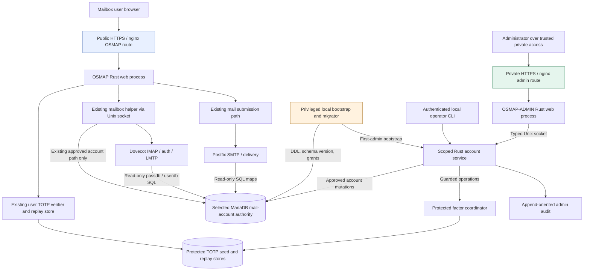
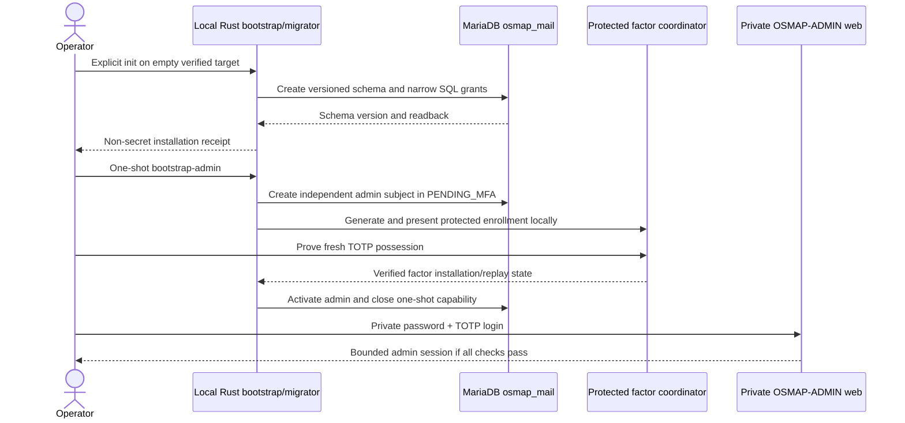
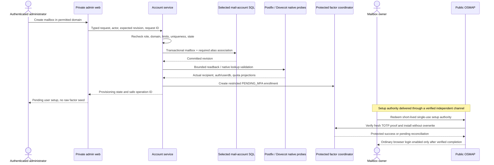
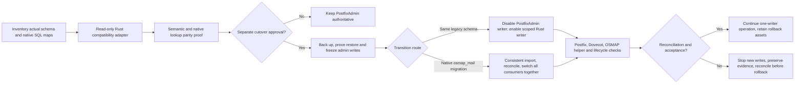

# OSMAP-ADMIN System Architecture

**Document:** `docs/OSMAP_ADMIN_SYSTEM_ARCHITECTURE.md`\
**Status:** Proposed architecture baseline, not an implementation or deployment approval\
**Version:** 0.1.0\
**Date:** 2026-11-13\
**Project:** OSMAP, OpenBSD Secure Mail Access Platform\
**Scope:** Rust services, trust boundaries, identity and authorization, MariaDB account authority, Postfix and Dovecot integrations, operational data flows

> **Change boundary:** This document is architecture and design only. It does not authorize a production database change, account or factor mutation, installation, traffic change, migration, PostfixAdmin disablement, or retirement. All such work requires a separately reviewed implementation slice, target-specific proof, and explicit operator approval.

## 1. Purpose, status, and governing decisions

OSMAP-ADMIN is a separate, native Rust administrative control plane for an OSMAP and OpenBSD Mailstack installation. It is intended to replace **the PostfixAdmin administration functions required by the installed mail environment**. It does not replace Postfix, Dovecot, MariaDB, OpenBSD, the filtering stack, or OSMAP's public webmail application.

The design follows the [administrative engineering request](ADMINISTRATIVE_USER_MANAGEMENT_ENGINEERING_REQUEST.md), the [OSMAP-ADMIN project plan](OSMAP_ADMIN_PROJECT_PLAN.md) in PR #84, and the [PostfixAdmin functional parity inventory](https://github.com/unattributed/OSMAP/issues/85). This document states the architectural contract; detailed physical SQL schema, migration mapping, user interface, and test procedures belong in their separate documents. Describing a future component here does **not** assert that it exists today.

### 1.1 Non-negotiable invariants

1. **One mail-account authority per installation.** Exactly one selected authoritative domain, mailbox, alias, credential and quota data source is used by the configured consumers at any time. Auxiliary admin session, audit and factor state are not a competing mail-account authority.
2. **One designated administrative writer.** Domain, mailbox, alias, credential and lifecycle mutations pass through one controlled account-mutation authority. Neither PostfixAdmin and OSMAP-ADMIN nor independent self-service helpers may concurrently write conflicting mail-account state. During transition, the existing OSMAP password-changing route must be inventoried and deliberately brought under this invariant before writer ownership changes.
3. **Postfix and Dovecot remain operational authorities.** Postfix makes transport, routing and recipient decisions. Dovecot provides IMAP, LMTP, password authentication and userdb/quotas. Both consume their configured SQL projections; neither calls OSMAP-ADMIN HTTP endpoints in a mail path.
4. **Independent security principals.** Mailbox users are not administrators by virtue of email identity. The private OSMAP-ADMIN application has its own authentication, MFA, session cookies and authorization. Public OSMAP sessions confer no administrative authority.
5. **Unprivileged web processes.** Neither browser-facing Rust process has SQL DDL grants, direct mail-account write grants, TOTP secret-store write grants, arbitrary shell authority, or host mail-configuration write permission.
6. **Canonical identities and existing data survive.** Existing password hashes, canonical account identities, alias multiplicity, Maildir locations and content, quotas, factor files, accepted TOTP counters, and relevant session state are preserved unless a separate reviewed change explicitly modifies them.
7. **Fail closed on uncertainty.** An incomplete multi-system operation is recorded as pending or uncertain, not claimed successful. Unknown schema versions, conflicting ownership, stale revisions and broken reconciliation prevent further mutation.
8. **No implied production qualification.** Source tests, obsd1 evidence and disposable-environment successes do not qualify the Toronto authoritative mail environment or another newly installed host.

### 1.2 Deployment modes

| Deployment | Selected mail-account authority | Writer transition | Architectural requirement |
| --- | --- | --- | --- |
| Documented existing Toronto installation | Current `postfixadmin` MariaDB schema | PostfixAdmin remains writer until the separately approved single-writer cutover; start OSMAP-ADMIN with read-only compatibility access | Keep live Postfix, Dovecot, OSMAP helper and administrative behavior stable while inventory and parity are proven |
| obsd1 development installation | Its own writable `postfixadmin` development schema; a separate read-only Toronto reference replica also exists | Development changes must not select or promote the Toronto replica | Preserve one-way reference separation; never infer Toronto authorization from development evidence |
| New installation | Native Rust-managed `osmap_mail` MariaDB schema | Rust bootstrap/migrator creates schema; the scoped Rust account service is the designated runtime writer | No PostfixAdmin, PHP or legacy schema prerequisite |
| Existing installation after optional native migration | `osmap_mail`, **only after approved cutover** | Freeze and reconcile writes, switch all consumers to the same new authority, then activate the single writer | No parallel active authority and no dual-write; retain the previous system for proven rollback |

## 2. Context and component boundaries

### 2.1 Logical component view

The arrows are logical contracts, not promises that all services communicate directly or that every component is already implemented. In particular, OSMAP's current account/password helper must be inventoried before its existing write behavior is replaced. A factor verifier and factor coordinator may share a reviewed Rust crate while remaining separate runtime privileges.

### 2.2 Runtime responsibilities

| Component | Responsibility | Explicitly excluded authority |
| --- | --- | --- |
| Public OSMAP Rust web | Mailbox-user password-plus-TOTP login, bounded sessions, mail UX and permitted own-account operations | Admin route, administrator identity/RBAC, general account-table writes, mail-host configuration |
| Existing OSMAP mailbox helper | Scoped mailbox access through its existing Unix socket and Dovecot authority | Domain or administrator management |
| Private OSMAP-ADMIN Rust web | Sign-in/MFA presentation and proof relay, opaque session handles, CSRF/UI state, validated requests and views | SQL write/DDL connection, raw factor secret files, shell command execution, mail/private-key content |
| Scoped Rust account/auth service | Own admin verification and authoritative session/capability issuance; independently authorize typed reads/writes and enforce single-writer/revision/scope/journal rules | Database creation/DDL; unbounded mail storage or process control |
| Factor coordinator | Explicitly authorized initial enrollment, proof verification, rotation, revocation and recovery transitions using existing protected factor rules | Unreviewed secret migration, factor disclosure after enrollment, replay-counter reset |
| Local Rust bootstrap/migrator | Empty-target checks, schema and grant creation, ordered migrations, first-admin bootstrap orchestration, installation receipts | Remote unauthenticated bootstrap, ordinary request handling |
| Local operator CLI | Authorized operational commands using the same typed service policy, plus separately gated bootstrap and migration commands | Hidden bypass of RBAC, audit, safety checks or writer ownership |
| MariaDB | Authoritative domain, mailbox, alias and related data, revision and migration records | Transport, delivery, TOTP seed custody or implicit business authorization |
| Postfix | SMTP transport, virtual-domain/recipient maps, alias expansion and delivery decisions | Admin authentication or database mutation |
| Dovecot | IMAP/LMTP, passdb/userdb, mailbox path and quota policy | OSMAP-ADMIN RBAC or browser TOTP enforcement |
| OpenBSD/nginx/WireGuard/PF | Process identities, private listener boundaries, sockets, filesystem access, TLS and network filtering | Application object-level authorization |

**Process layout:** Favor one Rust workspace with reviewed shared identity, validation, session, factor and protocol crates. OSMAP and OSMAP-ADMIN remain separate binaries and service identities. Do not copy security routines into divergent forks. The exact crate boundaries and process names are to be reconciled with the current workspace during Phase 0 and are not fixed by this document.

## 3. Trust boundaries and service confinement

| Boundary | Trust assumption | Required enforcement | Required negative proof |
| --- | --- | --- | --- |
| Internet to public OSMAP | All client input is untrusted | Existing nginx/TLS, Host and origin policies, bounded request parsing, login throttling, CSRF and sessions | Public OSMAP requests cannot reach an admin route or reuse an admin cookie |
| WireGuard/loopback to admin HTTPS | Private network location is **not** identity | Private-only listener, independent admin origin and certificate policy, strong admin login/MFA, throttling, CSRF, Host checks | A VPN peer without authorization cannot administer anything; public routing cannot expose the listener |
| Admin web to account-service Unix socket | Web compromise is in scope | Permissioned socket, peer process identity, bounded framed typed protocol, explicit version, timeout, request ID and service-side authorization | A forged role, actor, object scope or direct socket caller is rejected |
| Account service to MariaDB | Database credentials are powerful | Account-writer SQL identity with only required table/operation grants, parameterized queries, fixed statement shapes, revision checks | Writer cannot execute DDL or access unrelated databases; duplicate/stale changes fail |
| Postfix/Dovecot to MariaDB | Mail daemons are consumers | Dedicated read-only lookup users with least required SELECT privileges, compatible views or tables, protected credentials | Consumer SQL users cannot mutate data or enumerate privileged admin records |
| Factor service to secret/replay stores | Factor material is high sensitivity | Separate OS identity and restricted paths, no-overwrite creation, replay serialization, independent audit metadata | Web/account SQL compromise alone cannot read or overwrite seeds; replayed counters fail |
| Migrator to database/host | Local operator is strongly privileged | Interactive/local explicit authorization, backup and target proof, no network bootstrap endpoint, separate identity and executable | Unknown or populated target, concurrent installer and unknown migration checksum refuse |
| Audit/backup custody | Logs and backups can reveal sensitive metadata | Append-oriented restricted audit, redaction, rotation, integrity verification, protected backup custody | Secrets are not logged, backup restores are validated and non-privileged processes cannot rewrite history |

The admin entry should default to a **distinct private loopback or WireGuard-backed HTTPS virtual host**, not a public `/admin` route on the OSMAP site. The actual host/path policy must be proven with nginx and PF configuration and a remote negative reachability test. Use independent cookie names and scopes, `Secure`, `HttpOnly`, appropriate `SameSite`, short-lived sessions and verified rotation/invalidation. Do not rely on source IP or an asserted `X-Forwarded-For` header as authorization.

For OpenBSD, select the actual per-binary `pledge(2)` promises and `unveil(2)` paths after tracing required syscalls and reviewing the installed version. Run each daemon as a distinct non-root user wherever practical. Limit Unix socket directory ownership and permissions. Do not treat `pledge` or `unveil` as a substitute for application authorization. No arbitrary `doas`, shell, filesystem path, SQL or Dovecot command is accepted from an HTTP request.

## 4. Identity and authorization architecture

### 4.1 Separate subject namespaces

**Mailbox user:** Canonical mailbox identity resolved through the current Dovecot authentication path, subject to the existing OSMAP user TOTP verifier and browser-session contract. This subject is scoped to its own mailbox and expressly permitted self-service features.

**Administrator:** A separately issued stable `admin_id` with an independent password verifier, TOTP identity, session namespace, role grants and active/locked state. An administrator may exist without a mailbox or hosted domain. A mailbox address used as an admin contact attribute does not imply an account link or a role grant.

**Service/installer identity:** An OpenBSD process or trusted local operator with permissions specific to the invoked service, not an interactive domain or system administrator by default. Every CLI mutation still requires an explicitly identified authorization context; the privileged migrator is reserved for schema/bootstrap operations.

MFA implementation can reuse reviewed OSMAP components, but **admin secrets, replay counters, sessions and recovery approvals must not collide with mailbox-user files or names**. Keep current mailbox-user factor files and accepted counter state intact. The exact protected admin factor namespace and credential-hash algorithm are design decisions for Phase 0, not assumptions.

### 4.2 Roles and authorization predicates

Initial roles:

- **System administrator:** Installation-wide mail-account administration, domain assignments and admin-role governance, subject to step-up for high-risk actions.
- **Domain administrator:** Mailbox, alias and applicable domain settings for explicitly assigned domains only. A domain admin cannot create a system admin or expand their own scope.
- **Mailbox user:** Own-account operations exclusively in OSMAP, not an OSMAP-ADMIN session or role.

Every account-service operation must require a server-verified subject, active account state, explicit capability, permitted target domain(s), canonical target identity, current role grants, an expected object revision and a unique request/operation identifier. Sensitive changes also require recent administrator authentication and fresh MFA step-up. Scope must be checked against **all affected objects** before commit, including alias source, cross-domain local target behavior, administrator assignments and cascade effects. UI field hiding is never authorization.

| Operation | System administrator | Domain administrator | Mailbox user |
| --- | --- | --- | --- |
| Create/retire domain, change global policy | Permit, step-up and audit | Deny | Deny |
| View domain/mailbox/alias inventory | Installation scope | Assigned domains only | Deny in admin service |
| Create/edit/disable mailbox and quota | Permit | Assigned domains, constrained by policy | Deny |
| Manage aliases and forwarding | Permit | Assigned source domain and destination policy; no target-domain authority inferred | Own forwarding only if separately approved through the same writer |
| Issue first/setup enrollment | Permit with guarded process | Assigned mailbox only if explicitly enabled | Cannot issue arbitrary setup authority |
| Reset mailbox password or factor | Permit with strong identity and containment requirements | Only assigned mailbox if explicitly approved, never admins | Approved own-account path only |
| Create/disable domain admin, change domain grants | Permit, step-up and last-admin protection | Deny in initial release | Deny |
| Create/grant system administrator | Permit, step-up and independent audit | Deny | Deny |
| Read mailbox contents, private OpenPGP keys, factor seeds or accepted counters | Deny through admin plane | Deny | Own mail only through existing OSMAP; no seed retrieval |
| Change own credentials | Own admin identity in admin plane | Own admin identity in admin plane | Own credentials through scoped OSMAP route |
| Run schema migration or initial bootstrap | Deny over HTTP; separate authorized local tool | Deny | Deny |

No mailbox-user self-service route may become a second uncontrolled writer. Planned password, forwarding or account-setting changes that affect the authoritative tables must route through the selected scoped account-mutation authority, or remain disabled until the existing helper's equivalent single-writer and session/freshness behavior is preserved and tested. The already reviewed S04-02 credential-freshness and session-epoch properties are contracts to retain, not features to rewrite casually.

### 4.3 Authentication and session effects

The planned account/auth service, outside Web's writable authority, checks the separate admin credential verifier, active/lock state, protected factor proof and replay prevention before issuing an authoritative admin session. Web relays bounded proof and opaque handles and owns only non-authoritative UI/CSRF state. See the security model §5.1 for session/signing custody and the residual risk of active-session theft. The account service revalidates critical grant/state information for each privileged operation rather than trusting only a web session claim. Session identifiers must be rotated on authentication and step-up; logout, role changes, lockout, password changes and factor reset invalidate affected admin sessions under an explicit epoch or equivalent revocation rule.

A mailbox password change must preserve the current OSMAP requirement to revoke the affected **browser sessions** and demonstrate authoritative old-password rejection/new-password acceptance. This is not a claim that already authenticated IMAP/SMTP sessions are forcibly terminated. The installed Dovecot auth-cache behavior and the actual OSMAP helper route must be verified. A user browser TOTP factor does **not** automatically protect native IMAP/SMTP connections. Any restriction of native client access is a separate backend-authentication policy decision and acceptance test.

## 5. Data ownership and logical model

### 5.1 Authoritative mail-account entities

| Entity | Logical contract | Read/write consumers |
| --- | --- | --- |
| `domain` | Canonical unique name, active state, ownership/policy, supported mailbox/alias/quota limits, revision | Account service writes; Postfix maps read |
| `mailbox` | Canonical unique address, domain relationship, compatible stored password hash, active/auth/delivery policy, stable Maildir identity, quota and revision | Account service writes; Dovecot passdb/userdb and Postfix recipient maps read |
| `alias` | Canonical source, zero or more policy-valid destinations as supported, active state, local delivery preservation, revision | Account service writes; Postfix alias expansion reads |
| `alias_domain` | Optional whole-domain mapping, collision and recursion checks | Enabled only if installed Postfix maps require it |
| `domain_policy` / quota settings | Mailbox limits, effective quota constraints, feature flags | Account service writes; effective installed consumers enforce |

A mailbox-associated local-delivery alias may be necessary in the existing PostfixAdmin schema. Creating or editing forwarding must not silently remove local delivery. Catch-all, multi-recipient alias and alias-domain behavior is defined by the **effective Postfix maps**, not by a generic table model. Per-domain limits and aggregate quotas count as supported only when the active runtime enforces them.

### 5.2 Administrative and operational entities

| Entity | Logical contract | Custody |
| --- | --- | --- |
| `admin_subject`, `admin_credential`, `admin_role_grant` | Stable ID, reviewed password verifier, active/locked state, explicit domain scope, revision | Admin authentication and scoped account service |
| `enrollment` | Opaque subject reference, factor reference, lifecycle state, setup-token **digest**, expiry, single-use status, revision | Account/factor coordination; no raw TOTP seed in SQL |
| `operation_ledger` | Operation ID, actor, target, requested action, expected revision, stage, observed effect, uncertainty/reconciliation state | Scoped account service |
| `audit_event` | Attributable actor, action, affected canonical identifiers, time, request ID, decision/result, before/after revision or safe digest | Restricted append-oriented audit custody |
| `schema_migration` | Ordered version, checksum, target, execution result, pre/postcondition and operator receipt | Local migrator only |
| Factor seed and accepted-counter records | Existing protected file-backed TOTP store and distinct serialized replay store; separate admin namespace | Protected factor/verifier processes, **not** MariaDB account tables |
| Maildir, message metadata and OpenPGP private keys | Preserved by existing Dovecot/OSMAP ownership and custody | Never migrated or read as part of mail-account schema administration |

This is a **logical model**, not an authoritative `CREATE TABLE` specification. `OSMAP_ADMIN_DATABASE_DESIGN.md` (planned) must define exact physical tables, collations, indexes, constraints, mapping views and migration checksums after an installed-version inventory. Do not infer that every possible PostfixAdmin upstream table exists on Toronto.

### 5.3 SQL identity and privileges

Use separate least-privileged SQL identities for the schema migrator, account writer, Postfix maps and Dovecot passdb/userdb. An admin web process has no database credential. In a current-schema compatibility mode, grant only the exact safe reads required until writer handoff is approved. Avoid exposing administrator credential hashes, factor metadata and audit data through Postfix or Dovecot lookup credentials.

Schema creation and privilege changes are exclusively local migrator responsibilities. SQL DDL and `GRANT` cannot be treated as generally transactionally reversible in MariaDB; take and test a protected backup, record checksums and prove pre/postconditions. Use transactions and revision compare-and-swap for ordinary compatible row mutations, but do not claim a cross-process filesystem or mail-service change is atomic merely because SQL committed.

## 6. Postfix integration contract

Postfix continues to determine recipients and routing through its effective SQL lookup maps. OSMAP-ADMIN **writes account data** through the scoped account service; Postfix **reads the selected authority** through a dedicated SQL lookup principal. No HTTP call to an administration service is permitted in SMTP acceptance, alias expansion or delivery.

The Phase 0 inventory must capture the target's effective `main.cf`/`master.cf`, virtual domain, mailbox and alias maps, relevant recipient validation, relay restrictions, catch-all behavior, domain alias rules, local-delivery alias records, transport rules (if any), SQL query files, lookup credentials, and refresh/reload behavior. Confirm exact configuration with Postfix's installed tooling and representative native queries. Do not hardcode generic table or SQL examples into a production configuration without verifying that contract.

Required observable outcomes:

1. Domain creation makes the domain recognized by the configured Postfix lookup only when activated.
2. Mailbox creation makes the correct canonical recipient routable, without creating a conflicting or duplicate mailbox delivery association.
3. Alias updates preserve all intended destinations and required local delivery. Missing/cyclic destinations and catch-all policy are handled according to the installed maps.
4. Disabling or retiring a domain, mailbox or alias has an explicitly defined effect on SMTP acceptance, delivery and forwarding, verified natively rather than inferred from a database flag.
5. Postfix lookup failures and SQL unavailability have a documented effective outcome under the installed configuration; no success is asserted from stale UI state.

PostfixAdmin functionality not backed by a configured service or query, such as backup MX, transport controls or some alias-domain extensions, is conditional rather than automatically promised.

## 7. Dovecot integration contract

Dovecot continues to authenticate native mail clients and supply per-user mailbox metadata. The selected SQL `passdb` projection resolves supported password hashes and account admission. `userdb` resolves the canonical account, existing mail home, actual UID/GID, mail location and quota fields. Only the installed Dovecot version's syntax and behavior are authoritative. Dovecot 2.3-style query fields shown in the repository are an **example of a documented existing contract**, not a migration recipe.

The relevant OSMAP [mail storage documentation](../maint/openbsd/MAIL_STORAGE.md) records a `mailbox` lookup based on `username`, `maildir`, `quota`, and `active`, with an example `/var/vmail` location and illustrative UID/GID. Do not assume those paths or numeric owners are universal. Preserve the current password scheme, per-user Maildir mapping, mailbox UID/GID and quota semantics. A quota value displayed by OSMAP is not proof that native Dovecot storage enforces the limit.

Required observable outcomes:

1. The newly provisioned account resolves through actual `passdb` and `userdb` lookups, with correct password scheme, username normalization, home, mail location and UID/GID.
2. Active/disabled/retired statuses have defined and demonstrated authentication and delivery effects across the configured IMAP and LMTP paths.
3. Changed passwords are checked against the authoritative auth path, with old rejection, new acceptance, session effects, and a second account preserved.
4. Configured quota is observed and enforced by the installed quota plugin using a disposable account and actual over-quota refusal, not merely by stored values.
5. Maildir bytes and identity state, including UIDVALIDITY/UIDNEXT, message flags and subscriptions, are preserved during account-authority changes. Schema migration does not rewrite mail storage.
6. When SQL or configuration changes require a refresh, use the existing reviewed mailstack procedure; do not infer that an SQL update automatically invalidates all native auth caches or third-party sessions.

## 8. End-to-end data flows

### 8.1 Fresh installation and first system administrator

MariaDB itself must already have been initialized through supported vendor tooling or explicitly initialized as a separate approved local step. The Rust migrator then creates the application database, versioned schema and grants. It refuses a non-empty or ambiguously owned target, unexpected schema version, unverified partial migration or concurrent bootstrap. There is **no unauthenticated web bootstrap endpoint** and no requirement for PostfixAdmin or PHP. Activation of network listeners and mailstack SQL configurations occurs in a separate reviewed deployment stage.

### 8.2 Domain/mailbox creation and first mailbox-user enrollment

The setup authorization must be usable **before the user can read their new mailbox**. Persist only its digest, scope, expiry and consumption status. The user, not the administrator, normally receives and proves the TOTP seed. If SQL commits but the factor write or downstream readback fails, the operation remains pending/uncertain for explicit reconciliation. Do not log the seed or issue a normal mail-reading session from a setup token.

The following states must be modeled separately:

- **Mail account routing/auth state:** provisioning, enabled, disabled, retiring, retired. Native IMAP/SMTP exposure during browser MFA setup is a distinct explicit policy decision.
- **OSMAP browser enrollment state:** `PENDING_MFA`, `ACTIVE`, `REVOKED`/`RECOVERY_PENDING` or equivalent reviewed transitions.
- **Admin state:** `PENDING_MFA`, `ACTIVE`, `LOCKED`, `DISABLED`; a system administrator can exist without a mailbox.

Do not silently equate native mail-client authentication with OSMAP browser MFA completion.

### 8.3 Alias, quota and lifecycle mutation

1. Admin submits a typed intent with expected revision, affected source domain, destinations and operation ID.
2. Account service rechecks live role grants, canonicalizes addresses/domains, validates policy and existing local mailbox delivery, then performs a conditional database mutation.
3. The service reads back the revision and verifies the relevant Postfix lookup, or Dovecot userdb/native quota enforcement as applicable.
4. It records completed, refused, pending or uncertain state with safe audit correlation. A retry uses the original idempotency key and reconciliation, never blindly repeats an ambiguous write.
5. For disable/retire, a separate retention/export decision must precede irreversible mail storage purge. Disabling account metadata does not silently remove the user's mail bytes.

### 8.4 Password, factor and role change

1. A new request passes authentication, current authority, role, target, anti-CSRF, relevant step-up and expected-revision checks.
2. The one account-mutation authority applies the compatible password/role/status change; the factor coordinator applies its own reviewed no-overwrite, replay and recovery contract where relevant.
3. Affected **OSMAP or admin browser sessions** are invalidated or epoch-revoked as specified and verified. Do not assert termination of pre-existing external IMAP/SMTP sessions.
4. Read back authoritative credential and session effects, preserving unrelated accounts. Refuse uncertain states pending safe reconciliation.
5. Record secret-free success, denial or uncertainty. Factor recovery requires independently established identity/containment and the approved signed human authorization where existing policy requires it.

### 8.5 Existing PostfixAdmin authority to OSMAP-ADMIN

Phase 0 inventories the exact installed PostfixAdmin tables, triggers, credentials, authentication schemes, virtual maps, aliases, quotas, optional functions and effective consumers. The initial adapter is read-only. A compatible writer to the legacy schema is possible only after PostfixAdmin's administrative writes and any other writer paths are disabled or securely gated. A move to `osmap_mail` is a **separate** migration decision, not part of basic compatibility.

For a native transition, import a consistent snapshot into a new empty schema, preserve hashes/Maildir data, reconcile full key sets and semantic digests, freeze account mutations, catch up and compare the bounded delta, then switch Postfix, Dovecot and affected OSMAP helper configuration together. No dual-write, silent table re-creation or automatic promotion of the obsd1 reference replica. Post-cutover writes make simple snapshot rollback unsafe; reconcile forward changes before restoring the previous authority. PostfixAdmin retirement is a later independently authorized operation.

## 9. Service protocol and consistency rules

The web-to-account-service interface should be a **versioned, bounded, typed local protocol** over a permissioned Unix socket. Request fields should include protocol version, canonical operation type, actor/session binding, requested capability, target and domain, expected object revision, idempotency/operation ID, recent-auth proof reference where required, and validated arguments. Responses should report a typed result, observed revision and reconciliation status, not raw SQL errors or credential material.

Examples of logical operations include `domain.create`, `domain.disable`, `mailbox.create`, `mailbox.set_quota`, `mailbox.reset_password`, `alias.replace_destinations`, `admin.grant_domain`, `enrollment.initiate`, `factor.revoke` and `operation.status`. These are illustrative operation names; a separately reviewed OSMAP-ADMIN helper protocol specification must freeze actual wire shapes and error codes. A local operator CLI invokes the same policy rather than bypassing it.

Required service behaviors:

- Enforce a fixed maximum message length, parse depth, deadline, concurrency, pagination and work budget.
- Authenticate/verify the local socket peer where supported, then independently authorize the represented admin subject and every affected target.
- Serialize or reject conflicting writes using the database's proven concurrency semantics and expected revisions; detect lost update and repeated requests.
- Keep ordinary SQL mutations transactional where supported; use explicit operation stages and reconciliation for external factor/host/mail effects.
- Produce a safe audit decision for both success and denial; do not log passwords, stored password hashes, factor seeds/codes, setup or recovery tokens, private keys, raw backup contents or complete mail data.
- Fail closed on service, SQL, factor-store or audit failure when a change cannot be safely proven or recorded.
- Expose a **read-only**, bounded health and reconciliation status path that does not reveal secrets or enable arbitrary diagnostic commands.

## 10. Threat model and security assertions

The primary adversaries include public web attackers, stolen mailbox or admin credentials, compromised VPN endpoints, a compromised public OSMAP process, a compromised OSMAP-ADMIN web process, a hostile local unprivileged process, an administrator abusing a domain grant, and operational mistakes during schema/bootstrap/migration.

| Threat | Architectural response | Evidence needed |
| --- | --- | --- |
| Public user escalates to administrator | Separate routes, process identities, credential/MFA/session namespaces and deny-by-default service RBAC | Ordinary cookie, mailbox identity and direct admin URL attempts denied |
| Domain admin crosses scope | Per-operation canonical source/target evaluation, assigned-domain grants, no role self-escalation | Cross-domain create, alias, reset, admin-grant and raced grant revocation refused |
| Browser compromise reaches SQL/secret store | No DB writer or seed-write grant in web, permissioned typed socket and independent service policy | Process permission and direct socket-forgery tests |
| TOTP seed/replay compromise | Protected seed namespace, separate accepted-counter store, no overwrite, bounded enrollment | Concurrent/repeated codes, symlinks, permissive paths, repeated setup token refused |
| Password/factor change leaves stale browser authority | Existing account/session epoch guarantees preserved and native auth readback | Old browser sessions invalid, new credential works, unrelated account preserved |
| Alias abuse creates routing loop or loss of local delivery | Canonicalization, graph/cycle checks, native map validation, required mailbox alias preservation | Multi-destination, catch-all, local loop and mailbox-forward behavior tested |
| Installer upgrades wrong database | Explicit target identity and empty/precondition/version checks, checksummed migrations | Non-empty/unknown/partial/concurrent bootstrap refusal |
| Migration creates two writers or divergent authorities | Writer ownership gate, bounded freeze and reconciliation, atomic configuration decision | PostfixAdmin writes blocked after handoff; all consumers query selected source |
| SQL/data backup exposes credential material | Restrictive custody, encryption and private evidence handling, restore exercises | Backup ACL and restoration evidence without secrets in repository |
| Audit or downstream check fails after SQL commit | Operation ledger with `UNCERTAIN` and reconciliation before retry | Injection of failure at each boundary leaves no false success |

Use the [OSMAP security model](SECURITY_MODEL.md) and its current credential-freshness requirements as constraints. Detailed WSTG/ASVS controls, penetration testing and negative-path coverage belong to the the separately reviewed OSMAP-ADMIN test plan and should not be represented as already executed.

## 11. Deployment, backup, and recovery boundaries

A production-capable deployment requires separate OpenBSD service users, installed binary provenance, restricted socket directories, private TLS routing, SQL role grants, factor and replay file ownership, protected environment/credentials, database backup and tested restore, log/audit custody, and independent health checks. The installer may render candidate Postfix/Dovecot SQL configurations, but applying them is an explicit deployment decision after syntax, effective lookup and rollback validation.

Backups must encompass the selected account schema and migration ledger, relevant administrative credentials and grants, protected TOTP seed/replay state, session/epoch state needed for a safe restore, selected Postfix/Dovecot/OSMAP configuration and mailbox/storage references. Backups of mail storage are managed under their own established preservation requirements. A restored database without its compatible factor and session state is not automatically a valid recovery.

Failure policy:

- **Read-only SQL outage:** report degraded/unknown admin inventory; do not fabricate success or silently switch authority.
- **Write outage or stale revision:** reject mutation and retain a safe operation record; retry only after reconciling the original operation ID.
- **Audit outage:** refuse high-risk writes if a verifiable audit record cannot be assured.
- **Factor installation uncertainty:** leave the subject pending and reconcile the protected file/replay state without overwriting or clearing replay counters.
- **Mailstack config/query mismatch:** do not promote the database, disable PostfixAdmin, or declare account activation complete.
- **Last administrator loss:** use a reviewed, local, independently attested recovery process; never provide public no-MFA bootstrap or unlogged admin elevation.
- **Rollback after new writes:** stop further writes, reconcile both authorities and applicable mail/config/session changes; do not blindly restore a stale snapshot.

## 12. Implementation sequence and acceptance gates

The order is inherited from [OSMAP_ADMIN_PROJECT_PLAN.md](OSMAP_ADMIN_PROJECT_PLAN.md). This table states system-architecture evidence, not schedule or implementation authorization.

| Phase | Architecture deliverable | Exit proof |
| --- | --- | --- |
| 0, inventory | Effective Toronto/obsd1 separation; installed PostfixAdmin/SQL/Postfix/Dovecot/TOTP/password-helper contracts; feature parity; unresolved decisions | Observed contract inventory, no assumed schema or unsupported functionality |
| 1, Rust boundary | Separate admin authentication/sessions, scoped service protocol, read-only compatibility adapter and audit | Cross-role/cross-domain/socket rejection, private listener, read-only native parity |
| 2, fresh bootstrap | Local migrator, versioned `osmap_mail`, narrow grants, independent first-admin TOTP | Disposable new host can initialize and authenticate admin without PHP/PostfixAdmin; bad/partial target refuses |
| 3, core writer | Transactional domain, mailbox, alias, admin and quota mutations under one writer | Real Postfix recipient/alias behavior, Dovecot passdb/userdb and enforced quota, safe race/denial tests |
| 4, identity lifecycle | Restricted new-user setup, protected factor operations, session invalidation, recovery | First mailbox-user OSMAP password+TOTP login, factor replay/race/expiry tests, preserved old-user behavior |
| 5, parity/operations | Installed P0 functions plus enabled P1, CLI, audit and backup/restore; optional functionality only with backend proof | Feature-by-feature native acceptance or explicit approved deferment |
| 6, migration/cutover | One-writer transition, optional native schema migration, restore/rollback rehearsal | Reconciled keys/digests, all consumers on one authority, actual mail/auth tests, explicit operator acceptance |
| 7, retirement | Independent PostfixAdmin removal/change request | No remaining required workflow, obsolete public route, PHP-only dependency, job or excessive SQL grant |

A retirement decision requires all P0 functions from [issue #85](https://github.com/unattributed/OSMAP/issues/85) or a reviewed operator-approved disposition, live target-specific functional and security evidence, a tested restore and rollback, migration delta reconciliation, and explicit acceptance. Retire nothing based only on source code, fixture tests or documentation.

## 13. Open architecture decisions for Phase 0

These are deliberately **not** frozen before inspection of the active mailstack and Rust workspace:

1. Exact installed PostfixAdmin table/column/version/features, triggers, migrations and Postfix SQL map queries.
2. PostfixAdmin-schema adapter's safe read/write projections, and compatibility views needed for the native schema.
3. Native MariaDB physical table design, collations, indexes, password hash/scheme policy and SQL migration tool implementation.
4. Dovecot version, `passdb`/`userdb` and quota plugin configuration, native auth cache and session consequences.
5. Existing OSMAP account/password helper writer ownership and the migration path to a single scoped account writer without losing the established password-freshness proof.
6. Separate admin credential verification, factor namespace, recovery policy and exact session/epoch implementation.
7. A verified independent first-user setup delivery channel and explicit IMAP/SMTP availability policy while browser MFA is pending.
8. Which domain administrators, if any, may initiate mailbox factor recovery, and the required independent attestation/containment path.
9. Exact installation-specific OpenBSD account IDs, sockets, protected paths, `pledge`/`unveil` policy, private hostname, nginx and PF rules.
10. Conditional PostfixAdmin capabilities currently active, including alias domains, vacation/Sieve, catch-all, DKIM, transport, fetchmail and associated daemon behavior.

None of these open questions authorizes a guessed implementation or a production edit. Resolve them through the Phase 0 evidence set and the separate physical schema, RBAC, protocol, migration and test specifications.

## 14. Related repository documents and official sources

### Governing repository context

- [Administrative User Management Engineering Request](ADMINISTRATIVE_USER_MANAGEMENT_ENGINEERING_REQUEST.md), long-term objective, existing interim TOTP tooling and retirement gate.
- [OSMAP-ADMIN Project Plan](OSMAP_ADMIN_PROJECT_PLAN.md), proposed phased architecture on [PR #84](https://github.com/unattributed/OSMAP/pull/84) as of 2026-11-13, **not yet merged to main when this document was prepared**.
- [PostfixAdmin Functional Parity and Acceptance Matrix](https://github.com/unattributed/OSMAP/issues/85), proposed P0/P1/P2 capability inventory.
- [OSMAP Architecture](ARCHITECTURE.md), existing OSMAP browser/mailbox-helper boundary.
- [OSMAP Security Model](SECURITY_MODEL.md), threat model and current credential/session limits.
- [V3 Identity Lifecycle Evidence](V3_IDENTITY_LIFECYCLE_EVIDENCE.md), currently mailbox-user-only browser authority; restricted enrollment must be an explicit future exception with updated tests.
- [TOTP Secret Management Model](TOTP_SECRET_MANAGEMENT_MODEL.md), file-backed mailbox factors and separate replay store.
- [Mail Storage](../maint/openbsd/MAIL_STORAGE.md), existing Dovecot account-based Maildir and quota projection.
- [Development Database Notes](../maint/development-db/README.md), obsd1 development authority and Toronto read-only reference separation.

### Official vendor and maintainer sources

- **Postfix project:** [MySQL table lookup support](https://www.postfix.org/MYSQL_README.html) and [Postfix configuration reference](https://www.postfix.org/postconf.5.html). The effective deployed Postfix configuration is the operational source of truth.
- **Dovecot project:** [Dovecot 2.3 SQL passdb/userdb](https://doc.dovecot.org/2.3/configuration_manual/authentication/sql/) and [current Dovecot SQL documentation](https://doc.dovecot.org/main/core/config/auth/databases/sql.html). Query syntax differs across major versions; use installed-version documentation.
- **MariaDB Foundation / MariaDB project:** [Statements causing implicit commits](https://mariadb.com/docs/server/reference/sql-statements/transactions/sql-statements-that-cause-an-implicit-commit) and [server documentation](https://mariadb.com/docs/server/).
- **OpenBSD project:** [`pledge(2)`](https://man.openbsd.org/pledge.2) and [`unveil(2)`](https://man.openbsd.org/unveil.2).
- **PostfixAdmin maintainers:** [Upstream source](https://github.com/postfixadmin/postfixadmin), for candidate feature/schema identification, not proof of Toronto configuration.

---

**Architecture decision:** A separately authenticated, private Rust OSMAP-ADMIN web service invokes a least-privileged typed local account service. A local Rust migrator owns native schema bootstrap; protected factor coordination preserves existing TOTP semantics; Postfix and Dovecot use read-only SQL projections from one selected mail-account authority. Existing PostfixAdmin remains authoritative until an approved, reconciled single-writer cutover. Its retirement requires a separate decision and native acceptance evidence.
