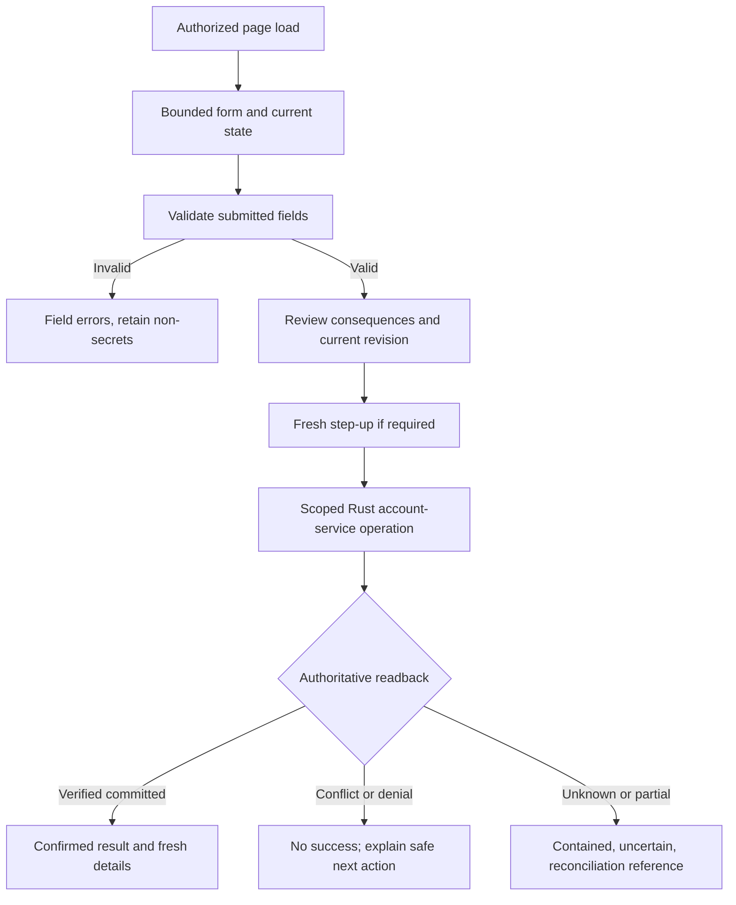

# OSMAP-ADMIN UX Specification

**Repository path:** `docs/OSMAP_ADMIN_UX_SPECIFICATION.md`\
**Project:** OSMAP / OSMAP-ADMIN, OpenBSD Secure Mail Access Platform\
**Version:** 0.1.0\
**Date:** 2026-11-13\
**Status:** Proposed product and interaction design, not an implemented interface or a visual-acceptance claim.\
**Purpose:** Administrative pages, forms, navigation, workflows, validation, empty/unavailable/error states, and accessible user journeys. **Reuse the established OSMAP UX.**

> **Scope and authority:** This document specifies a separate, private OSMAP-ADMIN Rust web interface. It does not authorize production changes, new accounts, an account-writer transition, a database migration, a host deployment, or PostfixAdmin retirement. The existing OSMAP UX approval and locked reference images govern the mailbox-user product, not an automatic sign-off of newly proposed admin screens. Any visual deviation from the existing design language, or amendment to a locked OSMAP page, needs review and the normal signed change process.

## 1. Governing decisions and dependencies

Read this alongside:

- [OSMAP-ADMIN System Architecture](OSMAP_ADMIN_SYSTEM_ARCHITECTURE.md): separate Rust processes, local account service, Postfix/Dovecot boundaries.
- [OSMAP-ADMIN Database Design](OSMAP_ADMIN_DATABASE_DESIGN.md): current authority, table/revision/grant model and single-writer rules.
- [OSMAP-ADMIN Identity Lifecycle](OSMAP_ADMIN_IDENTITY_LIFECYCLE.md): resource, browser-factor and administrator state machines.
- [OSMAP-ADMIN Security Model](OSMAP_ADMIN_SECURITY_MODEL.md): MFA, RBAC, admin session policy, step-up and audit controls.
- [OSMAP-ADMIN Project Plan](OSMAP_ADMIN_PROJECT_PLAN.md), on the signed documentation branch of [PR #84](https://github.com/unattributed/OSMAP/pull/84).
- [Administrative User Management Engineering Request](ADMINISTRATIVE_USER_MANAGEMENT_ENGINEERING_REQUEST.md) and [functional parity issue #85](https://github.com/unattributed/OSMAP/issues/85).

The UX cannot independently define authorization or alter the underlying account data model. If this specification and the security, lifecycle or database designs disagree on a state transition, preserve the fail-closed underlying contract and resolve the discrepancy through review before implementation.

### 1.1 Product principles

1. **One visual family, two security products.** OSMAP and OSMAP-ADMIN share reviewed *presentation* primitives, not cookies, sessions, routes, credentials, SQL grants or service authority.
2. **Native, server-rendered Rust UI.** Use semantic HTML and first-party CSS. Preserve the no-frontend-framework, no-required-JavaScript and no-external-CDN posture of OSMAP. Forms submit through bounded POST operations; links navigate through ordinary GET routes.
3. **Administrative truth over decorative completeness.** Every displayed count, quota, account state and operation result comes from an authorized readback. Show `Unknown`, `Unavailable`, `Pending` or `Requires reconciliation` rather than inventing success, health or coverage.
4. **Narrow actions and finite menus.** A visible action exists only when implemented and authorized. Unsupported PostfixAdmin features are labelled as unsupported or omitted, never painted as functioning.
5. **Explicit, reversible workflows.** Normal changes use a reviewable form and a checked save. Destructive changes use a consequence review, recent step-up and an appropriate retention decision. The UI never implies that deleting a SQL row deletes or preserves mail content without verification.
6. **Server-side authorization is independent of the UI.** Hiding a control is not a security boundary. The local Rust account service revalidates subject, scope, operation, revision, writer epoch and step-up.
7. **No direct access to private mail or secrets.** Administrative screens do not render message bodies, OpenPGP private keys, existing TOTP seeds, password hashes, raw setup tokens after issuance, protected recovery data or unrestricted SQL.
8. **Respect current installation authority.** Toronto remains on the existing PostfixAdmin account database until an approved one-writer cutover; a development replica is not a write authority. Read-only mode must be obvious on every affected page.

## 2. Existing OSMAP UX is the implementation baseline

The source of truth for *appearance and interaction patterns* is the existing OSMAP repository, not a newly invented dashboard theme. Review the referenced source at the actual selected implementation commit before extraction.

### 2.1 Visual and behavioural source map

| Existing asset or implementation | Reuse for OSMAP-ADMIN | Boundary and qualification |
| --- | --- | --- |
| `docs/design/osmap-ux-final-approved-20260919/README.md`, `APPROVAL_LOCK_FINAL.md`, `SHA256SUMS` | Approved visual language, information hierarchy and lock rules | The approved 25 PNGs are byte-locked OSMAP references. Do not redraw or mutate them as an admin mockup. |
| `maint/ux/approved_pages.json` | Existing 27-page control inventory, common navigation/appearance/accessibility expectations, positive and negative test style | Inventory and partial-completion flags are not proof that every pictured control works. |
| `src/http_ui.rs`, notably `app_header`, `app_header_with_storage` | Left application rail, selected destination, icon/label treatment, top bar, account menu, skip link, search shell | Extract/reuse *rendering ideas or neutral helpers*, not OSMAP's mailbox routes, subject, session, storage widget or protection claims. |
| `src/http_support.rs`, especially `browser_css`, `apply_appearance`, `browser_csp` | Existing first-party CSS tokens, responsive rails, tables, fieldsets, buttons, panels, notices and light/dark/system appearance | Share reviewed presentation source where practical; admin has its own response/cookie/origin and a separately reviewed CSP. |
| `src/settings_ui.rs`, `src/settings_general_ui.rs` | Settings sections, side navigation, cards, labelled controls, field help, save rows and native form layout | Admin account/security settings are separate, and mailbox preferences do not become installation controls. |
| `src/welcome_ui.rs` | Welcome/dashboard card composition, factual summary metrics, recent activity, explicit unavailable states | Replace mail statistics with *authorized* domain, mailbox, alias and operation projections; do not reuse mailbox data readers. |
| `src/http/routes_settings.rs` | Server-rendered GET/POST lifecycle, bounded search, CSRF-bound forms and validation response patterns | Implement independently under admin route/session middleware. |
| `src/http/header_theme.rs` | Whitelisted same-origin return destinations for appearance changes | Define a new finite allowlist of **admin-only** destinations. Never accept OSMAP mailbox URLs as admin return targets. |
| `docs/UX_DECISIONS.md` | Native HTML interaction, finite action menus, truthful failure states, security-first change design | Preserve relevant decisions and avoid importing unrelated Compose/Reader/OpenPGP assumptions. |
| `docs/UX_FULL_FUNCTIONAL_EPIC.md`, `docs/UX_PLAN_AMENDMENT_R2.md`, `docs/UX_EXECUTION_LEDGER.md` | Revision authority, per-page acceptance and evidence discipline | Check actual completion and installed evidence. Historical or partial results are not admin qualification. |
| `maint/ux/*workflows.py` | Browser test style: keyboard/pointer, route changes, `aria-current`, error/empty/unavailable cases | Write new admin-specific test fixtures and tests without exercising live account changes. |

### 2.2 The precise OSMAP page patterns to carry forward

| OSMAP approved page | OSMAP-ADMIN application |
| --- | --- |
| `PAGE-01` Welcome | Admin Dashboard: summary cards, pending operations, recent security events, factual service notices |
| `PAGE-02` Inbox and `PAGE-09` Search | Bounded domain/mailbox/alias tables with search, filters, selected row, sort and pagination |
| `PAGE-10` Security and `PAGE-11` General Settings | Admin security overview and installation-scoped detail pages with labelled subsections |
| `PAGE-12` Appearance | Same light/dark/system, density and typography approach in separate admin presentation preferences |
| `PAGE-20` Authentication & Recovery | Admin MFA and recovery overview; separate account-specific factor enrolment/recovery actions |
| `PAGE-22` Password Change | Explicit current/new/confirm fields and independent show/hide controls only if implemented without weakening CSP; otherwise use ordinary password inputs and explain the limitation |
| `PAGE-23` Recovery Contact | Distinguish validated recovery contact evidence from merely entered contact text; never expose protected recovery approvals |
| `PAGE-24` Active Sessions | Separate administrator session list, revoke session and revoke other sessions workflows |
| `PAGE-25` Login, `PAGE-26` TOTP Challenge | Retain the **existing OSMAP user login and challenge unchanged**. Admin sign-in borrows the approved visual treatment but runs on separate admin forms, endpoints, credentials and session stores |
| `PAGE-27` Canonical State Matrix | Truthful empty, partial, stale, unknown, denied, pending and error states throughout the admin UI |

The OSMAP approved reference bundle specifically retains the existing Login and TOTP Challenge implementation without replacement PNGs. OSMAP-ADMIN must **not** add admin functionality to the public login form, and must not infer that a separate admin login screen is already approved or implemented.

### 2.3 CSS and presentation reuse contract

Use the existing `src/http_support.rs` token names and semantics as the starting source of truth: `--bg`, `--panel`, `--panel-soft`, `--ink`, `--muted`, `--line`, `--line-strong`, `--accent`, `--accent-strong`, `--on-accent`, `--link`, `--selected`, `--ok-*`, `--warn-*`, `--danger-*`, `--focus` and `--shadow`. Retain the current light/dark/system CSS variable rules and their browser-preference fallback.

Expected reusable classes/patterns include `.app-rail`, `.rail-link`, `.topbar`, `.page-shell`, `.page-intro`, `.settings-layout`, `.settings-navigation`, `.panel`, `.primary-button`, `.button-link`, `.notice`, `.notice-success`, `.notice-error`, `.badge`, `.status-pill`, `.skip-link`, native table styling and `:focus-visible`. These names describe existing source patterns, not a requirement to copy the entire mailbox stylesheet unchanged. Refactor selected source into reviewed shared Rust/CSS presentation modules where feasible, with feature-specific admin styles explicitly namespaced so they cannot alter approved OSMAP user pages accidentally.

Do not add npm, a JavaScript framework, remote fonts, remote assets or an arbitrary icon library. The current OSMAP shell icon mechanism is the default visual starting point. Icons supplement labels; they are not the sole carrier of state or permission. Both light and dark themes must preserve semantic status distinctions and keyboard focus.

**Design gate:** Any decision to share code must be evaluated for security coupling. A common CSS helper is acceptable; sharing a user session serializer, HTTP route registry, cookie key, privileged helper handle or MFA subject namespace is not.

## 3. OSMAP-ADMIN shell and navigation

### 3.1 Desktop layout

```text
+------------------+----------------------------------------------------------+
| OSMAP-ADMIN rail | OSMAP Admin      Search scoped records   Admin account  |
|                  |                   Appearance / sessions / Sign out       |
| Dashboard        +----------------------------------------------------------+
| Domains          | Dashboard / Domains / example.test                      |
| Mailboxes        | Page heading                  [Supported action]         |
| Aliases          | Current authority: Read-only / Rust writer              |
| Administrators*  | Scope: Assigned domains / Installation                  |
| Authentication   |                                                          |
| Quotas           | Summary cards, status, help and readback freshness       |
| Audit            |                                                          |
| System*          | Table or details / labelled form / operation result      |
|                  |                                                          |
+------------------+----------------------------------------------------------+
```

`*` Role-restricted or operator-only. The visual shell shares OSMAP's rail, responsive collapse, top bar and page-intro rhythm, but the admin navigation contains **admin actions only**. No Inbox, Compose, Contacts, OpenPGP private-key management or mail-content search links are present. The brand text must read `OSMAP Admin` or `OSMAP-ADMIN`, never imply that the admin is currently reading their own mailbox.

### 3.2 Global regions

- **Skip link:** `Skip to administration content`, targeting `#main-content`.
- **Rail:** `nav[aria-label="Primary administration navigation"]`, finite destination links; exactly one current destination uses `aria-current="page"`.
- **Top bar:** Admin product identity, context-sensitive record search, current administrator identity, current effective role, theme control, admin account menu, sessions and Sign out.
- **Protection disclosure:** Replace mail-specific `Protected by Default` copy with a factual `Private administration` or `Administrative session` disclosure. Its text describes the real private listener and MFA state, not an unsupported claim about message encryption or native SMTP protection.
- **Scope strip:** Display selected installation, selected/assigned domain scope and writer mode. If effective authority is read-only or uncertain, show the condition prominently, disable mutation affordances and preserve read-only inspection.
- **Page heading:** One H1, concise purpose, canonical target/context breadcrumbs, status and allowed primary action.
- **Main content:** OSMAP-style metric cards, tables, details and form panels with clear help and status messaging.
- **Footer:** Product/version and truthful availability; do not claim universal production qualification, automatic backup success or healthy services without actual checks.

### 3.3 Responsive behaviour and state persistence

At 1440 CSS pixels, use the existing rail and content rhythm. At 768 CSS pixels, reflow cards and panels into fewer columns; do not force horizontal scrolling across destructive actions. At 360 CSS pixels, retain accessible rail disclosure, visible labels, a single-column form, and data tables that either expose an accessible horizontal scroll region or a responsive record-detail presentation. All actions must remain available via keyboard without hover.

Light/dark/system preference persists within the **admin presentation context**, not through a shared mailbox session cookie. The preference does not grant authority. If a server-side admin preference is unavailable, the fallback remains usable, reports persistence truthfully and avoids overwriting existing OSMAP user settings.

## 4. Information architecture and route catalogue

Paths below are **proposed internal admin routes**, not existing OSMAP endpoints. The deployment must select a distinct protected admin origin/virtual host. Prefixing a public OSMAP route with `/admin` does not by itself make it private.

| Navigation / page | Proposed GET route | Authorized audience | Primary purpose |
| --- | --- | --- | --- |
| Admin sign-in / factor challenge | `/admin/login`, `/admin/challenge` | Unauthenticated admin subject in restricted authentication state | Separate password and TOTP verification |
| Dashboard | `/admin/` | Active system/domain admin | Scoped overview with actual state and pending operations |
| Domains | `/admin/domains` | System admin: all; domain admin: assigned only | Find, inspect and manage domain state |
| Create domain | `/admin/domains/new` | System admin | Validate and review a new hosted domain |
| Domain detail | `/admin/domains/{domain_id}` | Authorized domain scope | Limits, status, mailboxes, aliases and policy |
| Mailboxes | `/admin/mailboxes` | System/domain admin | Find and inspect mailbox identities |
| Create mailbox | `/admin/mailboxes/new` | Assigned domain or system admin | Account, hash policy, quota and invitation decisions |
| Mailbox detail | `/admin/mailboxes/{mailbox_id}` | Authorized domain scope | Status, native auth, delivery, quota, MFA and lifecycle |
| Aliases | `/admin/aliases` | System/domain admin | Address-source mappings and forwarding |
| Alias detail / new | `/admin/aliases/{alias_id}`, `/admin/aliases/new` | Authorized source domain | Destinations, local mailbox preservation and loop rules |
| Alias domains | `/admin/alias-domains` | Conditional installed support | Alias-domain policy and conflicts |
| Administrators | `/admin/administrators` | System admin only | Admin subjects and domain grants |
| Administrator details / new | `/admin/administrators/{admin_id}`, `/admin/administrators/new` | System admin only, plus own settings as configured | Grant control, enrollment, disable and retirement |
| Authentication / TOTP | `/admin/authentication` | System/domain admin, scoped; own admin MFA via account menu | Pending, active, revoked factors and approved recovery actions |
| Quotas | `/admin/quotas` | Scoped | Configured limits and observed native quota results |
| Audit | `/admin/audit` | System admin or approved own-domain audit scope | Safe, immutable event summaries and correlation IDs |
| Operations / Reconciliation | `/admin/operations` | System admin; restricted scoped status if approved | Pending, committed, rejected, uncertain state |
| Settings / Appearance | `/admin/settings?section=appearance` | Own authenticated admin | Theme and presentation preferences |
| My Security / Sessions | `/admin/account/security`, `/admin/account/sessions` | Own authenticated admin | Credential, factor, session and sign-out controls |
| System / Schema status | `/admin/system` | System admin read-only; operator CLI for changes | Schema version, writer authority and configuration health |
| Setup invitation | Separately scoped OSMAP enrollment route, final path TBD | Intended mailbox owner holding a valid invitation | Restricted first-user factor setup, **no ordinary mail access** |

Use stable opaque IDs in detail URLs, not raw email addresses or secrets. Resource authorization is rechecked for each GET and POST. A domain admin must not infer the existence of unassigned objects through `404` versus `403` differences; the external response can be uniformly non-enumerating while the protected audit records the actual denial reason.

### 4.1 Navigation visibility by capability

| Section | System administrator | Domain administrator | Mailbox user |
| --- | --- | --- | --- |
| Dashboard, domains, mailboxes, aliases, quotas | Installation scope | Assigned domains only | No admin sign-in |
| Administrators and global grant management | Visible | Not shown and denied | Denied |
| Authentication and mailbox recovery | Scope and policy-controlled | Assigned mailboxes, only where explicitly enabled | Own self-service via OSMAP, not admin pages |
| Audit | Installation scope | Own domain subset if policy explicitly permits | Denied |
| System / Writer / Schema | Read-only details; no web DDL | No privileged configuration | Denied |
| Own admin security, sessions and appearance | Visible | Visible | Not an OSMAP-ADMIN identity |

Do not use a role string supplied by a browser form to decide visibility or grant. Server-rendered navigation derives from fresh server-side authorization data, and every route still requires independent account-service authorization.

## 5. Reusable admin components and behaviour contracts

| Component | Existing OSMAP model | Admin-specific behaviour |
| --- | --- | --- |
| Application rail | `.app-rail`, `.rail-link`, selected state | Admin destinations only; hide links outside current grants |
| Page title/intro | `.page-intro`, H1, explanatory text | Subject, domain/installation context and actual status |
| Settings subsections | `.settings-navigation` and card groups | Own admin security/appearance and detail subsections |
| Search bar | Native `form[role=search]` | Scope-selected records; never global private mail search |
| Data table | Bounded sortable/paginated message/search conventions | Stable IDs, status, revision/freshness, row action and accessible headers |
| Detail card | `.panel`, `.badge`, `.status-pill` | Exposes only fields authorized for this actor |
| Notices | `.notice-success`, `.notice-error`, `role=status/alert` | Only confirmed outcomes; `uncertain` is never styled as success |
| Forms | Native `label`, `fieldset`, `legend`, input, select, textarea | CSRF, expected revision, bounded fields and server validation |
| Save/action row | `.primary-button`, `.button-link` | Confirmed mutation, Cancel, review consequence, bounded reauth |
| Native disclosures | `<details>/<summary>` for finite help and supplemental controls | No privileged action merely by expanding a disclosure |
| Session list | Existing OSMAP sessions page pattern | Own administrator sessions only, distinct state store |
| Appearance | Theme/density/font-size controls | Separate admin preference and allowlisted return targets |
| Empty and unavailable | Welcome/Settings explicit unknowns | Distinguish empty result from failed backend or absent authorization |

Interaction rules: no mutation on GET; one operation per form; use labelled text actions instead of glyph-only buttons; preserve unsaved non-secret form values on validation error; do not echo password/TOTP fields back into HTML; and use POST followed by readback and a safe redirect only when authoritative state is known.

## 6. Page specifications

### 6.1 Dashboard

**Purpose:** At-a-glance access to *permitted* resources and actionable reconciliation, not an invented overall security score.

**Layout:** Existing OSMAP Welcome composition: page intro, small summary cards, recent activity panel, quick links and operational notices.

**Cards, where observable:** managed domains, active mailboxes, disabled mailboxes, aliases, pending first-user enrollment, uncertain account operations, quota warnings and schema/writer mode. A domain admin sees only assigned-domain aggregates. Each card links to a scoped filtered view. Show source and observation time when freshness matters.

**Recent activity:** Sanitized authorization/audit events, actor identity within grant scope, target, action, time, outcome and correlation ID. Never display credentials, raw tokens, factor codes or foreign-domain records.

**Errors:** If audit is down but the account store is available, show `Audit unavailable` and omit claims about recent changes. If writer mode is read-only, show `Read-only compatibility mode` with explanation. If reconciler cannot determine a result, show `Requires reconciliation` with operation ID, not `Done`.

### 6.2 Domains list and detail

**List columns:** Canonical domain, active/disabled/retiring state, mailbox count (scope and freshness), alias count, configured limit, last verified/updated time and permitted action. Provide search by canonical name, state filter, allowed sort and bounded pagination.

**Domain detail sections:** Overview, Mailboxes, Aliases, Limits & Quotas, Authentication/Delivery policy, Activity. Conditional feature tabs: Alias Domains, DKIM status, vacation/transport status only if supported by installed backend and approved scope.

**Primary forms:** Create, edit domain description/limits, enable/disable, staged retire. Domain creation is system-admin only. Domain status changes must show the known native Postfix effect, dependent mailbox counts and required review. A domain admin cannot modify global policy by adjusting a local form.

**Validation:** Server-verified canonical domain syntax, uniqueness, eligible installed backend, supported limit range, actual aggregate limits and current revision. An internationalized domain is converted only according to the approved canonicalization policy; no unverified implicit normalization. DNS diagnostics are read-only and never substitute for a successful Postfix lookup.

**Disable/retire confirmation:** List affected mailboxes, aliases/catch-all and existing delivery-policy consequences. Require approved role, step-up, exact target/revision, acknowledgement and independent native verification. Preserve mail bytes and audit history.

### 6.3 Mailboxes list, new mailbox and detail

**List columns:** Canonical mailbox address, display name, hosted domain, lifecycle state (`pending`, `active`, `disabled`, `retiring`), native authentication flag, delivery flag, configured quota, browser TOTP state and last verification result. Explicitly separate these states rather than compressing into one `Active` badge.

**Create mailbox form:**

| Field | Control | Behaviour |
| --- | --- | --- |
| Hosted domain | Scoped select | Only allowed active domains; domain ID reauthorized on submit |
| Mailbox local part | Text | Length/canonicalization and uniqueness checked against installed contract |
| Full address preview | Read-only derived display | Server-generated from canonical local part and domain; not independent submitted authority |
| Display name | Text | Bounded, escaped in all rendering; optional only if policy allows |
| Initial credential method | Radio/select | Approved generated secret or operator-input flow; no disclosure via audit/email |
| Initial password / confirmation | Password inputs when policy permits | Never re-render or log; verify against selected Dovecot hash/verifier policy |
| Quota | Numeric + unit/help | Explicit units; domain max and native enforcement support; `0` as unlimited only where verified |
| Native authentication | Explicit policy choice | Clearly distinguish from OSMAP browser activation |
| Delivery eligibility | Explicit policy choice | Actual recipient/LMTP behaviour must be read back |
| Browser MFA setup | Status/explanation | New ordinary browser access remains pending until verified user-held factor |
| Setup invitation channel | Approved channel selector | Must work without access to the new mailbox and be identity-verified |
| Revision/operation metadata | Hidden server-issued tokens | Must be revalidated; browser fields confer no authority |

**Creation result:** Show exact confirmed canonical address, lifecycle, native authentication/delivery projection and a restricted setup invitation outcome. If a secret or token is ever shown on a controlled surface, it is a separately approved one-time disclosure, not a standing detail field or persistent page cache. The creating administrator normally does not see the new user's TOTP seed.

**Mailbox detail:** Overview, Authentication, TOTP & Recovery, Quota & Usage, Aliases/Forwarding, Activity and Retirement. Distinguish configured quota from actual Dovecot consumption, with `Unknown` if native observation is unavailable. Show relevant source observations, not raw protected credentials or private mail paths beyond permitted configuration metadata.

**Actions:** Edit display name/quota, verified disable/reactivate, credential reset, initiate factor recovery, revoke browser sessions and staged retirement, all within current scope and policy. `Reset password` is not the same as the mailbox owner's self-service `Change password`. A password reset invalidates browser sessions under the tested epoch policy but must not promise instant termination of existing IMAP/SMTP sessions.

### 6.4 Aliases, forwarding, catch-all and alias domains

**List:** Source address, owning domain, type (`manual`, `mailbox_local`, `catchall` where supported), enabled state, destination count, affected mailbox and revision.

**Edit form:** Select authorized **source** domain; enter validated source name/address; manage ordered destination rows; choose enabled/disabled; view protected local-delivery linkage; choose only backend-supported catch-all/alias-domain modes. Each destination row uses a clear Add/Remove control with a no-JavaScript server round trip or a bounded fixed number of fields. Remove actions alter the form draft, not the authoritative alias, until Save is confirmed.

**Rules:** Do not silently remove an automatically required local-delivery alias during forwarding edits. A domain admin's grant over the source does not give control of the destination domain. Validate duplicate targets, reserved aliases, loops, catch-all conflicts and configured expansion semantics. Show when native Postfix readback is incomplete.

**Confirmation:** Display the exact final source-to-destinations mapping before committing a high-impact forwarding change. Warn clearly about external forwarding exposure, catch-all effects and potential loss of local delivery. Never present a successful save as proven delivery until required native verification passes.

### 6.5 Administrators and domain assignments

**Audience:** System administrators only for listing and global grant changes. Domain administrators have only their own admin account settings and sessions.

**Admin list:** Stable admin login, current state (`pending`, `active`, `disabled`, `locked`, `retiring`), grant type, assigned domains, MFA status, session count if observable, revision and last relevant activity. Do not link a matching mailbox address to automatic admin authority.

**Create admin:** Admin-only login, credential establishment method, `system` or `domain` role, exact domain assignments, enrollment invitation method, pending MFA, and reviewed confirmation. New administrator starts `pending`; role grants alone do not activate login.

**Grant edit:** Present a before/after diff of system grant or assigned domain IDs. Require a current system admin, recent step-up, explicit target, expected revision and immediate admin-session epoch invalidation. No domain admin can self-promote. Last qualified system-admin protection must be enforced even if an old form was cached.

**Disable/retire:** Confirm impact on active sessions and operational recovery, without affecting a separate mailbox identity that person may own. Preserve audit attribution and grant history; never cascade-delete audit events.

### 6.6 Authentication, TOTP, password and recovery

**Admin account settings:** Use OSMAP's Settings > Authentication & Recovery style for **separate admin subject** password/TOTP/session views. Password and factor status is summarized without revealing stored hash, seed or replay counter.

**Mailbox-factor management:** Display `missing`, `pending`, `active`, `revoked`, each qualified against actual protected factor-store state. Recovery and rotation are *workflows*, not new factor-table states unless approved database migrations add them. SQL `active` with missing/unreadable protected file is an invalid, fail-closed condition.

**Enrollment:** The administrator may issue an approved restricted setup authorization. The intended mailbox owner proves possession of a newly generated TOTP secret on the restricted OSMAP enrollment path. The admin may see status and expiry, never the user's already established seed. A completed browser MFA enrollment does not itself alter Dovecot IMAP/SMTP policy.

**Reset/recovery:** Distinguish request, independent identity attestation, authorized approval, containment, one-time factor installation, browser session invalidation and native result readback. The UI must never imply a click to `Recover` circumvents the signed-operator approval or other independently approved recovery requirements. Require step-up, target binding and no-overwrite semantics.

**First administrator:** Local Rust bootstrap, not an unauthenticated web wizard. The first admin is created locally pending password and TOTP proof; the private admin UI activates normal use only after that proof and protected-store reconciliation.

### 6.7 Quotas and storage

Use the OSMAP storage/report cards as a presentation model. Show configured mailbox quota, actual Dovecot-observed usage when obtainable, domain limit/aggregate only where supported, account state and observation time. `Unavailable` is not zero and `0` means unlimited only under the verified installed quota convention. Link to the mailbox detail for changes. A quota update is successful only when native Dovecot enforcement is verified as required; a UI save or SQL row change is insufficient.

### 6.8 Audit and operation journal

**Audit page:** Read-only, scoped search by permitted actor, operation class, target, result, time range and correlation ID. Bounded pagination, explicit redaction and consistent UTC timestamps. A domain admin sees only the subset explicitly allowed by policy. Denial records may be summarized without exposing target names from foreign domains.

**Operation page:** Show prepared/pending, committed, rejected, uncertain/reconciliation states using **exact database-supported journal values** from `OSMAP_ADMIN_DATABASE_DESIGN.md`. Do not invent an extra SQL enum. Present operation ID, safe target label, phase, last observed result and recommended bounded operator action. Do not offer a generic `retry privileged operation` control that replays a factor seed, password reset or destructive mutation blindly.

### 6.9 System, schema and migration status

**Web view is read-only:** Selected authority (`postfixadmin` compatibility or `osmap_mail`), writer mode, schema version, migration receipt status, Postfix/Dovecot lookup verification timestamps, optional module support and bounded service diagnostics. A global system admin may inspect permitted non-secret summaries; no browser-run DDL, direct SQL console, grant editor, database dump, mail-config edit or host shell.

**Migration:** The interface may display a staged migration checklist and reconciliation results, but only separately approved local Rust/operator tooling can create schema, change grants, switch authoritative lookups or retire PostfixAdmin. In the legacy read-only phase the UI must not present usable Create/Edit/Disable account controls.

## 7. Workflow specifications and server outcomes

Every workflow uses the same sequence unless a stricter service contract applies:



| Workflow ID | User journey | UI success and refusal conditions |
| --- | --- | --- |
| UX-WF-01 | Private admin sign-in | Account/auth service verifies password and TOTP in the admin namespace and issues the authoritative session; Web relays proof and handles. Generic failure, bounded throttle and no subject enumeration. |
| UX-WF-02 | First-admin bootstrap | Offline operator procedure, then separate admin login. No `Create first administrator` public route. |
| UX-WF-03 | Create domain | Review canonical name and policy; native Postfix recognition verified; duplicate/stale/unsupported states refused. |
| UX-WF-04 | Create mailbox | Scoped domain, credential, quota, alias and native readback; browser enrollment pending, not falsely active. |
| UX-WF-05 | User-held first TOTP | Independent setup channel, restricted token, fresh code proof; ordinary OSMAP access only after full reconciliation. |
| UX-WF-06 | Change quota | Validate supported native quota, compare-and-swap revision, verified readback; over-limit negative test. |
| UX-WF-07 | Forward or edit alias | Preview exact source/destinations and protected local delivery; reject loop/foreign-domain authority; verify maps. |
| UX-WF-08 | Disable/reactivate mailbox | Show native auth/delivery policy separately; step-up; session barrier; native verification and audit. |
| UX-WF-09 | Reset password | Protected secret input, actor/target binding, session invalidation; verify old/new auth outcomes without promising existing client disconnect. |
| UX-WF-10 | Factor recovery | Signed/approved recovery conditions, independent attestation, no-overwrite, protected state and replay/session continuity. |
| UX-WF-11 | Create/modify administrator | Pending admin MFA or grant diff; system-only step-up; last-admin and stale-session denial. |
| UX-WF-12 | Retire mailbox/domain | Multi-stage consequences, retention and alias dependency review, containment and final disposition. |
| UX-WF-13 | Read audit | Scoped filters, redacted results, known completeness limits and access denial. |
| UX-WF-14 | Handle uncertainty | Show operation journal and reconciliation route; never auto-repeat or claim a completed effect. |
| UX-WF-15 | Appearance / sessions | Reuse OSMAP settings/session controls with separate admin origin and state; safe native redirect. |

### 7.1 Review and confirmation pages

For a dangerous mutation, render an accessible **review screen**, not a fragile JavaScript-only modal. It shows action, canonical target, affected records, current state, requested state, native consequences and retention policy. It requires an explicit labelled confirmation control and a bound, expiring step-up proof where applicable. For irreversible purges or high-risk domain retirement, choose a typed confirmation phrase or equivalent deliberate approval only after threat and accessibility review; never treat that alone as proof of authorization.

A confirmation is bound to target stable ID, intended action, authoritative revision, current grant/epoch, writer fence and short expiration. If any changes between review and submit, refuse with a precise conflict and return to a fresh review. Never silently apply a changed target or widened scope.

### 7.2 Post/redirect/get and state readback

Use POST to submit a bounded operation; use redirect only for a verified terminal state or safe, stable operation-status page. A result URL may contain a random correlation/operation ID but never a password, factor seed, OTP, invitation token, session value or secret-bearing SQL trace. The redirected GET independently reauthorizes the viewer and reloads the current target state. A success notice is displayed only if the operation and required native/factor/session verification are complete.

## 8. Forms and validation contract

### 8.1 Global form constraints

- Provide an explicit visible `<label>` for every input; group related fields using `<fieldset>` and `<legend>`.
- Use native HTML input semantics (`type=password`, `type=number`, `autocomplete` where appropriate) for usability, but always repeat validation on the server and scoped service.
- Bound total form bytes, field count, duplicate keys, lengths, numerical ranges, destination cardinality and expensive database lookups. The exact limits come from the approved service/database policy, not invented UX constants.
- Canonicalize on the trusted server, show the canonical result for review, and reject ambiguous normalization. Preserve local-part semantics and existing Postfix/Dovecot compatibility.
- Reject unknown fields on security-sensitive forms unless an explicitly versioned compatibility contract allows them.
- Include a session CSRF token, operation intent, expected object revision and server-issued idempotency token in mutation workflows. All are revalidated server-side; hidden fields are not authorization.
- Omit secrets from rendered values, form redisplay, links, hidden state, browser storage, logs and audit.
- Never auto-fill an existing password, established TOTP seed, admin API secret, raw recovery token or private mail content into a form.
- `Cancel` returns to a scoped safe details/list route and performs no mutation.
- `Save`/`Confirm` remain semantically distinct from `Review`; do not label a submit as `Done` before readback.

### 8.2 Field validation matrix

| Field family | Required server-side check | User-facing guidance |
| --- | --- | --- |
| Domain name | Installed canonicalization, syntax, uniqueness, domain limits and permission | `Enter a supported, unique domain name.` |
| Mailbox local part / address | Domain binding, supported mailbox syntax, uniqueness, retired-address quarantine, existing case policy | `The address is unavailable or does not meet this installation's mailbox policy.` |
| Display name / description | Explicit length and character bounds; HTML escape on output | `Use the permitted length and characters.` |
| Password | Appropriate hash verifier, established policy, current/confirm semantics, safe transport | `The password does not meet the configured requirements.` No logging or echo. |
| TOTP code | Correct subject, pending challenge, bounded numeric format, trusted time and replay counter | `The code could not be verified. Check the authenticator and try again.` |
| Invite/setup code | Digest, scope, expiry, consumption state and independent-channel policy | `The setup link is unavailable or expired. Request an authorized new invitation.` |
| Quota and domain limits | Numeric parse, unit semantics, max allowed, plugin support, effective native quota | `Enter a quota permitted by this domain and mail server.` |
| Alias destination | Supported address parser, uniqueness, wildcard/catch-all restrictions, loop and reserved alias checks | `One or more destinations are invalid or conflict with existing routing.` |
| Admin role and domains | Current system grant, exact target scopes, step-up, last-admin safety | `You cannot assign these permissions.` |
| Lifecycle action | Current target state, dependencies, policy, revision and writer mode | `The account changed or is not eligible for this transition.` |
| Search/filter | Bounded string, valid enum, permitted scope, pagination cursor | `Enter a supported search or filter.` |
| Revision, operation ID, CSRF | Freshness, equality, target binding, idempotency and session | `The request could not be completed. Reload the current record.` |

### 8.3 Errors remain accessible and preserve safe input

On a field error, show an error summary after the H1 with `role="alert"`, identify each incorrect field in text, set `aria-invalid="true"`, connect helper/error text via `aria-describedby`, preserve valid non-secret fields and position focus at the summary or first invalid field on the rendered response. An error must not be communicated only by red borders, icon shape or colour. Rebuild a safe form with current authorized values when a stale revision occurs.

## 9. Status and error-state taxonomy

Use a consistent status vocabulary across pages, cards, tables and forms. Do **not** flatten independent resource, native auth, delivery, factor, writer and operation states into a single generic badge.

| Display status | Actual meaning | Required UI behaviour |
| --- | --- | --- |
| `Active` | The named **specific plane** is presently eligible/verified | Name the plane and observation source, e.g. `Native authentication: enabled` |
| `Pending setup` | Restricted enrollment or provisioning outstanding | No ordinary browser grant; offer permitted next step |
| `Disabled` | Administrative or native capability explicitly disabled | Show scope and affected plane; do not imply mail content deletion |
| `Locked` | Admin login risk containment | Offer approved unlock/recovery route, no bypass |
| `Retiring` | Staged resource retirement | Show retention and dependent alias actions, not destructive shortcuts |
| `Revoked` | Factor or grant withdrawn | No active-factor claim; include safe recovery guidance |
| `Read-only` | Selected writer unavailable/legacy compatibility mode | No enabled mutation controls or contradictory success links |
| `Unsupported` | No backend or feature contract | Explain what capability is absent, with no deceptive control |
| `Unavailable` | Service or observation could not be completed | Do not show zero or green health in place of unknown |
| `Unknown` | Data stale or insufficient to make a claim | Source/time where available; refresh or reconcile |
| `Rejected` / `Denied` | No permitted operation committed | Explain permissible remedy without exposing foreign target information |
| `Conflict` / `Stale` | Revision or writer fence changed | Reload, review and resubmit; never overwrite blindly |
| `Requires reconciliation` | Outcome or side effect uncertain | Record safe operation ID, contain and use reviewed recovery workflow |
| `Verified complete` | Required SQL, factor/session and native readback passed | Success notice; link to authoritative detail and audit correlation |

### 9.1 Transport and application failure classes

| Class | Candidate HTTP response | Page/notice treatment |
| --- | --- | --- |
| Malformed / unknown input | `400` or `422` as selected by route contract | Field summary and safe correction; no SQL trace |
| Admin authentication absent/expired | `401` or safe redirect to admin login | Never redirect to public OSMAP mailbox login |
| Unauthorized role/scope | `403` or non-enumerating `404` | Generic denial; preserve sanitized audit correlation |
| Missing authorized target | `404` | No foreign-domain names in link or page |
| Stale revision / conflicting writer | `409` | Current revision readback and review link |
| Throttled / locked login | `429` or selected bounded response | Generic message, safe retry policy, no user enumeration |
| Service/factor/mail backend unavailable | `503` where appropriate | Distinguish unavailable from empty or success |
| Multi-store outcome uncertain | Defined operation-status response; HTTP code chosen by protocol | No success; stable reconciliation/status link |

HTTP codes are candidate implementation semantics. Freeze exact protocol mappings and client tests when the Rust route and account-service protocol are specified. Never leak internal SQL errors, daemon process output, raw database names where sensitive, credential values or exception traces to the browser.

### 9.2 Empty and loading states without JavaScript

- Empty list: `No mailboxes match this domain and filter`, with an authorized `Clear filters` link; not `No mailboxes exist` unless the full authorized inventory was verified.
- Backend failed: `Mailbox inventory unavailable`, with safe retry guidance; do not show an empty table with a zero total.
- Feature unsupported: explain unavailable native capability and omit nonfunctional Create/Edit controls.
- Transition pending: show a server-rendered operation-status page with an explicit Refresh link, bounded retry budget and no automatic reissue of the original mutation.
- Long response: preserve existing OSMAP server-rendered request-budget/error behaviour; do not invent an in-browser progress animation as proof of a background job.

## 10. Security-critical presentation rules

1. **Separate origins and sessions:** All admin pages use a private origin, independent admin cookie and admin credential/factor store. The ordinary OSMAP session is never accepted as admin authority.
2. **Protection against CSRF and request confusion:** Strict methods, input parser, Host, Origin, proxy trust, CSRF and return-route allowlists. SameSite is defence in depth, not the only control.
3. **Authorization and data minimization:** Every list count, filter option, detail and export is scoped at query and service level. Client-hidden controls are no security boundary. Use stable object IDs and exact domain grants.
4. **Step-up:** Show which action requires reauthentication and why. Bind proof to target/action/revision and expiration; never expose a transferable generic `step_up=true` form value. The security-model baseline proposes a five-minute limit for sensitive confirmation, subject to approved policy.
5. **Session timeout:** The security model proposes 15-minute idle and eight-hour absolute admin lifetimes, subject to Phase 0 approval. Show session expiry truthfully; on expiry, require new admin authentication and never reuse a stale mutation intent without review.
6. **Redaction:** No passwords, hashes, TOTP seeds, accepted replay counters, invitation tokens, raw private recovery evidence or mail content in logs, list pages, DOM, success URLs or audit.
7. **Uncertain results:** Never label a MariaDB commit as full success when the required protected factor/session or Postfix/Dovecot effect is not verified. No blind retry of sensitive operations.
8. **Writer state:** A read-only compatibility adapter cannot turn into a writer via a browser click. The UI must surface the single-writer lock/authority state and deny mutation on stale or conflicting fencing.
9. **MFA semantics:** TOTP gates OSMAP browser access, not existing native IMAP/SMTP clients by itself. Show distinct native auth/delivery state and do not overstate session revocation.
10. **Audit custody:** Show audit summaries only. No browser editor/deleter for audit or operation-journal history.
11. **Retirement:** No button deletes mail bytes by implication; show retention and explicit approved purge boundary. Reissued addresses must not inherit prior factor/session/Maildir state.
12. **External destinations:** Alias forwarding and diagnostic links cannot create open redirects or arbitrary server-side network fetch capabilities. Apply installed policy and reviewed link handling.

## 11. Accessibility and visual acceptance

**Accessibility target:** W3C WCAG 2.2 AA with the existing OSMAP keyboard/forced-colour expectations. The target is an acceptance goal, not an assertion of conformity.

- All pages have one descriptive H1, semantic navigation landmarks, explicit current item, skip link and sensible keyboard focus order.
- All form fields have visible labels, instructions, `aria-invalid` plus linked textual error, grouped controls and a clear submit/cancel path.
- Read-only, disabled and unavailable are distinguishable in both text and semantics; use `disabled` only for actual inactive controls and explain *why*.
- Tables use headers with proper scopes, captions/labels when needed, bounded pagination and accessible record actions. Status icon/colour is never the only information.
- Status updates use `role="status"` for confirmed, nonurgent results and `role="alert"` for errors. Avoid focus traps in native disclosure patterns.
- Include keyboard-only, pointer, screen-reader-labelled checks, browser zoom/200% reflow, forced colours and 360/768/1440 CSS pixel comparisons in light, dark and system themes.
- Preserve OSMAP's no-required-JavaScript baseline. If implementing password visibility controls or dynamic alias rows requires new client scripting, obtain separate approval, assess CSP/security impact and retain a full no-JavaScript path.
- Perform visual comparison against existing OSMAP reference *patterns* and actual current source. New admin screen mockups, once approved, need their own manifest and reference hashes. Do not repurpose the 25 locked OSMAP PNG files as editable admin deliverables.
- Preserve the source repository's existing UX approval and test evidence without promoting partial or pending OSMAP states into an admin release claim.

## 12. UX-to-service contract and no-leak assertions

Each server-rendered admin view model receives **only** scoped, typed, sanitized projections from the reviewed account service. It does not hold arbitrary SQL rows, database password hashes, seed files or raw daemon output. For every mutation the view model includes, at most, a current actor/session context, authorized action set, stable target ID, redacted current values, expected revision, operation ID, writer mode, active confirmation/step-up requirements, observation timestamp and safe status text.

| UI event | Backend capability | Proof required before verified success |
| --- | --- | --- |
| Open scoped inventory | Authorized projection query | Correct scope and no foreign-domain leaks |
| Submit create/edit | Typed Rust account-service request | Role, target, revision, fence, journal and required native readback |
| Confirm password/factor change | Typed credential/factor coordinator | Protected store, accepted-code/replay and tested session effects |
| Display quota state | Dovecot/authoritative SQL observation | Configured versus actual usage clearly distinguished |
| Display audit | Restricted audit reader | Redacted scoped events with source/retention honesty |
| Show system schema | Read-only status endpoint | Version/authority actual; no online schema mutation |
| Refresh uncertain operation | Typed journal/reconciliation read | No duplicate mutation and no success without verified convergence |

The UX cannot compensate for a missing back-end security control. For example, a missing revision field, role check, factor-store no-overwrite guarantee or writer fence is a blocker, not merely a UI issue.

## 13. Test catalogue and acceptance criteria

### 13.1 Reuse and visual consistency

| ID | Acceptance test |
| --- | --- |
| UX-01 | Admin shell uses current OSMAP CSS tokens and native rail/topbar/page-intro/form patterns; no unrelated visual framework or remote assets. |
| UX-02 | New admin routes do not alter locked OSMAP user login, challenge, inbox or settings pages without approved change. |
| UX-03 | Light/dark/system, density and font-size behave consistently with reused OSMAP presentation patterns while keeping separate preference/session state. |
| UX-04 | Keyboard rail/disclosure navigation exposes one current destination and a working skip link. |
| UX-05 | 360/768/1440 viewports, 200% zoom and forced colours keep all essential admin controls usable. |
| UX-06 | All submitted forms work with JavaScript disabled and no external client resources. |
| UX-07 | New admin pages have their own reviewed visual reference/evidence record rather than claiming mailbox UX image approval. |

### 13.2 Page and workflow function

| ID | Acceptance test |
| --- | --- |
| UX-08 | Dashboard counts and recent events match authorized bounded backend projections, with unavailable data not shown as zero. |
| UX-09 | Domain admin sees only assigned domain, mailbox, alias, quota and event records, including in filtered search counts. |
| UX-10 | System admin can create/edit a domain with valid native Postfix verification; duplicates and invalid policy are rejected. |
| UX-11 | Mailbox create preserves required local-delivery alias and shows MFA pending until owner enrollment succeeds. |
| UX-12 | Mailbox list/detail clearly separates lifecycle, native authentication, delivery and browser TOTP states. |
| UX-13 | Alias edit preview matches exact source and destination set; local-delivery association, collision and loop checks block unsafe changes. |
| UX-14 | Quota page distinguishes configured limit, native observed usage and unknown; actual enforcement proof is recorded separately. |
| UX-15 | Administrator grant edit displays an accurate before/after scope and enforces last-admin protection. |
| UX-16 | First-admin path is offline and no public bootstrap wizard is served. |
| UX-17 | Owner TOTP enrollment is a restricted workflow; normal OSMAP login remains denied until independent factor verification. |
| UX-18 | Password/factor recovery UI requires approved attestation/step-up and cannot disclose existing factor material. |
| UX-19 | Suspension/reactivation conveys native auth and delivery consequences separately and proves the desired outcomes. |
| UX-20 | Retirement review shows dependent objects, retention and irreversible boundary without deleting mail implicitly. |
| UX-21 | Audit and journal pages distinguish committed, rejected and uncertain outcomes and never expose private credentials. |
| UX-22 | Read-only PostfixAdmin mode exposes no executable account mutations, including direct POST attempts. |

### 13.3 Adversarial, concurrency and error testing

| ID | Acceptance test |
| --- | --- |
| UX-23 | Public OSMAP mailbox session and cookie cannot open any admin route, including routes shared in appearance only. |
| UX-24 | Forged role, domain, target ID, scope, CSRF, revision, writer fence and step-up fields are refused by the local service. |
| UX-25 | Cross-domain list counts, details and recovery attempts return no foreign-domain information. |
| UX-26 | Expired login, step-up and enrollment attempts have truthful, scoped errors and no accidental authorization. |
| UX-27 | Duplicate POST, repeated confirmation, changed revision and concurrent writer conflict do not double-create or clobber records. |
| UX-28 | Interrupted SQL/factor/session/native workflows display `Requires reconciliation`, never false success or automatic dangerous retry. |
| UX-29 | Missing factor file, stale replay state and SQL `active` mismatch fail closed; UI reports a safe invalid state. |
| UX-30 | Invalid, excessive, duplicated or control-character form fields are bounded and rejected without SQL or HTML injection. |
| UX-31 | Admin credential, factor, token, session and recovery data are absent from page source, URL, logs, audit and test evidence. |
| UX-32 | Logout, role downgrade, factor rotation/revocation and password reset invalidate admin sessions according to the current epoch contract. |
| UX-33 | Native IMAP/SMTP consequences are described only to the extent proven by installed Postfix/Dovecot tests. |
| UX-34 | Login, form errors, conflicts, inaccessible records and unavailable backends are keyboard accessible and include textual guidance. |
| UX-35 | Browser, service, SQL and native acceptance evidence are separated by target host; obsd1 is not represented as Toronto proof. |

A UX PASS requires a functioning bounded journey, negative-path evidence, actual source and renderer review, and the appropriate installed-host outcome. A good screenshot or a populated mock data table alone is not functional or security acceptance.

## 14. Delivery sequencing and dependencies

| Slice | Work | Dependency / gate |
| --- | --- | --- |
| UX-A0 | Inventory live OSMAP UX files, current approved page states, accessible components and chosen admin origin | Existing UX reference lock and documented architecture |
| UX-A1 | Extract reviewed shared **presentation-only** primitives and add an isolated admin shell/theme | No changes to approved OSMAP user behaviour without regression approval |
| UX-A2 | Admin login, TOTP challenge, own sessions, current admin scope and read-only dashboard | Separate auth/session/factor service, private listener, verified RBAC |
| UX-A3 | Domain/mailbox/alias read-only search, list, detail, filters and empty/error states | Read-only compatibility adapter, scope enforcement, safe projections |
| UX-A4 | Native fresh-install support/status and first-admin bootstrap documentation; writer state indicators | Versioned schema, grants and offline bootstrap qualified in disposable environment |
| UX-A5 | Domain/mailbox/alias forms and verified mutation result pages | Exclusive writer gate, revisions, audit and Postfix/Dovecot native contract |
| UX-A6 | Administrator/grant lifecycle, password/factor/recovery workflows, step-up and sessions | Approved policies, factor no-overwrite, epoch and signed recovery requirements |
| UX-A7 | Conditional parity modules, quota status, audit, reconciliation and staged retirement | Installed supported backends, non-secret readbacks and operator accepted feature disposition |
| UX-A8 | Full responsive/accessibility, WSTG and security negative-path tests, owner UAT | Exact selected host, bounded test identities, approved visual references and independent review |

Never use UX page readiness as authorization to perform migration, live credential reset or PostfixAdmin retirement. Those are separate cutover/operator decisions.

## 15. Open decisions before implementation

1. Which current OSMAP Rust presentation functions can be safely extracted into a shared module without coupling security services or changing locked output? Record source revisions and regression evidence.
2. What exact admin origin, private nginx rule, hostname, cookie scope and appearance-preference store will be selected? A proposed `/admin/*` route catalogue is not approval of public deployment.
3. What is the current installed PostfixAdmin capability matrix and which optional UI sections must appear? Unsupported modules must remain absent or clearly nonfunctional.
4. What is the native-client authentication policy while first-user TOTP enrollment is pending? Browser MFA does not automatically stop IMAP/SMTP authentication.
5. What independent setup invitation channel, recovery attestation method, and optional domain-admin reset authority will be approved?
6. What exact field length limits, row caps, filter vocabulary and status freshness rules does the typed service contract enforce? Do not invent limits in forms.
7. What audit and operation-journal state enum values are final after schema review, and what operation status is safe to expose to domain admins?
8. Which current runtime CSS, theme and accessibility controls are complete, partial, or awaiting final approved-image comparison? Review the live execution ledger, not the original plan alone.
9. What admin-specific visual reference images, if any, need operator approval and checksums? Existing OSMAP's 25 approved PNGs stay unmodified.
10. What installed OpenBSD, Dovecot, Postfix and MariaDB evidence is required before a screen may claim native verification, quota enforcement or operational health?

## 16. Source attribution

### Existing project UX and product authority

- [Approved OSMAP UX reference bundle](https://github.com/unattributed/OSMAP/tree/main/docs/design/osmap-ux-final-approved-20260919), including `APPROVAL_LOCK_FINAL.md` and `SHA256SUMS`.
- [OSMAP approved pages and controls](https://github.com/unattributed/OSMAP/blob/main/maint/ux/approved_pages.json).
- [Current OSMAP browser renderers](https://github.com/unattributed/OSMAP/blob/main/src/http_ui.rs) and [shared browser CSS/CSP](https://github.com/unattributed/OSMAP/blob/main/src/http_support.rs).
- [Settings renderer](https://github.com/unattributed/OSMAP/blob/main/src/settings_ui.rs), [general settings renderer](https://github.com/unattributed/OSMAP/blob/main/src/settings_general_ui.rs), [welcome/dashboard renderer](https://github.com/unattributed/OSMAP/blob/main/src/welcome_ui.rs).
- [Current settings routes](https://github.com/unattributed/OSMAP/blob/main/src/http/routes_settings.rs), [theme return routing](https://github.com/unattributed/OSMAP/blob/main/src/http/header_theme.rs).
- [OSMAP UX decisions](https://github.com/unattributed/OSMAP/blob/main/docs/UX_DECISIONS.md), [full UX epic](https://github.com/unattributed/OSMAP/blob/main/docs/UX_FULL_FUNCTIONAL_EPIC.md), [revision 2](https://github.com/unattributed/OSMAP/blob/main/docs/UX_PLAN_AMENDMENT_R2.md), and [execution ledger](https://github.com/unattributed/OSMAP/blob/main/docs/UX_EXECUTION_LEDGER.md).
- [OSMAP-ADMIN project plan PR #84](https://github.com/unattributed/OSMAP/pull/84) and [PostfixAdmin replacement parity issue #85](https://github.com/unattributed/OSMAP/issues/85).

### Original standards bodies and security maintainers

- **W3C:** [Web Content Accessibility Guidelines (WCAG) 2.2](https://www.w3.org/TR/WCAG22/), including form error identification, labels/instructions, error prevention, keyboard navigation, focus visibility and accessible status messages.
- **OWASP Foundation:** [Session Management Cheat Sheet](https://cheatsheetseries.owasp.org/cheatsheets/Session_Management_Cheat_Sheet.html), [CSRF Prevention Cheat Sheet](https://cheatsheetseries.owasp.org/cheatsheets/Cross-Site_Request_Forgery_Prevention_Cheat_Sheet.html), [Authorization Cheat Sheet](https://cheatsheetseries.owasp.org/cheatsheets/Authorization_Cheat_Sheet.html) and [Input Validation Cheat Sheet](https://cheatsheetseries.owasp.org/cheatsheets/Input_Validation_Cheat_Sheet.html).
- **Postfix project / Wietse Venema:** [Postfix MySQL lookup documentation](https://www.postfix.org/MYSQL_README.html).
- **Dovecot project:** [Dovecot documentation](https://doc.dovecot.org/).

These official references supplement, rather than override, the repository's selected operating constraints and approved UX design.

## 17. Document control and change discipline

This is the proposed **UX contract** for a future OSMAP-ADMIN implementation. It must be reviewed together with the other four OSMAP-ADMIN design documents and the exact current source. When approved, record the controlling repository commit, updated design references, reviewer decisions and traceable test IDs. Any new browser functionality still requires its own scoped implementation, review, independent tests, signed Git delivery and separately qualified host evidence. PostfixAdmin remains installed and authoritative until its dedicated migration/retirement gates pass.

**Suggested commit message:** `docs: specify osmap-admin ux using existing osmap interface patterns`
